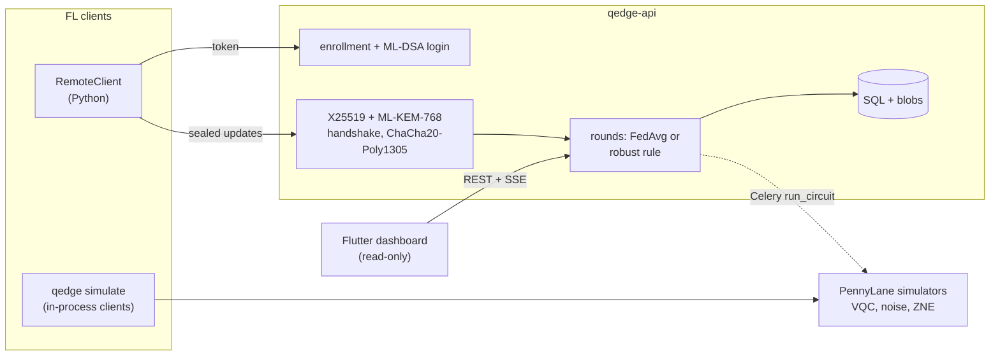

# Q-Edge

[](https://github.com/rasidi3112/Q-Edge/actions/workflows/ci.yml)
[](LICENSE)
[](pyproject.toml)

**English** | [العربية](README_ar.md) | [Deutsch](README_de.md) | [Español](README_es.md) | [Français](README_fr.md) | [हिन्दी](README_hi.md) | [Bahasa Indonesia](README_id.md) | [Italiano](README_it.md) | [日本語](README_ja.md) | [한국어](README_ko.md) | [Bahasa Melayu](README_ms.md) | [Português](README_pt.md) | [Русский](README_ru.md) | [Türkçe](README_tr.md) | [Tiếng Việt](README_vi.md) | [中文](README_zh.md)

Q-Edge is a research testbed for federated learning with hybrid
quantum-classical models and post-quantum protection of client updates. It
answers three questions with reproducible numbers:

1. On non-IID data, does a small variational quantum circuit (VQC) head do
   as well as a classical head with the same number of parameters, with and
   without noise and zero-noise extrapolation?
2. What does post-quantum protection (ML-KEM-768, ML-DSA-65, hybrid
   X25519 + ML-KEM-768 and secure aggregation) cost per round?
3. How much damage can malicious clients do, how much do robust
   aggregation rules help, and how do those rules conflict with secure
   aggregation?

Negative answers count as results. Every number below comes from
`results/summary/*.json`, which `make reproduce` regenerates;
[`docs/results.md`](docs/results.md) has the full tables and figures.

## What it is and what it is not

It is:

- A federated simulator (`qedge simulate`) on scikit-learn's breast_cancer
  and digits with Dirichlet label skew. Strategies: FedAvg, FedProx,
  FedAdam and FedYogi. Also top-k compression, attacks, robust rules and
  secure aggregation. The same client and server code runs as Flower 1.40
  apps (`flwr run experiments/flower`).
- Hybrid PyTorch models with a PennyLane VQC head, simulated gate and
  readout noise, ZNE by global folding, and diagnostics (gradient variance,
  kernel concentration, expressibility).
- A FastAPI server with admin enrollment, ML-DSA challenge-response login,
  a signed X25519 + ML-KEM-768 transport, validated rounds, server-sent
  events and Prometheus metrics. A read-only Flutter dashboard shows its
  state.

It is not:

- Quantum hardware. All circuits run on simulators (`default.qubit`,
  `default.mixed`).
- A real deployment. Clients are simulated in one process or are Python
  scripts; there is no mobile training.
- Audited cryptography. The hybrid KEM combiner, the transport and the
  secure aggregation protocol are this project's own constructions. The
  pure-Python backend is not constant-time.
- Evidence of quantum advantage. In these experiments the VQC head is never
  clearly better than the classical head.

## Architecture



Details: [`docs/architecture.md`](docs/architecture.md); decisions:
[`docs/decisions/`](docs/decisions/); threats:
[`docs/threat-model.md`](docs/threat-model.md).

## Quickstart

```bash
git clone https://github.com/rasidi3112/Q-Edge.git && cd Q-Edge
python -m venv .venv && source .venv/bin/activate
pip install torch --index-url https://download.pytorch.org/whl/cpu   # optional: CPU-only torch
pip install -e ".[fl,pqc-pure]"

qedge demo                       # one run of each component, about 5 s
qedge simulate --dataset breast_cancer --clients 10 --rounds 30 --alpha 0.5 --strategy fedavg
qedge simulate --model hybrid-vqc --qubits 4 --layers 2 --noise 0.01 --zne richardson
qedge simulate --dataset digits --model mlp --attack scaling --attack-fraction 0.3 --defense multi_krum
qedge simulate --secure-aggregation
```

Each `simulate` run writes `results/runs/<run_id>/config.yaml` (config,
client partition, parameter counts, package versions, machine) and
`metrics.jsonl` (one row per round). `pqc-pure` is a pure-Python ML-KEM and
ML-DSA for trying things out; for anything else build liboqs 0.16 and
install `q-edge[pqc]`.

| Extra | Adds |
|---|---|
| `fl` | PyTorch, Flower, scikit-learn, PyYAML: simulator, hybrid models |
| `server` | FastAPI server, Celery worker, `qedge clients` |
| `pqc` | liboqs-python (needs the liboqs C library) |
| `pqc-pure` | kyber-py and dilithium-py: not constant-time, tests only |
| `report` | matplotlib for `python -m experiments.report` |
| `flower-sim` | Ray, for `flwr run` |
| `postgres` | psycopg, for the compose stack |
| `dev` | pytest, hypothesis, ruff, mypy, pre-commit |

### Server

```bash
pip install -e ".[server,pqc-pure]"
qedge keys init --dir ./keys --backend pure        # server KEM and ML-DSA keys
qedge clients keygen --out ./admin --backend pure  # admin key pair, stays local
qedge clients add --id admin --scope admin --public-key ./admin/client.pub --backend pure
JWT_SECRET_KEY=$(python -c "import secrets; print(secrets.token_urlsafe(48))") \
  QEDGE_CRYPTO_BACKEND=pure QEDGE_KEY_DIR=./keys qedge-api
```

The admin enrolls clients and opens rounds (`POST /admin/rounds`). A client
(`qedge.fl.remote.RemoteClient`) logs in by signing a nonce, opens an
encrypted session and sends one sealed update per round. The server
aggregates when `min_clients` updates arrive or the deadline passes, using
`QEDGE_AGGREGATION` (`fedavg`, `median`, `trimmed_mean`, `krum`,
`multi_krum` or `bounded`). Without keys or a crypto backend it refuses to
start. With Docker:

```bash
cp .env.example .env   # set JWT_SECRET_KEY, REDIS_PASSWORD, POSTGRES_PASSWORD
qedge clients keygen --out ./admin
docker compose run --rm api qedge keys init --dir /keys
docker compose run --rm -v "$PWD/admin:/admin:ro" api \
  qedge clients add --id admin --scope admin --public-key /admin/client.pub
docker compose up --build
```

The dashboard: `cd mobile_app && flutter run -d chrome --web-port 3000
--dart-define=QEDGE_API_URL=http://localhost:8000`
([`mobile_app/README.md`](mobile_app/README.md)).

## Results

Simulated clients on a laptop CPU; mean ± std over seeds 0-2. Full tables,
figures and configs: [`docs/results.md`](docs/results.md),
`experiments/configs/`.

**RQ1: VQC head vs classical head.** 5 clients, 15 rounds, 4 qubits, 2
strongly entangling layers (24 parameters) against a tanh head with 20.
Encoder and readout are identical.

| Dataset, α | Classical head | VQC | VQC, p = 0.01 | VQC, p = 0.01, ZNE |
|---|---|---|---|---|
| breast_cancer, 0.1 | 0.968 ± 0.018 | 0.965 ± 0.032 | 0.930 ± 0.092 | 0.965 ± 0.032 |
| breast_cancer, 1.0 | 0.974 ± 0.018 | 0.977 ± 0.018 | 0.974 ± 0.018 | 0.977 ± 0.018 |
| digits, 0.1 | 0.643 ± 0.125 | 0.486 ± 0.093 | 0.496 ± 0.086 | 0.491 ± 0.084 |
| digits, 1.0 | 0.685 ± 0.143 | 0.514 ± 0.061 | 0.485 ± 0.100 | 0.512 ± 0.058 |

The VQC head matches the classical head on breast_cancer and is about 0.16
worse on digits. Depolarizing noise at p = 0.01 and ZNE change final
accuracy by less than the seed-to-seed spread; the largest effect is on
breast_cancer at α = 0.1 (0.965 noiseless, 0.930 with noise, 0.965 with
ZNE). ZNE makes training about 8x slower. On random 4-qubit circuits ZNE cuts the expectation-value error at
p = 0.01 from 0.055 to 0.005 (Richardson) or 0.003 (exponential).

**RQ2: cost of post-quantum protection** (liboqs 0.16):

- The transport handshake takes 0.57 ms and 7 840 bytes once per
  session, plus 52 bytes per update frame.
- Secure aggregation per round, per client, against a plain float32
  upload:
  - 10 clients, 1 210 parameters: 36.6 KiB up instead of 4.7 KiB, 2.6 ms;
    server 3.8 ms.
  - 50 clients, 100 000 parameters: 895 KiB instead of 391 KiB, 33 ms;
    server 95 ms.
- The upload doubles because masked values take 8 bytes, and the key
  exchange grows linearly with the number of clients.

**RQ3: malicious clients** (digits, MLP, 10 clients, 30 rounds, 3 of 10
attack):

| Attack | FedAvg | Median | Multi-Krum |
|---|---|---|---|
| none | 0.952 ± 0.003 | 0.931 ± 0.006 | 0.922 ± 0.003 |
| label flip | 0.700 ± 0.314 | 0.883 ± 0.032 | 0.938 ± 0.013 |
| scaling (model replacement) | 0.177 ± 0.094 | 0.908 ± 0.015 | 0.936 ± 0.022 |
| random noise | 0.578 ± 0.065 | 0.933 ± 0.014 | 0.936 ± 0.022 |
| fake sample counts | 0.030 ± 0.018 | 0.883 ± 0.032 | 0.938 ± 0.013 |

FedAvg fails against every attack. Multi-Krum holds within 0.02 of its own
clean accuracy but costs 0.03 without attackers; Krum alone costs 0.28 on
non-IID data. None of these rules can run under secure aggregation, which
hides the individual updates they inspect (ADR 0010). Trimmed mean, norm
clipping and sample caps are in `docs/results.md`.

## Security model

Protected: reading or forging updates on the wire, now or after a quantum
break of X25519 (hybrid KEM, signed handshake, AEAD frames, replay
counters); impersonating the server or an enrolled client; malformed or
duplicated updates; clients triggering aggregation. Partly protected:
malicious clients within the protocol, through robust rules. Not
protected: a curious server outside the simulator (secure aggregation is
not exposed over HTTP), inference from the global model (no privacy
accountant), denial of service, side channels of the pure backend, and
stolen tokens before expiry. See [`docs/threat-model.md`](docs/threat-model.md).

## Limitations

- Two small, easy datasets. Differences below about one standard
  deviation (up to 0.14 on digits in RQ1) are not resolved with 3 seeds.
- RQ1 uses 5 clients and 15 rounds to keep ZNE runs affordable, so digits
  accuracies (0.5-0.7) are far below a 30-round MLP (0.95).
- Simulated noise is one channel per gate and wire: no crosstalk, idle
  noise or coherent errors. Backpropagation through `default.mixed` gives
  gradients that hardware cannot (ADR 0009).
- Secure aggregation has no dropout recovery and runs in-process only. The
  measured costs exclude network latency.
- Clipping and Gaussian noise exist, but no ε is reported, because there is
  no privacy accountant.
- Robust rules assume at most 30% attackers and are not tested against
  targeted backdoors or adaptive attackers.
- The Flutter app is read-only and does no cryptography; Android and iOS
  builds are untested.

## Development

```bash
pip install torch --index-url https://download.pytorch.org/whl/cpu
pip install -e ".[dev,server,pqc-pure,fl,report]"
pre-commit install
make lint             # ruff check, ruff format --check, mypy --strict on src/qedge
make test             # pytest -m "not slow"
pytest -m slow        # Flower end-to-end and a noisy ZNE run (needs flower-sim)
make reproduce        # every experiment and docs/results.md, about 62 minutes
```

`python -m experiments.run_all --skip quantum_head` reruns everything but
the ZNE grid in about 7 minutes. CI runs lint and tests on Python 3.11-3.13,
a liboqs job, the Flutter tests and Docker builds.

## Layout

```
src/qedge/
  crypto/     ML-KEM, ML-DSA, hybrid KEM, transport, key files, backends
  fl/         datasets, models, training, strategies, robust rules, attacks,
              compression, privacy, secure aggregation, simulator, Flower apps
  quantum/    circuits, noise, ZNE and readout mitigation, kernels, models,
              diagnostics
  server/     FastAPI app, auth, rounds, storage, metrics, Celery worker
  cli.py      qedge keys | clients | simulate | demo
  demo.py
experiments/  configs/*.yaml, one script per experiment, run_all.py, report.py
bench/        crypto.py, secagg.py
results/      summary/*.json (committed), runs/ (ignored)
docs/         architecture.md, threat-model.md, results.md, figures/, decisions/
mobile_app/   Flutter dashboard
```

## References

- McMahan et al., "Communication-Efficient Learning of Deep Networks from
  Decentralized Data", 2017, arXiv:1602.05629 (FedAvg).
- Li et al., "Federated Optimization in Heterogeneous Networks", 2018,
  arXiv:1812.06127 (FedProx).
- Reddi et al., "Adaptive Federated Optimization", 2020, arXiv:2003.00295
  (FedAdam, FedYogi).
- Karimireddy et al., "Error Feedback Fixes SignSGD and other Gradient
  Compression Schemes", 2019, arXiv:1901.09847.
- Yin et al., "Byzantine-Robust Distributed Learning: Towards Optimal
  Statistical Rates", 2018, arXiv:1803.01498 (median, trimmed mean).
- Blanchard et al., "Machine Learning with Adversaries: Byzantine Tolerant
  Gradient Descent", NeurIPS 2017 (Krum).
- Sun et al., "Can You Really Backdoor Federated Learning?", 2019,
  arXiv:1911.07963 (norm clipping).
- Bagdasaryan et al., "How To Backdoor Federated Learning", 2018,
  arXiv:1807.00459 (model replacement).
- Bonawitz et al., "Practical Secure Aggregation for Privacy-Preserving
  Machine Learning", CCS 2017.
- Schuld et al., "Circuit-centric quantum classifiers", 2018,
  arXiv:1804.00633.
- Pérez-Salinas et al., "Data re-uploading for a universal quantum
  classifier", 2020, arXiv:1907.02085.
- Havlíček et al., "Supervised learning with quantum-enhanced feature
  spaces", Nature 2019.
- Temme et al., "Error mitigation for short-depth quantum circuits", 2017,
  arXiv:1612.02058.
- Giurgica-Tiron et al., "Digital zero noise extrapolation for quantum
  error mitigation", 2020, arXiv:2005.10921.
- McClean et al., "Barren plateaus in quantum neural network training
  landscapes", 2018, arXiv:1803.11173.
- Thanasilp et al., "Exponential concentration in quantum kernel methods",
  2022, arXiv:2208.11060.
- Sim et al., "Expressibility and entangling capability of parameterized
  quantum circuits", 2019, arXiv:1905.10876.
- NIST FIPS 203 (ML-KEM) and FIPS 204 (ML-DSA), 2024.

## License

Apache 2.0, see [LICENSE](LICENSE). Changes are listed in
[CHANGELOG.md](CHANGELOG.md).
