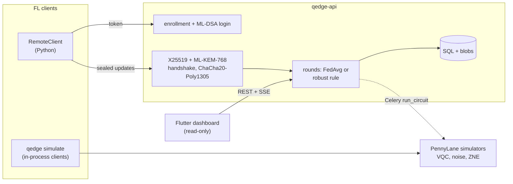

# Q-Edge

[](https://github.com/rasidi3112/Q-Edge/actions/workflows/ci.yml)
[](LICENSE)
[](pyproject.toml)

[English](README.md) | **العربية** | [Deutsch](README_de.md) | [Español](README_es.md) | [Français](README_fr.md) | [हिन्दी](README_hi.md) | [Bahasa Indonesia](README_id.md) | [Italiano](README_it.md) | [日本語](README_ja.md) | [한국어](README_ko.md) | [Bahasa Melayu](README_ms.md) | [Português](README_pt.md) | [Русский](README_ru.md) | [Türkçe](README_tr.md) | [Tiếng Việt](README_vi.md) | [中文](README_zh.md)

> هذه ترجمة لملف [README.md](README.md). عند وجود أي اختلاف، تُعتمد النسخة الإنجليزية.

Q-Edge منصة اختبار بحثية للتعلّم الاتحادي (federated learning) باستخدام نماذج
هجينة كمّية-كلاسيكية، مع حماية ما بعد الكمّ لتحديثات العملاء. وهي تجيب عن ثلاثة
أسئلة بأرقام قابلة لإعادة الإنتاج:

1. على بيانات غير متجانسة التوزيع (non-IID)، هل يؤدي رأس صغير قائم على دارة كمّية
   تغايرية (VQC) أداءً مماثلاً لرأس كلاسيكي بالعدد نفسه من المعاملات، مع الضجيج
   وبدونه، ومع الاستقراء إلى الضجيج الصفري وبدونه؟
2. ما تكلفة حماية ما بعد الكمّ (ML-KEM-768 وML-DSA-65 والهجين
   X25519 + ML-KEM-768 والتجميع الآمن) في كل جولة؟
3. ما حجم الضرر الذي يمكن أن يلحقه العملاء الخبيثون، وإلى أي مدى تساعد قواعد
   التجميع المتين، وكيف تتعارض هذه القواعد مع التجميع الآمن؟

تُحتسب الإجابات السلبية نتائجَ أيضاً. كل رقم أدناه مأخوذ من
`results/summary/*.json`، التي يعيد `make reproduce` توليدها؛ ويحتوي
[`docs/results.md`](docs/results.md) على الجداول والأشكال كاملة.

## ما هو المشروع وما ليس هو

المشروع هو:

- محاكي اتحادي (`qedge simulate`) على مجموعتي breast_cancer وdigits من
  scikit-learn مع انحياز في التسميات وفق توزيع Dirichlet. الاستراتيجيات: FedAvg
  وFedProx وFedAdam وFedYogi. إضافة إلى ضغط top-k والهجمات والقواعد المتينة
  والتجميع الآمن. ويعمل الكود نفسه للعميل والخادم أيضاً كتطبيقات Flower 1.40
  (`flwr run experiments/flower`).
- نماذج هجينة في PyTorch برأس VQC من PennyLane، ومحاكاة لضجيج البوابات والقراءة،
  وZNE عبر الطيّ الشامل (global folding)، وأدوات تشخيص (تباين التدرّج، تركّز
  النواة، القدرة التعبيرية).
- خادم FastAPI يتضمن تسجيل العملاء من قِبل المسؤول، وتسجيل دخول بأسلوب
  التحدي-الاستجابة عبر ML-DSA، ونقلاً موقّعاً X25519 + ML-KEM-768، وجولات يجري
  التحقق منها، وserver-sent events، ومقاييس Prometheus. وتعرض لوحة Flutter
  للقراءة فقط حالته.

المشروع ليس:

- عتاداً كمّياً. تعمل كل الدارات على محاكيات (`default.qubit`،
  `default.mixed`).
- نشراً حقيقياً. يُحاكى العملاء داخل عملية واحدة أو هم سكربتات Python؛ ولا يوجد
  تدريب على الأجهزة المحمولة.
- تشفيراً خضع للتدقيق. إن طريقة دمج KEM الهجين وطبقة النقل وبروتوكول التجميع
  الآمن من تصميم هذا المشروع نفسه. والواجهة الخلفية المكتوبة بـ Python الخالصة
  ليست ثابتة الزمن.
- دليلاً على التفوق الكمّي. في هذه التجارب لم يكن رأس VQC أفضل بوضوح من الرأس
  الكلاسيكي في أي مرة.

## البنية



التفاصيل: [`docs/architecture.md`](docs/architecture.md)؛ القرارات:
[`docs/decisions/`](docs/decisions/)؛ التهديدات:
[`docs/threat-model.md`](docs/threat-model.md).

## البدء السريع

```bash
git clone https://github.com/rasidi3112/Q-Edge.git && cd Q-Edge
python -m venv .venv && source .venv/bin/activate
pip install torch --index-url https://download.pytorch.org/whl/cpu   # optional: CPU-only torch
pip install -e ".[fl,pqc-pure]"

qedge demo                       # one run of each component, about 5 s
qedge simulate --dataset breast_cancer --clients 10 --rounds 30 --alpha 0.5 --strategy fedavg
qedge simulate --model hybrid-vqc --qubits 4 --layers 2 --noise 0.01 --zne richardson
qedge simulate --dataset digits --model mlp --attack scaling --attack-fraction 0.3 --defense multi_krum
qedge simulate --secure-aggregation
```

يكتب كل تشغيل لـ `simulate` الملف `results/runs/<run_id>/config.yaml` (الإعدادات،
وتقسيم العملاء، وعدد المعاملات، وإصدارات الحزم، والجهاز) والملف
`metrics.jsonl` (سطر لكل جولة). `pqc-pure` تنفيذ لـ ML-KEM وML-DSA بلغة Python
الخالصة للتجربة؛ ولأي استخدام آخر، ابنِ liboqs 0.16 وثبّت `q-edge[pqc]`.

| Extra | ما يضيفه |
|---|---|
| `fl` | PyTorch وFlower وscikit-learn وPyYAML: المحاكي والنماذج الهجينة |
| `server` | خادم FastAPI وعامل Celery و`qedge clients` |
| `pqc` | liboqs-python (يتطلب مكتبة liboqs بلغة C) |
| `pqc-pure` | kyber-py وdilithium-py: ليست ثابتة الزمن، للاختبار فقط |
| `report` | matplotlib لأجل `python -m experiments.report` |
| `flower-sim` | Ray لأجل `flwr run` |
| `postgres` | psycopg لحزمة compose |
| `dev` | pytest وhypothesis وruff وmypy وpre-commit |

### الخادم

```bash
pip install -e ".[server,pqc-pure]"
qedge keys init --dir ./keys --backend pure        # server KEM and ML-DSA keys
qedge clients keygen --out ./admin --backend pure  # admin key pair, stays local
qedge clients add --id admin --scope admin --public-key ./admin/client.pub --backend pure
JWT_SECRET_KEY=$(python -c "import secrets; print(secrets.token_urlsafe(48))") \
  QEDGE_CRYPTO_BACKEND=pure QEDGE_KEY_DIR=./keys qedge-api
```

يسجّل المسؤول العملاء ويفتح الجولات (`POST /admin/rounds`). يسجّل العميل
(`qedge.fl.remote.RemoteClient`) دخوله بتوقيع nonce، ثم يفتح جلسة مشفّرة ويرسل
تحديثاً واحداً مختوماً في كل جولة. يجمّع الخادم التحديثات عند وصول `min_clients`
منها أو عند انتهاء المهلة، باستخدام `QEDGE_AGGREGATION` (`fedavg` أو `median` أو
`trimmed_mean` أو `krum` أو `multi_krum` أو `bounded`). ويرفض الخادم البدء دون
مفاتيح أو واجهة تشفير خلفية. باستخدام Docker:

```bash
cp .env.example .env   # set JWT_SECRET_KEY, REDIS_PASSWORD, POSTGRES_PASSWORD
qedge clients keygen --out ./admin
docker compose run --rm api qedge keys init --dir /keys
docker compose run --rm -v "$PWD/admin:/admin:ro" api \
  qedge clients add --id admin --scope admin --public-key /admin/client.pub
docker compose up --build
```

لوحة المعلومات: `cd mobile_app && flutter run -d chrome --web-port 3000
--dart-define=QEDGE_API_URL=http://localhost:8000`
([`mobile_app/README.md`](mobile_app/README.md)).

## النتائج

العملاء مُحاكَون على معالج حاسوب محمول؛ المتوسط ± الانحراف المعياري على البذور
0-2. الجداول الكاملة والأشكال والإعدادات: [`docs/results.md`](docs/results.md)،
`experiments/configs/`.

**RQ1: رأس VQC مقابل الرأس الكلاسيكي.** 5 عملاء، 15 جولة، 4 كيوبتات، 2 من طبقات
strongly entangling (24 معاملاً) مقابل رأس tanh بـ 20 معاملاً. المُرمِّز وطبقة
الخرج متطابقان.

| مجموعة البيانات، α | الرأس الكلاسيكي | VQC | VQC, p = 0.01 | VQC, p = 0.01, ZNE |
|---|---|---|---|---|
| breast_cancer, 0.1 | 0.968 ± 0.018 | 0.965 ± 0.032 | 0.930 ± 0.092 | 0.965 ± 0.032 |
| breast_cancer, 1.0 | 0.974 ± 0.018 | 0.977 ± 0.018 | 0.974 ± 0.018 | 0.977 ± 0.018 |
| digits, 0.1 | 0.643 ± 0.125 | 0.486 ± 0.093 | 0.496 ± 0.086 | 0.491 ± 0.084 |
| digits, 1.0 | 0.685 ± 0.143 | 0.514 ± 0.061 | 0.485 ± 0.100 | 0.512 ± 0.058 |

يتساوى رأس VQC مع الرأس الكلاسيكي على breast_cancer، ويقلّ عنه بنحو 0.16 على
digits. يغيّر ضجيج إزالة الاستقطاب عند p = 0.01 وZNE الدقة النهائية بأقل من
التفاوت بين البذور؛ وأكبر أثر يظهر على breast_cancer عند α = 0.1 (0.965 دون ضجيج،
و0.930 مع الضجيج، و0.965 مع ZNE). يجعل ZNE التدريب أبطأ بنحو 8 مرات. وعلى دارات
عشوائية من 4 كيوبتات، يخفض ZNE خطأ القيمة المتوقعة عند p = 0.01 من 0.055 إلى
0.005 (Richardson) أو 0.003 (الأُسّي).

**RQ2: تكلفة حماية ما بعد الكمّ** (liboqs 0.16):

- تستغرق المصافحة في طبقة النقل 0.57 ms و7 840 بايت مرة واحدة لكل جلسة، إضافة
  إلى 52 بايت لكل إطار تحديث.
- التجميع الآمن لكل جولة ولكل عميل، مقارنة بإرسال float32 عادي:
  - 10 عملاء، 1 210 معاملات: 36.6 KiB صعوداً بدلاً من 4.7 KiB، و2.6 ms؛
    والخادم 3.8 ms.
  - 50 عميلاً، 100 000 معامل: 895 KiB بدلاً من 391 KiB، و33 ms؛ والخادم 95 ms.
- يتضاعف حجم الإرسال لأن القيم المقنّعة تشغل 8 بايت، ويزداد تبادل المفاتيح
  خطياً مع عدد العملاء.

**RQ3: العملاء الخبيثون** (digits، MLP، 10 عملاء، 30 جولة، يهاجم 3 من 10):

| الهجوم | FedAvg | الوسيط | Multi-Krum |
|---|---|---|---|
| لا يوجد | 0.952 ± 0.003 | 0.931 ± 0.006 | 0.922 ± 0.003 |
| قلب التسميات | 0.700 ± 0.314 | 0.883 ± 0.032 | 0.938 ± 0.013 |
| التضخيم (استبدال النموذج) | 0.177 ± 0.094 | 0.908 ± 0.015 | 0.936 ± 0.022 |
| ضجيج عشوائي | 0.578 ± 0.065 | 0.933 ± 0.014 | 0.936 ± 0.022 |
| أعداد عينات مزيّفة | 0.030 ± 0.018 | 0.883 ± 0.032 | 0.938 ± 0.013 |

يفشل FedAvg أمام كل هجوم. يبقى Multi-Krum ضمن 0.02 من دقته الخاصة دون هجوم، لكنه
يكلّف 0.03 عند غياب المهاجمين؛ أما Krum وحده فيكلّف 0.28 على البيانات غير
المتجانسة. لا يمكن لأي من هذه القواعد العمل تحت التجميع الآمن، لأنه يخفي تحديداً
التحديثات الفردية التي تفحصها (ADR 0010). يوجد المتوسط المقتطع وقصّ المعيار وحدود
عدد العينات في `docs/results.md`.

## نموذج الأمان

محمي: قراءة التحديثات أو تزويرها أثناء النقل، الآن أو بعد أن يكسر حاسوب كمّي
X25519 (KEM هجين، مصافحة موقّعة، إطارات AEAD، عدّادات منع الإعادة)؛ انتحال صفة
الخادم أو عميل مسجّل؛ التحديثات المشوّهة أو المكررة؛ إطلاق العملاء لعملية
التجميع. محمي جزئياً: العملاء الخبيثون الملتزمون بالبروتوكول، عبر القواعد
المتينة. غير محمي: خادم فضولي خارج المحاكي (التجميع الآمن غير متاح عبر HTTP)،
والاستدلال من النموذج العام (لا توجد محاسبة للخصوصية)، وحجب الخدمة، والقنوات
الجانبية للواجهة الخلفية الخالصة، والرموز المسروقة قبل انتهاء صلاحيتها. راجع
[`docs/threat-model.md`](docs/threat-model.md).

## القيود

- مجموعتا بيانات صغيرتان وسهلتان. لا يمكن الحسم في فروق أقل من انحراف معياري
  واحد تقريباً (حتى 0.14 على digits في RQ1) باستخدام 3 بذور.
- يستخدم RQ1 ‏5 عملاء و15 جولة لإبقاء تشغيلات ZNE في حدود معقولة، لذا تبقى
  دقة digits (0.5-0.7) أقل بكثير من MLP بـ 30 جولة (0.95).
- الضجيج المُحاكى قناة واحدة لكل بوابة وسلك: لا تداخل (crosstalk)، ولا ضجيج
  خمول، ولا أخطاء مترابطة. ويعطي الانتشار العكسي عبر `default.mixed` تدرّجات
  لا يستطيع العتاد إعطاءها (ADR 0009).
- لا يتعافى التجميع الآمن من انسحاب العملاء ويعمل داخل العملية فقط. ولا تشمل
  التكاليف المقيسة زمن تأخر الشبكة.
- القصّ والضجيج الغاوسي موجودان، لكن لا تُذكر قيمة ε لعدم وجود محاسبة
  للخصوصية.
- تفترض القواعد المتينة ألا يتجاوز المهاجمون 30 %، ولم تُختبر ضد الأبواب
  الخلفية الموجّهة أو المهاجمين المتكيّفين.
- تطبيق Flutter للقراءة فقط ولا ينفّذ أي تشفير؛ ولم تُختبر نسختا Android وiOS.

## التطوير

```bash
pip install torch --index-url https://download.pytorch.org/whl/cpu
pip install -e ".[dev,server,pqc-pure,fl,report]"
pre-commit install
make lint             # ruff check, ruff format --check, mypy --strict on src/qedge
make test             # pytest -m "not slow"
pytest -m slow        # Flower end-to-end and a noisy ZNE run (needs flower-sim)
make reproduce        # every experiment and docs/results.md, about 62 minutes
```

يعيد `python -m experiments.run_all --skip quantum_head` تشغيل كل شيء ما عدا
شبكة ZNE في نحو 7 دقائق. يشغّل نظام CI الفحص (lint) والاختبارات على Python
3.11-3.13، ومهمة liboqs، واختبارات Flutter، وبناء Docker.

## هيكل المشروع

```
src/qedge/
  crypto/     ML-KEM, ML-DSA, hybrid KEM, transport, key files, backends
  fl/         datasets, models, training, strategies, robust rules, attacks,
              compression, privacy, secure aggregation, simulator, Flower apps
  quantum/    circuits, noise, ZNE and readout mitigation, kernels, models,
              diagnostics
  server/     FastAPI app, auth, rounds, storage, metrics, Celery worker
  cli.py      qedge keys | clients | simulate | demo
  demo.py
experiments/  configs/*.yaml, one script per experiment, run_all.py, report.py
bench/        crypto.py, secagg.py
results/      summary/*.json (committed), runs/ (ignored)
docs/         architecture.md, threat-model.md, results.md, figures/, decisions/
mobile_app/   Flutter dashboard
```

## المراجع

- McMahan et al., "Communication-Efficient Learning of Deep Networks from
  Decentralized Data", 2017, arXiv:1602.05629 (FedAvg).
- Li et al., "Federated Optimization in Heterogeneous Networks", 2018,
  arXiv:1812.06127 (FedProx).
- Reddi et al., "Adaptive Federated Optimization", 2020, arXiv:2003.00295
  (FedAdam, FedYogi).
- Karimireddy et al., "Error Feedback Fixes SignSGD and other Gradient
  Compression Schemes", 2019, arXiv:1901.09847.
- Yin et al., "Byzantine-Robust Distributed Learning: Towards Optimal
  Statistical Rates", 2018, arXiv:1803.01498 (median, trimmed mean).
- Blanchard et al., "Machine Learning with Adversaries: Byzantine Tolerant
  Gradient Descent", NeurIPS 2017 (Krum).
- Sun et al., "Can You Really Backdoor Federated Learning?", 2019,
  arXiv:1911.07963 (norm clipping).
- Bagdasaryan et al., "How To Backdoor Federated Learning", 2018,
  arXiv:1807.00459 (model replacement).
- Bonawitz et al., "Practical Secure Aggregation for Privacy-Preserving
  Machine Learning", CCS 2017.
- Schuld et al., "Circuit-centric quantum classifiers", 2018,
  arXiv:1804.00633.
- Pérez-Salinas et al., "Data re-uploading for a universal quantum
  classifier", 2020, arXiv:1907.02085.
- Havlíček et al., "Supervised learning with quantum-enhanced feature
  spaces", Nature 2019.
- Temme et al., "Error mitigation for short-depth quantum circuits", 2017,
  arXiv:1612.02058.
- Giurgica-Tiron et al., "Digital zero noise extrapolation for quantum
  error mitigation", 2020, arXiv:2005.10921.
- McClean et al., "Barren plateaus in quantum neural network training
  landscapes", 2018, arXiv:1803.11173.
- Thanasilp et al., "Exponential concentration in quantum kernel methods",
  2022, arXiv:2208.11060.
- Sim et al., "Expressibility and entangling capability of parameterized
  quantum circuits", 2019, arXiv:1905.10876.
- NIST FIPS 203 (ML-KEM) and FIPS 204 (ML-DSA), 2024.

## الترخيص

Apache 2.0، راجع [LICENSE](LICENSE). التغييرات مدرجة في
[CHANGELOG.md](CHANGELOG.md).
