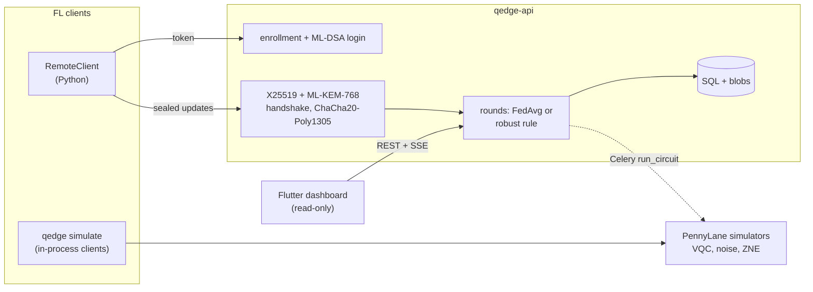

# Q-Edge

[](https://github.com/rasidi3112/Q-Edge/actions/workflows/ci.yml)
[](LICENSE)
[](pyproject.toml)

[English](README.md) | [العربية](README_ar.md) | **Deutsch** | [Español](README_es.md) | [Français](README_fr.md) | [हिन्दी](README_hi.md) | [Bahasa Indonesia](README_id.md) | [Italiano](README_it.md) | [日本語](README_ja.md) | [한국어](README_ko.md) | [Bahasa Melayu](README_ms.md) | [Português](README_pt.md) | [Русский](README_ru.md) | [Türkçe](README_tr.md) | [Tiếng Việt](README_vi.md) | [中文](README_zh.md)

> Dies ist eine Übersetzung von [README.md](README.md). Bei Abweichungen gilt die englische Fassung.

Q-Edge ist eine Forschungs-Testumgebung für Federated Learning mit hybriden
quanten-klassischen Modellen und Post-Quanten-Schutz der Client-Updates. Sie
beantwortet drei Fragen mit reproduzierbaren Zahlen:

1. Ist ein kleiner Variational-Quantum-Circuit-(VQC-)Head auf Nicht-IID-Daten
   so gut wie ein klassischer Head mit gleich vielen Parametern, mit und ohne
   Rauschen und Zero-Noise-Extrapolation?
2. Was kostet Post-Quanten-Schutz (ML-KEM-768, ML-DSA-65, hybrides
   X25519 + ML-KEM-768 und Secure Aggregation) pro Runde?
3. Wie viel Schaden richten bösartige Clients an, wie viel helfen robuste
   Aggregationsregeln, und wie stehen diese Regeln im Konflikt mit Secure
   Aggregation?

Negative Antworten zählen als Ergebnisse. Jede Zahl unten stammt aus
`results/summary/*.json`, die `make reproduce` neu erzeugt;
[`docs/results.md`](docs/results.md) enthält alle Tabellen und Abbildungen.

## Was es ist und was nicht

Es ist:

- Ein föderierter Simulator (`qedge simulate`) auf den scikit-learn-Datensätzen
  breast_cancer und digits mit Dirichlet-Label-Skew. Strategien: FedAvg,
  FedProx, FedAdam und FedYogi. Außerdem Top-k-Kompression, Angriffe,
  robuste Regeln und Secure Aggregation. Derselbe Client- und Server-Code
  läuft auch als Flower-1.40-Apps (`flwr run experiments/flower`).
- Hybride PyTorch-Modelle mit einem PennyLane-VQC-Head, simuliertem Gate- und
  Ausleserauschen, ZNE per Global Folding und Diagnosen (Gradientenvarianz,
  Kernel-Konzentration, Expressibility).
- Ein FastAPI-Server mit Registrierung durch einen Admin, ML-DSA
  Challenge-Response-Login, signiertem X25519 + ML-KEM-768-Transport,
  validierten Runden, Server-Sent Events und Prometheus-Metriken. Ein
  schreibgeschütztes Flutter-Dashboard zeigt seinen Zustand.

Es ist nicht:

- Quantenhardware. Alle Schaltkreise laufen auf Simulatoren
  (`default.qubit`, `default.mixed`).
- Ein echter Einsatz. Clients werden in einem Prozess simuliert oder sind
  Python-Skripte; es gibt kein Training auf Mobilgeräten.
- Auditierte Kryptographie. Der hybride KEM-Kombinierer, der Transport und
  das Secure-Aggregation-Protokoll sind eigene Konstruktionen dieses
  Projekts. Das reine Python-Backend ist nicht constant-time.
- Ein Nachweis von Quantenvorteil. In diesen Experimenten ist der VQC-Head
  nie klar besser als der klassische Head.

## Architektur



Details: [`docs/architecture.md`](docs/architecture.md); Entscheidungen:
[`docs/decisions/`](docs/decisions/); Bedrohungen:
[`docs/threat-model.md`](docs/threat-model.md).

## Schnellstart

```bash
git clone https://github.com/rasidi3112/Q-Edge.git && cd Q-Edge
python -m venv .venv && source .venv/bin/activate
pip install torch --index-url https://download.pytorch.org/whl/cpu   # optional: CPU-only torch
pip install -e ".[fl,pqc-pure]"

qedge demo                       # one run of each component, about 5 s
qedge simulate --dataset breast_cancer --clients 10 --rounds 30 --alpha 0.5 --strategy fedavg
qedge simulate --model hybrid-vqc --qubits 4 --layers 2 --noise 0.01 --zne richardson
qedge simulate --dataset digits --model mlp --attack scaling --attack-fraction 0.3 --defense multi_krum
qedge simulate --secure-aggregation
```

Jeder `simulate`-Lauf schreibt `results/runs/<run_id>/config.yaml`
(Konfiguration, Client-Aufteilung, Parameterzahlen, Paketversionen, Rechner)
und `metrics.jsonl` (eine Zeile pro Runde). `pqc-pure` ist ein reines
Python-ML-KEM und -ML-DSA zum Ausprobieren; für alles andere liboqs 0.16 bauen
und `q-edge[pqc]` installieren.

| Extra | Fügt hinzu |
|---|---|
| `fl` | PyTorch, Flower, scikit-learn, PyYAML: Simulator, hybride Modelle |
| `server` | FastAPI-Server, Celery-Worker, `qedge clients` |
| `pqc` | liboqs-python (benötigt die liboqs-C-Bibliothek) |
| `pqc-pure` | kyber-py und dilithium-py: nicht constant-time, nur für Tests |
| `report` | matplotlib für `python -m experiments.report` |
| `flower-sim` | Ray, für `flwr run` |
| `postgres` | psycopg, für den Compose-Stack |
| `dev` | pytest, hypothesis, ruff, mypy, pre-commit |

### Server

```bash
pip install -e ".[server,pqc-pure]"
qedge keys init --dir ./keys --backend pure        # server KEM and ML-DSA keys
qedge clients keygen --out ./admin --backend pure  # admin key pair, stays local
qedge clients add --id admin --scope admin --public-key ./admin/client.pub --backend pure
JWT_SECRET_KEY=$(python -c "import secrets; print(secrets.token_urlsafe(48))") \
  QEDGE_CRYPTO_BACKEND=pure QEDGE_KEY_DIR=./keys qedge-api
```

Der Admin registriert Clients und eröffnet Runden (`POST /admin/rounds`). Ein
Client (`qedge.fl.remote.RemoteClient`) meldet sich durch Signieren einer
Nonce an, öffnet eine verschlüsselte Sitzung und sendet pro Runde ein
versiegeltes Update. Der Server aggregiert, sobald `min_clients` Updates
eingegangen sind oder die Frist abläuft, mit `QEDGE_AGGREGATION` (`fedavg`,
`median`, `trimmed_mean`, `krum`, `multi_krum` oder `bounded`). Ohne
Schlüssel oder Krypto-Backend verweigert er den Start. Mit Docker:

```bash
cp .env.example .env   # set JWT_SECRET_KEY, REDIS_PASSWORD, POSTGRES_PASSWORD
qedge clients keygen --out ./admin
docker compose run --rm api qedge keys init --dir /keys
docker compose run --rm -v "$PWD/admin:/admin:ro" api \
  qedge clients add --id admin --scope admin --public-key /admin/client.pub
docker compose up --build
```

Das Dashboard: `cd mobile_app && flutter run -d chrome --web-port 3000
--dart-define=QEDGE_API_URL=http://localhost:8000`
([`mobile_app/README.md`](mobile_app/README.md)).

## Ergebnisse

Simulierte Clients auf einer Laptop-CPU; Mittelwert ± Standardabweichung über
die Seeds 0-2. Vollständige Tabellen, Abbildungen und Konfigurationen:
[`docs/results.md`](docs/results.md), `experiments/configs/`.

**RQ1: VQC-Head gegen klassischen Head.** 5 Clients, 15 Runden, 4 Qubits,
2 Strongly-Entangling-Schichten (24 Parameter) gegen einen tanh-Head mit 20.
Encoder und Readout sind identisch.

| Datensatz, α | Klassischer Head | VQC | VQC, p = 0.01 | VQC, p = 0.01, ZNE |
|---|---|---|---|---|
| breast_cancer, 0.1 | 0.968 ± 0.018 | 0.965 ± 0.032 | 0.930 ± 0.092 | 0.965 ± 0.032 |
| breast_cancer, 1.0 | 0.974 ± 0.018 | 0.977 ± 0.018 | 0.974 ± 0.018 | 0.977 ± 0.018 |
| digits, 0.1 | 0.643 ± 0.125 | 0.486 ± 0.093 | 0.496 ± 0.086 | 0.491 ± 0.084 |
| digits, 1.0 | 0.685 ± 0.143 | 0.514 ± 0.061 | 0.485 ± 0.100 | 0.512 ± 0.058 |

Der VQC-Head ist auf breast_cancer gleichauf mit dem klassischen Head und auf
digits etwa 0.16 schlechter. Depolarisierendes Rauschen mit p = 0.01 und ZNE
ändern die Endgenauigkeit um weniger als die Streuung zwischen Seeds; der
größte Effekt liegt bei breast_cancer mit α = 0.1 (0.965 ohne Rauschen, 0.930
mit Rauschen, 0.965 mit ZNE). ZNE macht das Training etwa 8x langsamer. Auf
zufälligen 4-Qubit-Schaltkreisen senkt ZNE den Fehler des Erwartungswerts bei
p = 0.01 von 0.055 auf 0.005 (Richardson) bzw. 0.003 (exponentiell).

**RQ2: Kosten des Post-Quanten-Schutzes** (liboqs 0.16):

- Der Transport-Handshake dauert 0.57 ms und 7 840 Bytes einmal pro Sitzung,
  plus 52 Bytes pro Update-Frame.
- Secure Aggregation pro Runde und Client, verglichen mit einem einfachen
  float32-Upload:
  - 10 Clients, 1 210 Parameter: 36.6 KiB Upload statt 4.7 KiB, 2.6 ms;
    Server 3.8 ms.
  - 50 Clients, 100 000 Parameter: 895 KiB statt 391 KiB, 33 ms; Server 95 ms.
- Der Upload verdoppelt sich, weil maskierte Werte 8 Bytes belegen, und der
  Schlüsselaustausch wächst linear mit der Zahl der Clients.

**RQ3: bösartige Clients** (digits, MLP, 10 Clients, 30 Runden, 3 von 10
greifen an):

| Angriff | FedAvg | Median | Multi-Krum |
|---|---|---|---|
| keiner | 0.952 ± 0.003 | 0.931 ± 0.006 | 0.922 ± 0.003 |
| Label-Flip | 0.700 ± 0.314 | 0.883 ± 0.032 | 0.938 ± 0.013 |
| Scaling (Model Replacement) | 0.177 ± 0.094 | 0.908 ± 0.015 | 0.936 ± 0.022 |
| Zufallsrauschen | 0.578 ± 0.065 | 0.933 ± 0.014 | 0.936 ± 0.022 |
| gefälschte Stichprobenzahlen | 0.030 ± 0.018 | 0.883 ± 0.032 | 0.938 ± 0.013 |

FedAvg scheitert an jedem Angriff. Multi-Krum bleibt innerhalb von 0.02 seiner
eigenen sauberen Genauigkeit, kostet aber ohne Angreifer 0.03; Krum allein
kostet auf Nicht-IID-Daten 0.28. Keine dieser Regeln kann unter Secure
Aggregation laufen, die genau die einzelnen Updates verbirgt, die sie prüfen
(ADR 0010). Trimmed Mean, Norm-Clipping und Stichprobenobergrenzen stehen in
`docs/results.md`.

## Sicherheitsmodell

Geschützt: Mitlesen oder Fälschen von Updates auf der Leitung, jetzt oder
nachdem X25519 durch einen Quantencomputer gebrochen wurde (hybrides KEM,
signierter Handshake, AEAD-Frames, Replay-Zähler); Ausgeben als Server oder
registrierter Client; fehlerhafte oder doppelte Updates; Clients, die die
Aggregation auslösen. Teilweise geschützt: bösartige Clients innerhalb des
Protokolls, durch robuste Regeln. Nicht geschützt: ein neugieriger Server
außerhalb des Simulators (Secure Aggregation ist nicht über HTTP verfügbar),
Rückschlüsse aus dem globalen Modell (kein Privacy Accountant), Denial of
Service, Seitenkanäle des reinen Backends und gestohlene Tokens vor ihrem
Ablauf. Siehe [`docs/threat-model.md`](docs/threat-model.md).

## Einschränkungen

- Zwei kleine, einfache Datensätze. Unterschiede unter etwa einer
  Standardabweichung (bis 0.14 bei digits in RQ1) lassen sich mit 3 Seeds
  nicht auflösen.
- RQ1 nutzt 5 Clients und 15 Runden, damit die ZNE-Läufe bezahlbar bleiben;
  daher liegen die digits-Genauigkeiten (0.5-0.7) weit unter einem MLP mit
  30 Runden (0.95).
- Das simulierte Rauschen ist ein Kanal pro Gate und Leitung: kein
  Crosstalk, kein Idle-Rauschen, keine kohärenten Fehler. Backpropagation
  durch `default.mixed` liefert Gradienten, die Hardware nicht liefern kann
  (ADR 0009).
- Secure Aggregation hat keine Dropout-Wiederherstellung und läuft nur im
  Prozess. Die gemessenen Kosten enthalten keine Netzwerklatenz.
- Clipping und Gaußsches Rauschen sind vorhanden, aber es wird kein ε
  angegeben, weil es keinen Privacy Accountant gibt.
- Robuste Regeln setzen höchstens 30 % Angreifer voraus und sind nicht gegen
  gezielte Backdoors oder adaptive Angreifer getestet.
- Die Flutter-App ist schreibgeschützt und betreibt keine Kryptographie;
  Android- und iOS-Builds sind ungetestet.

## Entwicklung

```bash
pip install torch --index-url https://download.pytorch.org/whl/cpu
pip install -e ".[dev,server,pqc-pure,fl,report]"
pre-commit install
make lint             # ruff check, ruff format --check, mypy --strict on src/qedge
make test             # pytest -m "not slow"
pytest -m slow        # Flower end-to-end and a noisy ZNE run (needs flower-sim)
make reproduce        # every experiment and docs/results.md, about 62 minutes
```

`python -m experiments.run_all --skip quantum_head` führt alles außer dem
ZNE-Raster in etwa 7 Minuten erneut aus. Die CI führt Lint und Tests auf
Python 3.11-3.13, einen liboqs-Job, die Flutter-Tests und Docker-Builds aus.

## Aufbau

```
src/qedge/
  crypto/     ML-KEM, ML-DSA, hybrid KEM, transport, key files, backends
  fl/         datasets, models, training, strategies, robust rules, attacks,
              compression, privacy, secure aggregation, simulator, Flower apps
  quantum/    circuits, noise, ZNE and readout mitigation, kernels, models,
              diagnostics
  server/     FastAPI app, auth, rounds, storage, metrics, Celery worker
  cli.py      qedge keys | clients | simulate | demo
  demo.py
experiments/  configs/*.yaml, one script per experiment, run_all.py, report.py
bench/        crypto.py, secagg.py
results/      summary/*.json (committed), runs/ (ignored)
docs/         architecture.md, threat-model.md, results.md, figures/, decisions/
mobile_app/   Flutter dashboard
```

## Literatur

- McMahan et al., "Communication-Efficient Learning of Deep Networks from
  Decentralized Data", 2017, arXiv:1602.05629 (FedAvg).
- Li et al., "Federated Optimization in Heterogeneous Networks", 2018,
  arXiv:1812.06127 (FedProx).
- Reddi et al., "Adaptive Federated Optimization", 2020, arXiv:2003.00295
  (FedAdam, FedYogi).
- Karimireddy et al., "Error Feedback Fixes SignSGD and other Gradient
  Compression Schemes", 2019, arXiv:1901.09847.
- Yin et al., "Byzantine-Robust Distributed Learning: Towards Optimal
  Statistical Rates", 2018, arXiv:1803.01498 (median, trimmed mean).
- Blanchard et al., "Machine Learning with Adversaries: Byzantine Tolerant
  Gradient Descent", NeurIPS 2017 (Krum).
- Sun et al., "Can You Really Backdoor Federated Learning?", 2019,
  arXiv:1911.07963 (norm clipping).
- Bagdasaryan et al., "How To Backdoor Federated Learning", 2018,
  arXiv:1807.00459 (model replacement).
- Bonawitz et al., "Practical Secure Aggregation for Privacy-Preserving
  Machine Learning", CCS 2017.
- Schuld et al., "Circuit-centric quantum classifiers", 2018,
  arXiv:1804.00633.
- Pérez-Salinas et al., "Data re-uploading for a universal quantum
  classifier", 2020, arXiv:1907.02085.
- Havlíček et al., "Supervised learning with quantum-enhanced feature
  spaces", Nature 2019.
- Temme et al., "Error mitigation for short-depth quantum circuits", 2017,
  arXiv:1612.02058.
- Giurgica-Tiron et al., "Digital zero noise extrapolation for quantum
  error mitigation", 2020, arXiv:2005.10921.
- McClean et al., "Barren plateaus in quantum neural network training
  landscapes", 2018, arXiv:1803.11173.
- Thanasilp et al., "Exponential concentration in quantum kernel methods",
  2022, arXiv:2208.11060.
- Sim et al., "Expressibility and entangling capability of parameterized
  quantum circuits", 2019, arXiv:1905.10876.
- NIST FIPS 203 (ML-KEM) and FIPS 204 (ML-DSA), 2024.

## Lizenz

Apache 2.0, siehe [LICENSE](LICENSE). Änderungen stehen in
[CHANGELOG.md](CHANGELOG.md).
