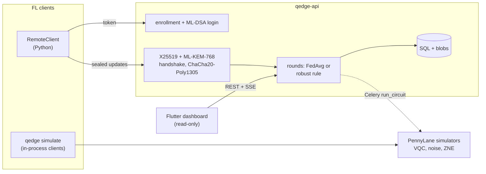

# Q-Edge

[](https://github.com/rasidi3112/Q-Edge/actions/workflows/ci.yml)
[](LICENSE)
[](pyproject.toml)

[English](README.md) | [العربية](README_ar.md) | [Deutsch](README_de.md) | **Español** | [Français](README_fr.md) | [हिन्दी](README_hi.md) | [Bahasa Indonesia](README_id.md) | [Italiano](README_it.md) | [日本語](README_ja.md) | [한국어](README_ko.md) | [Bahasa Melayu](README_ms.md) | [Português](README_pt.md) | [Русский](README_ru.md) | [Türkçe](README_tr.md) | [Tiếng Việt](README_vi.md) | [中文](README_zh.md)

> Esta es una traducción de [README.md](README.md). En caso de diferencias, prevalece la versión en inglés.

Q-Edge es un banco de pruebas de investigación para aprendizaje federado con
modelos híbridos cuántico-clásicos y protección poscuántica de las
actualizaciones de los clientes. Responde tres preguntas con cifras
reproducibles:

1. Con datos no IID, ¿una cabeza pequeña de circuito cuántico variacional
   (VQC) rinde tanto como una cabeza clásica con el mismo número de
   parámetros, con y sin ruido y extrapolación a ruido cero?
2. ¿Cuánto cuesta por ronda la protección poscuántica (ML-KEM-768, ML-DSA-65,
   híbrido X25519 + ML-KEM-768 y agregación segura)?
3. ¿Cuánto daño pueden hacer los clientes maliciosos, cuánto ayudan las reglas
   de agregación robusta y en qué entran en conflicto con la agregación
   segura?

Las respuestas negativas cuentan como resultados. Cada cifra de abajo proviene
de `results/summary/*.json`, que `make reproduce` regenera;
[`docs/results.md`](docs/results.md) contiene todas las tablas y figuras.

## Qué es y qué no es

Es:

- Un simulador federado (`qedge simulate`) sobre los conjuntos breast_cancer y
  digits de scikit-learn con sesgo de etiquetas de Dirichlet. Estrategias:
  FedAvg, FedProx, FedAdam y FedYogi. También compresión top-k, ataques,
  reglas robustas y agregación segura. El mismo código de cliente y servidor
  se ejecuta como aplicaciones de Flower 1.40 (`flwr run experiments/flower`).
- Modelos híbridos de PyTorch con una cabeza VQC de PennyLane, ruido simulado
  de puertas y de lectura, ZNE por plegado global y diagnósticos (varianza del
  gradiente, concentración del kernel, expresividad).
- Un servidor FastAPI con alta de clientes por un administrador, inicio de
  sesión desafío-respuesta con ML-DSA, transporte firmado X25519 +
  ML-KEM-768, rondas validadas, server-sent events y métricas de Prometheus.
  Un panel de Flutter de solo lectura muestra su estado.

No es:

- Hardware cuántico. Todos los circuitos se ejecutan en simuladores
  (`default.qubit`, `default.mixed`).
- Un despliegue real. Los clientes se simulan en un proceso o son scripts de
  Python; no hay entrenamiento en móviles.
- Criptografía auditada. El combinador KEM híbrido, el transporte y el
  protocolo de agregación segura son construcciones propias de este proyecto.
  El backend en Python puro no es de tiempo constante.
- Una prueba de ventaja cuántica. En estos experimentos la cabeza VQC nunca es
  claramente mejor que la cabeza clásica.

## Arquitectura



Detalles: [`docs/architecture.md`](docs/architecture.md); decisiones:
[`docs/decisions/`](docs/decisions/); amenazas:
[`docs/threat-model.md`](docs/threat-model.md).

## Inicio rápido

```bash
git clone https://github.com/rasidi3112/Q-Edge.git && cd Q-Edge
python -m venv .venv && source .venv/bin/activate
pip install torch --index-url https://download.pytorch.org/whl/cpu   # optional: CPU-only torch
pip install -e ".[fl,pqc-pure]"

qedge demo                       # one run of each component, about 5 s
qedge simulate --dataset breast_cancer --clients 10 --rounds 30 --alpha 0.5 --strategy fedavg
qedge simulate --model hybrid-vqc --qubits 4 --layers 2 --noise 0.01 --zne richardson
qedge simulate --dataset digits --model mlp --attack scaling --attack-fraction 0.3 --defense multi_krum
qedge simulate --secure-aggregation
```

Cada ejecución de `simulate` escribe `results/runs/<run_id>/config.yaml`
(configuración, partición de clientes, número de parámetros, versiones de
paquetes, máquina) y `metrics.jsonl` (una fila por ronda). `pqc-pure` es un
ML-KEM y ML-DSA en Python puro para hacer pruebas; para todo lo demás, compila
liboqs 0.16 e instala `q-edge[pqc]`.

| Extra | Añade |
|---|---|
| `fl` | PyTorch, Flower, scikit-learn, PyYAML: simulador, modelos híbridos |
| `server` | Servidor FastAPI, worker de Celery, `qedge clients` |
| `pqc` | liboqs-python (requiere la biblioteca C liboqs) |
| `pqc-pure` | kyber-py y dilithium-py: no de tiempo constante, solo para pruebas |
| `report` | matplotlib para `python -m experiments.report` |
| `flower-sim` | Ray, para `flwr run` |
| `postgres` | psycopg, para el stack de compose |
| `dev` | pytest, hypothesis, ruff, mypy, pre-commit |

### Servidor

```bash
pip install -e ".[server,pqc-pure]"
qedge keys init --dir ./keys --backend pure        # server KEM and ML-DSA keys
qedge clients keygen --out ./admin --backend pure  # admin key pair, stays local
qedge clients add --id admin --scope admin --public-key ./admin/client.pub --backend pure
JWT_SECRET_KEY=$(python -c "import secrets; print(secrets.token_urlsafe(48))") \
  QEDGE_CRYPTO_BACKEND=pure QEDGE_KEY_DIR=./keys qedge-api
```

El administrador da de alta a los clientes y abre rondas
(`POST /admin/rounds`). Un cliente (`qedge.fl.remote.RemoteClient`) inicia
sesión firmando un nonce, abre una sesión cifrada y envía una actualización
sellada por ronda. El servidor agrega cuando llegan `min_clients`
actualizaciones o vence el plazo, usando `QEDGE_AGGREGATION` (`fedavg`,
`median`, `trimmed_mean`, `krum`, `multi_krum` o `bounded`). Sin claves ni
backend criptográfico se niega a arrancar. Con Docker:

```bash
cp .env.example .env   # set JWT_SECRET_KEY, REDIS_PASSWORD, POSTGRES_PASSWORD
qedge clients keygen --out ./admin
docker compose run --rm api qedge keys init --dir /keys
docker compose run --rm -v "$PWD/admin:/admin:ro" api \
  qedge clients add --id admin --scope admin --public-key /admin/client.pub
docker compose up --build
```

El panel: `cd mobile_app && flutter run -d chrome --web-port 3000
--dart-define=QEDGE_API_URL=http://localhost:8000`
([`mobile_app/README.md`](mobile_app/README.md)).

## Resultados

Clientes simulados en la CPU de un portátil; media ± desviación estándar sobre
las semillas 0-2. Tablas completas, figuras y configuraciones:
[`docs/results.md`](docs/results.md), `experiments/configs/`.

**RQ1: cabeza VQC frente a cabeza clásica.** 5 clientes, 15 rondas, 4 qubits,
2 capas strongly entangling (24 parámetros) frente a una cabeza tanh con 20.
El codificador y la capa de salida son idénticos.

| Conjunto, α | Cabeza clásica | VQC | VQC, p = 0.01 | VQC, p = 0.01, ZNE |
|---|---|---|---|---|
| breast_cancer, 0.1 | 0.968 ± 0.018 | 0.965 ± 0.032 | 0.930 ± 0.092 | 0.965 ± 0.032 |
| breast_cancer, 1.0 | 0.974 ± 0.018 | 0.977 ± 0.018 | 0.974 ± 0.018 | 0.977 ± 0.018 |
| digits, 0.1 | 0.643 ± 0.125 | 0.486 ± 0.093 | 0.496 ± 0.086 | 0.491 ± 0.084 |
| digits, 1.0 | 0.685 ± 0.143 | 0.514 ± 0.061 | 0.485 ± 0.100 | 0.512 ± 0.058 |

La cabeza VQC iguala a la clásica en breast_cancer y es unos 0.16 peor en
digits. El ruido despolarizante con p = 0.01 y ZNE cambian la exactitud final
menos que la dispersión entre semillas; el mayor efecto está en breast_cancer
con α = 0.1 (0.965 sin ruido, 0.930 con ruido, 0.965 con ZNE). ZNE hace el
entrenamiento unas 8x más lento. En circuitos aleatorios de 4 qubits, ZNE
reduce el error del valor esperado con p = 0.01 de 0.055 a 0.005 (Richardson)
o 0.003 (exponencial).

**RQ2: coste de la protección poscuántica** (liboqs 0.16):

- El handshake del transporte tarda 0.57 ms y ocupa 7 840 bytes una vez por
  sesión, más 52 bytes por trama de actualización.
- Agregación segura por ronda y por cliente, frente a una subida float32
  simple:
  - 10 clientes, 1 210 parámetros: 36.6 KiB de subida en lugar de 4.7 KiB,
    2.6 ms; servidor 3.8 ms.
  - 50 clientes, 100 000 parámetros: 895 KiB en lugar de 391 KiB, 33 ms;
    servidor 95 ms.
- La subida se duplica porque los valores enmascarados ocupan 8 bytes, y el
  intercambio de claves crece linealmente con el número de clientes.

**RQ3: clientes maliciosos** (digits, MLP, 10 clientes, 30 rondas, 3 de 10
atacan):

| Ataque | FedAvg | Mediana | Multi-Krum |
|---|---|---|---|
| ninguno | 0.952 ± 0.003 | 0.931 ± 0.006 | 0.922 ± 0.003 |
| inversión de etiquetas | 0.700 ± 0.314 | 0.883 ± 0.032 | 0.938 ± 0.013 |
| escalado (reemplazo de modelo) | 0.177 ± 0.094 | 0.908 ± 0.015 | 0.936 ± 0.022 |
| ruido aleatorio | 0.578 ± 0.065 | 0.933 ± 0.014 | 0.936 ± 0.022 |
| número de muestras falso | 0.030 ± 0.018 | 0.883 ± 0.032 | 0.938 ± 0.013 |

FedAvg falla ante todos los ataques. Multi-Krum se mantiene a menos de 0.02 de
su propia exactitud limpia, pero cuesta 0.03 sin atacantes; Krum solo cuesta
0.28 con datos no IID. Ninguna de estas reglas puede funcionar con agregación
segura, que oculta justamente las actualizaciones individuales que examinan
(ADR 0010). La media recortada, el recorte de norma y los topes de muestras
están en `docs/results.md`.

## Modelo de seguridad

Protegido: leer o falsificar actualizaciones en la red, ahora o después de que
un ordenador cuántico rompa X25519 (KEM híbrido, handshake firmado, tramas
AEAD, contadores contra repetición); suplantar al servidor o a un cliente
dado de alta; actualizaciones malformadas o duplicadas; clientes que disparan
la agregación. Protegido en parte: clientes maliciosos dentro del protocolo,
mediante reglas robustas. No protegido: un servidor curioso fuera del
simulador (la agregación segura no está disponible por HTTP), la inferencia a
partir del modelo global (no hay contador de privacidad), la denegación de
servicio, los canales laterales del backend puro y los tokens robados antes de
que caduquen. Véase [`docs/threat-model.md`](docs/threat-model.md).

## Limitaciones

- Dos conjuntos de datos pequeños y fáciles. Las diferencias inferiores a
  aproximadamente una desviación estándar (hasta 0.14 en digits en RQ1) no se
  pueden resolver con 3 semillas.
- RQ1 usa 5 clientes y 15 rondas para que las ejecuciones con ZNE sean
  asumibles, así que las exactitudes de digits (0.5-0.7) quedan muy por debajo
  de un MLP de 30 rondas (0.95).
- El ruido simulado es un canal por puerta y por hilo: sin diafonía, ruido en
  reposo ni errores coherentes. La retropropagación a través de
  `default.mixed` da gradientes que el hardware no puede dar (ADR 0009).
- La agregación segura no tiene recuperación ante abandonos y solo se ejecuta
  dentro del proceso. Los costes medidos no incluyen la latencia de red.
- Existen el recorte y el ruido gaussiano, pero no se informa ningún ε porque
  no hay contador de privacidad.
- Las reglas robustas suponen como mucho un 30 % de atacantes y no se han
  probado contra puertas traseras dirigidas ni atacantes adaptativos.
- La app de Flutter es de solo lectura y no hace criptografía; las versiones
  para Android e iOS no se han probado.

## Desarrollo

```bash
pip install torch --index-url https://download.pytorch.org/whl/cpu
pip install -e ".[dev,server,pqc-pure,fl,report]"
pre-commit install
make lint             # ruff check, ruff format --check, mypy --strict on src/qedge
make test             # pytest -m "not slow"
pytest -m slow        # Flower end-to-end and a noisy ZNE run (needs flower-sim)
make reproduce        # every experiment and docs/results.md, about 62 minutes
```

`python -m experiments.run_all --skip quantum_head` vuelve a ejecutar todo
salvo la rejilla de ZNE en unos 7 minutos. La CI ejecuta lint y pruebas en
Python 3.11-3.13, un trabajo con liboqs, las pruebas de Flutter y las
compilaciones de Docker.

## Estructura

```
src/qedge/
  crypto/     ML-KEM, ML-DSA, hybrid KEM, transport, key files, backends
  fl/         datasets, models, training, strategies, robust rules, attacks,
              compression, privacy, secure aggregation, simulator, Flower apps
  quantum/    circuits, noise, ZNE and readout mitigation, kernels, models,
              diagnostics
  server/     FastAPI app, auth, rounds, storage, metrics, Celery worker
  cli.py      qedge keys | clients | simulate | demo
  demo.py
experiments/  configs/*.yaml, one script per experiment, run_all.py, report.py
bench/        crypto.py, secagg.py
results/      summary/*.json (committed), runs/ (ignored)
docs/         architecture.md, threat-model.md, results.md, figures/, decisions/
mobile_app/   Flutter dashboard
```

## Referencias

- McMahan et al., "Communication-Efficient Learning of Deep Networks from
  Decentralized Data", 2017, arXiv:1602.05629 (FedAvg).
- Li et al., "Federated Optimization in Heterogeneous Networks", 2018,
  arXiv:1812.06127 (FedProx).
- Reddi et al., "Adaptive Federated Optimization", 2020, arXiv:2003.00295
  (FedAdam, FedYogi).
- Karimireddy et al., "Error Feedback Fixes SignSGD and other Gradient
  Compression Schemes", 2019, arXiv:1901.09847.
- Yin et al., "Byzantine-Robust Distributed Learning: Towards Optimal
  Statistical Rates", 2018, arXiv:1803.01498 (median, trimmed mean).
- Blanchard et al., "Machine Learning with Adversaries: Byzantine Tolerant
  Gradient Descent", NeurIPS 2017 (Krum).
- Sun et al., "Can You Really Backdoor Federated Learning?", 2019,
  arXiv:1911.07963 (norm clipping).
- Bagdasaryan et al., "How To Backdoor Federated Learning", 2018,
  arXiv:1807.00459 (model replacement).
- Bonawitz et al., "Practical Secure Aggregation for Privacy-Preserving
  Machine Learning", CCS 2017.
- Schuld et al., "Circuit-centric quantum classifiers", 2018,
  arXiv:1804.00633.
- Pérez-Salinas et al., "Data re-uploading for a universal quantum
  classifier", 2020, arXiv:1907.02085.
- Havlíček et al., "Supervised learning with quantum-enhanced feature
  spaces", Nature 2019.
- Temme et al., "Error mitigation for short-depth quantum circuits", 2017,
  arXiv:1612.02058.
- Giurgica-Tiron et al., "Digital zero noise extrapolation for quantum
  error mitigation", 2020, arXiv:2005.10921.
- McClean et al., "Barren plateaus in quantum neural network training
  landscapes", 2018, arXiv:1803.11173.
- Thanasilp et al., "Exponential concentration in quantum kernel methods",
  2022, arXiv:2208.11060.
- Sim et al., "Expressibility and entangling capability of parameterized
  quantum circuits", 2019, arXiv:1905.10876.
- NIST FIPS 203 (ML-KEM) and FIPS 204 (ML-DSA), 2024.

## Licencia

Apache 2.0, véase [LICENSE](LICENSE). Los cambios se recogen en
[CHANGELOG.md](CHANGELOG.md).
