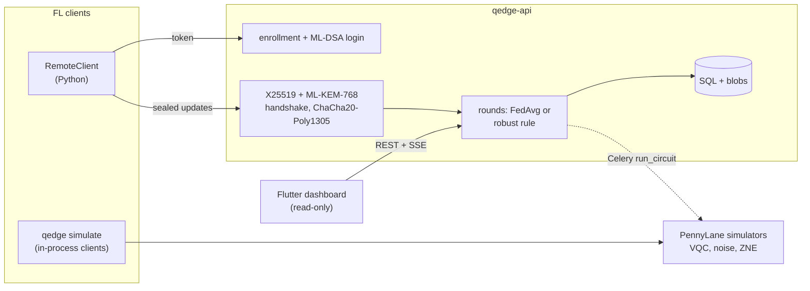

# Q-Edge

[](https://github.com/rasidi3112/Q-Edge/actions/workflows/ci.yml)
[](LICENSE)
[](pyproject.toml)

[English](README.md) | [العربية](README_ar.md) | [Deutsch](README_de.md) | [Español](README_es.md) | **Français** | [हिन्दी](README_hi.md) | [Bahasa Indonesia](README_id.md) | [Italiano](README_it.md) | [日本語](README_ja.md) | [한국어](README_ko.md) | [Bahasa Melayu](README_ms.md) | [Português](README_pt.md) | [Русский](README_ru.md) | [Türkçe](README_tr.md) | [Tiếng Việt](README_vi.md) | [中文](README_zh.md)

> Ceci est une traduction de [README.md](README.md). En cas de divergence, la version anglaise fait foi.

Q-Edge est un banc d'essai de recherche pour l'apprentissage fédéré avec des
modèles hybrides quantiques-classiques et une protection post-quantique des
mises à jour des clients. Il répond à trois questions avec des chiffres
reproductibles :

1. Sur des données non IID, une petite tête de circuit quantique variationnel
   (VQC) fait-elle aussi bien qu'une tête classique avec le même nombre de
   paramètres, avec et sans bruit et extrapolation à bruit nul ?
2. Combien coûte par tour la protection post-quantique (ML-KEM-768,
   ML-DSA-65, hybride X25519 + ML-KEM-768 et agrégation sécurisée) ?
3. Quels dégâts des clients malveillants peuvent-ils causer, dans quelle
   mesure les règles d'agrégation robuste aident-elles, et en quoi ces règles
   entrent-elles en conflit avec l'agrégation sécurisée ?

Les réponses négatives comptent comme des résultats. Chaque chiffre ci-dessous
provient de `results/summary/*.json`, que `make reproduce` régénère ;
[`docs/results.md`](docs/results.md) contient l'ensemble des tableaux et
figures.

## Ce que c'est et ce que ce n'est pas

C'est :

- Un simulateur fédéré (`qedge simulate`) sur les jeux breast_cancer et digits
  de scikit-learn avec un biais d'étiquettes de Dirichlet. Stratégies :
  FedAvg, FedProx, FedAdam et FedYogi. Également compression top-k, attaques,
  règles robustes et agrégation sécurisée. Le même code client et serveur
  s'exécute aussi sous forme d'applications Flower 1.40
  (`flwr run experiments/flower`).
- Des modèles hybrides PyTorch avec une tête VQC PennyLane, un bruit simulé
  sur les portes et la lecture, la ZNE par repliement global et des
  diagnostics (variance du gradient, concentration du noyau, expressivité).
- Un serveur FastAPI avec inscription des clients par un administrateur,
  connexion défi-réponse ML-DSA, transport signé X25519 + ML-KEM-768, tours
  validés, server-sent events et métriques Prometheus. Un tableau de bord
  Flutter en lecture seule affiche son état.

Ce n'est pas :

- Du matériel quantique. Tous les circuits tournent sur des simulateurs
  (`default.qubit`, `default.mixed`).
- Un déploiement réel. Les clients sont simulés dans un processus ou sont des
  scripts Python ; il n'y a pas d'entraînement sur mobile.
- De la cryptographie auditée. Le combineur KEM hybride, le transport et le
  protocole d'agrégation sécurisée sont des constructions propres à ce
  projet. Le backend en Python pur n'est pas à temps constant.
- Une preuve d'avantage quantique. Dans ces expériences, la tête VQC n'est
  jamais nettement meilleure que la tête classique.

## Architecture



Détails : [`docs/architecture.md`](docs/architecture.md) ; décisions :
[`docs/decisions/`](docs/decisions/) ; menaces :
[`docs/threat-model.md`](docs/threat-model.md).

## Démarrage rapide

```bash
git clone https://github.com/rasidi3112/Q-Edge.git && cd Q-Edge
python -m venv .venv && source .venv/bin/activate
pip install torch --index-url https://download.pytorch.org/whl/cpu   # optional: CPU-only torch
pip install -e ".[fl,pqc-pure]"

qedge demo                       # one run of each component, about 5 s
qedge simulate --dataset breast_cancer --clients 10 --rounds 30 --alpha 0.5 --strategy fedavg
qedge simulate --model hybrid-vqc --qubits 4 --layers 2 --noise 0.01 --zne richardson
qedge simulate --dataset digits --model mlp --attack scaling --attack-fraction 0.3 --defense multi_krum
qedge simulate --secure-aggregation
```

Chaque exécution de `simulate` écrit `results/runs/<run_id>/config.yaml`
(configuration, partition des clients, nombre de paramètres, versions des
paquets, machine) et `metrics.jsonl` (une ligne par tour). `pqc-pure` est un
ML-KEM et un ML-DSA en Python pur pour faire des essais ; pour tout le reste,
compilez liboqs 0.16 et installez `q-edge[pqc]`.

| Extra | Ajoute |
|---|---|
| `fl` | PyTorch, Flower, scikit-learn, PyYAML : simulateur, modèles hybrides |
| `server` | Serveur FastAPI, worker Celery, `qedge clients` |
| `pqc` | liboqs-python (nécessite la bibliothèque C liboqs) |
| `pqc-pure` | kyber-py et dilithium-py : pas à temps constant, tests uniquement |
| `report` | matplotlib pour `python -m experiments.report` |
| `flower-sim` | Ray, pour `flwr run` |
| `postgres` | psycopg, pour la pile compose |
| `dev` | pytest, hypothesis, ruff, mypy, pre-commit |

### Serveur

```bash
pip install -e ".[server,pqc-pure]"
qedge keys init --dir ./keys --backend pure        # server KEM and ML-DSA keys
qedge clients keygen --out ./admin --backend pure  # admin key pair, stays local
qedge clients add --id admin --scope admin --public-key ./admin/client.pub --backend pure
JWT_SECRET_KEY=$(python -c "import secrets; print(secrets.token_urlsafe(48))") \
  QEDGE_CRYPTO_BACKEND=pure QEDGE_KEY_DIR=./keys qedge-api
```

L'administrateur inscrit les clients et ouvre des tours (`POST /admin/rounds`).
Un client (`qedge.fl.remote.RemoteClient`) se connecte en signant un nonce,
ouvre une session chiffrée et envoie une mise à jour scellée par tour. Le
serveur agrège lorsque `min_clients` mises à jour sont arrivées ou que
l'échéance est passée, avec `QEDGE_AGGREGATION` (`fedavg`, `median`,
`trimmed_mean`, `krum`, `multi_krum` ou `bounded`). Sans clés ni backend
cryptographique, il refuse de démarrer. Avec Docker :

```bash
cp .env.example .env   # set JWT_SECRET_KEY, REDIS_PASSWORD, POSTGRES_PASSWORD
qedge clients keygen --out ./admin
docker compose run --rm api qedge keys init --dir /keys
docker compose run --rm -v "$PWD/admin:/admin:ro" api \
  qedge clients add --id admin --scope admin --public-key /admin/client.pub
docker compose up --build
```

Le tableau de bord : `cd mobile_app && flutter run -d chrome --web-port 3000
--dart-define=QEDGE_API_URL=http://localhost:8000`
([`mobile_app/README.md`](mobile_app/README.md)).

## Résultats

Clients simulés sur le CPU d'un ordinateur portable ; moyenne ± écart-type sur
les graines 0-2. Tableaux complets, figures et configurations :
[`docs/results.md`](docs/results.md), `experiments/configs/`.

**RQ1 : tête VQC contre tête classique.** 5 clients, 15 tours, 4 qubits,
2 couches strongly entangling (24 paramètres) contre une tête tanh à 20.
L'encodeur et la couche de sortie sont identiques.

| Jeu, α | Tête classique | VQC | VQC, p = 0.01 | VQC, p = 0.01, ZNE |
|---|---|---|---|---|
| breast_cancer, 0.1 | 0.968 ± 0.018 | 0.965 ± 0.032 | 0.930 ± 0.092 | 0.965 ± 0.032 |
| breast_cancer, 1.0 | 0.974 ± 0.018 | 0.977 ± 0.018 | 0.974 ± 0.018 | 0.977 ± 0.018 |
| digits, 0.1 | 0.643 ± 0.125 | 0.486 ± 0.093 | 0.496 ± 0.086 | 0.491 ± 0.084 |
| digits, 1.0 | 0.685 ± 0.143 | 0.514 ± 0.061 | 0.485 ± 0.100 | 0.512 ± 0.058 |

La tête VQC égale la tête classique sur breast_cancer et fait environ 0.16 de
moins sur digits. Le bruit dépolarisant à p = 0.01 et la ZNE modifient la
précision finale de moins que la dispersion entre graines ; l'effet le plus
marqué concerne breast_cancer avec α = 0.1 (0.965 sans bruit, 0.930 avec
bruit, 0.965 avec ZNE). La ZNE rend l'entraînement environ 8x plus lent. Sur
des circuits aléatoires de 4 qubits, la ZNE réduit l'erreur de la valeur
moyenne à p = 0.01 de 0.055 à 0.005 (Richardson) ou 0.003 (exponentielle).

**RQ2 : coût de la protection post-quantique** (liboqs 0.16) :

- La poignée de main du transport prend 0.57 ms et 7 840 octets une fois par
  session, plus 52 octets par trame de mise à jour.
- Agrégation sécurisée par tour et par client, comparée à un simple envoi
  float32 :
  - 10 clients, 1 210 paramètres : 36.6 Kio envoyés au lieu de 4.7 Kio,
    2.6 ms ; serveur 3.8 ms.
  - 50 clients, 100 000 paramètres : 895 Kio au lieu de 391 Kio, 33 ms ;
    serveur 95 ms.
- L'envoi double parce que les valeurs masquées occupent 8 octets, et
  l'échange de clés croît linéairement avec le nombre de clients.

**RQ3 : clients malveillants** (digits, MLP, 10 clients, 30 tours, 3 sur 10
attaquent) :

| Attaque | FedAvg | Médiane | Multi-Krum |
|---|---|---|---|
| aucune | 0.952 ± 0.003 | 0.931 ± 0.006 | 0.922 ± 0.003 |
| inversion d'étiquettes | 0.700 ± 0.314 | 0.883 ± 0.032 | 0.938 ± 0.013 |
| mise à l'échelle (remplacement de modèle) | 0.177 ± 0.094 | 0.908 ± 0.015 | 0.936 ± 0.022 |
| bruit aléatoire | 0.578 ± 0.065 | 0.933 ± 0.014 | 0.936 ± 0.022 |
| faux nombres d'échantillons | 0.030 ± 0.018 | 0.883 ± 0.032 | 0.938 ± 0.013 |

FedAvg échoue face à chaque attaque. Multi-Krum reste à moins de 0.02 de sa
propre précision sans attaque, mais coûte 0.03 en l'absence d'attaquants ;
Krum seul coûte 0.28 sur des données non IID. Aucune de ces règles ne peut
fonctionner avec l'agrégation sécurisée, qui masque précisément les mises à
jour individuelles qu'elles examinent (ADR 0010). La moyenne tronquée, le
seuillage de norme et les plafonds d'échantillons figurent dans
`docs/results.md`.

## Modèle de sécurité

Protégé : la lecture ou la falsification des mises à jour sur le réseau,
maintenant ou après qu'un ordinateur quantique a cassé X25519 (KEM hybride,
poignée de main signée, trames AEAD, compteurs anti-rejeu) ; l'usurpation du
serveur ou d'un client inscrit ; les mises à jour malformées ou dupliquées ;
les clients qui déclenchent l'agrégation. Protégé en partie : les clients
malveillants qui respectent le protocole, grâce aux règles robustes. Non
protégé : un serveur curieux hors du simulateur (l'agrégation sécurisée n'est
pas exposée en HTTP), l'inférence à partir du modèle global (pas de
comptabilité de confidentialité), le déni de service, les canaux auxiliaires
du backend pur et les jetons volés avant leur expiration. Voir
[`docs/threat-model.md`](docs/threat-model.md).

## Limites

- Deux jeux de données petits et faciles. Les écarts inférieurs à environ un
  écart-type (jusqu'à 0.14 sur digits dans RQ1) ne sont pas tranchés avec
  3 graines.
- RQ1 utilise 5 clients et 15 tours pour que les exécutions avec ZNE restent
  abordables ; les précisions sur digits (0.5-0.7) restent donc loin d'un MLP
  à 30 tours (0.95).
- Le bruit simulé est un canal par porte et par fil : ni diaphonie, ni bruit
  au repos, ni erreurs cohérentes. La rétropropagation à travers
  `default.mixed` fournit des gradients que le matériel ne peut pas fournir
  (ADR 0009).
- L'agrégation sécurisée ne gère pas les abandons et ne s'exécute que dans le
  processus. Les coûts mesurés n'incluent pas la latence réseau.
- Le seuillage et le bruit gaussien existent, mais aucun ε n'est indiqué faute
  de comptabilité de confidentialité.
- Les règles robustes supposent au plus 30 % d'attaquants et n'ont pas été
  testées contre des portes dérobées ciblées ni des attaquants adaptatifs.
- L'application Flutter est en lecture seule et ne fait aucune cryptographie ;
  les builds Android et iOS n'ont pas été testés.

## Développement

```bash
pip install torch --index-url https://download.pytorch.org/whl/cpu
pip install -e ".[dev,server,pqc-pure,fl,report]"
pre-commit install
make lint             # ruff check, ruff format --check, mypy --strict on src/qedge
make test             # pytest -m "not slow"
pytest -m slow        # Flower end-to-end and a noisy ZNE run (needs flower-sim)
make reproduce        # every experiment and docs/results.md, about 62 minutes
```

`python -m experiments.run_all --skip quantum_head` relance tout sauf la
grille ZNE en environ 7 minutes. La CI exécute le lint et les tests sous
Python 3.11-3.13, une tâche liboqs, les tests Flutter et les builds Docker.

## Organisation

```
src/qedge/
  crypto/     ML-KEM, ML-DSA, hybrid KEM, transport, key files, backends
  fl/         datasets, models, training, strategies, robust rules, attacks,
              compression, privacy, secure aggregation, simulator, Flower apps
  quantum/    circuits, noise, ZNE and readout mitigation, kernels, models,
              diagnostics
  server/     FastAPI app, auth, rounds, storage, metrics, Celery worker
  cli.py      qedge keys | clients | simulate | demo
  demo.py
experiments/  configs/*.yaml, one script per experiment, run_all.py, report.py
bench/        crypto.py, secagg.py
results/      summary/*.json (committed), runs/ (ignored)
docs/         architecture.md, threat-model.md, results.md, figures/, decisions/
mobile_app/   Flutter dashboard
```

## Références

- McMahan et al., "Communication-Efficient Learning of Deep Networks from
  Decentralized Data", 2017, arXiv:1602.05629 (FedAvg).
- Li et al., "Federated Optimization in Heterogeneous Networks", 2018,
  arXiv:1812.06127 (FedProx).
- Reddi et al., "Adaptive Federated Optimization", 2020, arXiv:2003.00295
  (FedAdam, FedYogi).
- Karimireddy et al., "Error Feedback Fixes SignSGD and other Gradient
  Compression Schemes", 2019, arXiv:1901.09847.
- Yin et al., "Byzantine-Robust Distributed Learning: Towards Optimal
  Statistical Rates", 2018, arXiv:1803.01498 (median, trimmed mean).
- Blanchard et al., "Machine Learning with Adversaries: Byzantine Tolerant
  Gradient Descent", NeurIPS 2017 (Krum).
- Sun et al., "Can You Really Backdoor Federated Learning?", 2019,
  arXiv:1911.07963 (norm clipping).
- Bagdasaryan et al., "How To Backdoor Federated Learning", 2018,
  arXiv:1807.00459 (model replacement).
- Bonawitz et al., "Practical Secure Aggregation for Privacy-Preserving
  Machine Learning", CCS 2017.
- Schuld et al., "Circuit-centric quantum classifiers", 2018,
  arXiv:1804.00633.
- Pérez-Salinas et al., "Data re-uploading for a universal quantum
  classifier", 2020, arXiv:1907.02085.
- Havlíček et al., "Supervised learning with quantum-enhanced feature
  spaces", Nature 2019.
- Temme et al., "Error mitigation for short-depth quantum circuits", 2017,
  arXiv:1612.02058.
- Giurgica-Tiron et al., "Digital zero noise extrapolation for quantum
  error mitigation", 2020, arXiv:2005.10921.
- McClean et al., "Barren plateaus in quantum neural network training
  landscapes", 2018, arXiv:1803.11173.
- Thanasilp et al., "Exponential concentration in quantum kernel methods",
  2022, arXiv:2208.11060.
- Sim et al., "Expressibility and entangling capability of parameterized
  quantum circuits", 2019, arXiv:1905.10876.
- NIST FIPS 203 (ML-KEM) and FIPS 204 (ML-DSA), 2024.

## Licence

Apache 2.0, voir [LICENSE](LICENSE). Les changements sont listés dans
[CHANGELOG.md](CHANGELOG.md).
