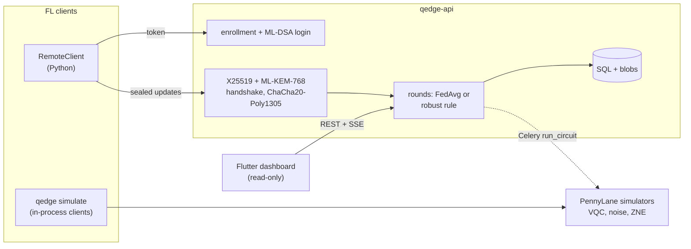

# Q-Edge

[](https://github.com/rasidi3112/Q-Edge/actions/workflows/ci.yml)
[](LICENSE)
[](pyproject.toml)

[English](README.md) | [العربية](README_ar.md) | [Deutsch](README_de.md) | [Español](README_es.md) | [Français](README_fr.md) | **हिन्दी** | [Bahasa Indonesia](README_id.md) | [Italiano](README_it.md) | [日本語](README_ja.md) | [한국어](README_ko.md) | [Bahasa Melayu](README_ms.md) | [Português](README_pt.md) | [Русский](README_ru.md) | [Türkçe](README_tr.md) | [Tiếng Việt](README_vi.md) | [中文](README_zh.md)

> यह [README.md](README.md) का अनुवाद है। किसी अंतर की स्थिति में अंग्रेज़ी संस्करण मान्य है।

Q-Edge हाइब्रिड क्वांटम-क्लासिकल मॉडलों के साथ फ़ेडरेटेड लर्निंग और क्लाइंट
अपडेट की पोस्ट-क्वांटम सुरक्षा के लिए एक शोध टेस्टबेड है। यह तीन प्रश्नों का
उत्तर पुनरुत्पादनीय संख्याओं के साथ देता है:

1. non-IID डेटा पर, क्या एक छोटा वेरिएशनल क्वांटम सर्किट (VQC) हेड उतने ही
   पैरामीटर वाले क्लासिकल हेड जितना अच्छा प्रदर्शन करता है, नॉइज़ के साथ और
   बिना, तथा ज़ीरो-नॉइज़ एक्सट्रपोलेशन के साथ और बिना?
2. पोस्ट-क्वांटम सुरक्षा (ML-KEM-768, ML-DSA-65, हाइब्रिड
   X25519 + ML-KEM-768 और सिक्योर एग्रीगेशन) की प्रति राउंड लागत क्या है?
3. दुर्भावनापूर्ण क्लाइंट कितना नुकसान कर सकते हैं, रोबस्ट एग्रीगेशन नियम
   कितनी मदद करते हैं, और ये नियम सिक्योर एग्रीगेशन से कैसे टकराते हैं?

नकारात्मक उत्तर भी परिणाम माने जाते हैं। नीचे दी गई हर संख्या
`results/summary/*.json` से ली गई है, जिसे `make reproduce` दोबारा बनाता है;
पूरी तालिकाएँ और चित्र [`docs/results.md`](docs/results.md) में हैं।

## यह क्या है और क्या नहीं है

यह है:

- scikit-learn के breast_cancer और digits डेटासेट पर Dirichlet लेबल स्क्यू के
  साथ एक फ़ेडरेटेड सिम्युलेटर (`qedge simulate`)। रणनीतियाँ: FedAvg, FedProx,
  FedAdam और FedYogi। साथ ही top-k कम्प्रेशन, हमले, रोबस्ट नियम और सिक्योर
  एग्रीगेशन। वही क्लाइंट और सर्वर कोड Flower 1.40 ऐप के रूप में भी चलता है
  (`flwr run experiments/flower`)।
- PennyLane VQC हेड वाले हाइब्रिड PyTorch मॉडल, गेट और रीडआउट नॉइज़ का
  सिमुलेशन, ग्लोबल फ़ोल्डिंग द्वारा ZNE, और डायग्नॉस्टिक्स (ग्रेडिएंट वेरिएंस,
  कर्नेल कंसन्ट्रेशन, एक्सप्रेसिबिलिटी)।
- एक FastAPI सर्वर, जिसमें एडमिन द्वारा क्लाइंट पंजीकरण, ML-DSA
  चैलेंज-रिस्पॉन्स लॉगिन, हस्ताक्षरित X25519 + ML-KEM-768 ट्रांसपोर्ट, सत्यापित
  राउंड, server-sent events और Prometheus मेट्रिक्स हैं। एक केवल-पढ़ने वाला
  Flutter डैशबोर्ड इसकी स्थिति दिखाता है।

यह नहीं है:

- क्वांटम हार्डवेयर। सभी सर्किट सिम्युलेटर (`default.qubit`, `default.mixed`)
  पर चलते हैं।
- वास्तविक तैनाती। क्लाइंट एक ही प्रोसेस में सिम्युलेट होते हैं या Python
  स्क्रिप्ट हैं; मोबाइल पर कोई ट्रेनिंग नहीं होती।
- ऑडिट की गई क्रिप्टोग्राफ़ी। हाइब्रिड KEM कंबाइनर, ट्रांसपोर्ट और सिक्योर
  एग्रीगेशन प्रोटोकॉल इस प्रोजेक्ट की अपनी रचनाएँ हैं। शुद्ध Python बैकएंड
  constant-time नहीं है।
- क्वांटम लाभ का प्रमाण। इन प्रयोगों में VQC हेड कभी भी क्लासिकल हेड से
  स्पष्ट रूप से बेहतर नहीं रहा।

## आर्किटेक्चर



विवरण: [`docs/architecture.md`](docs/architecture.md); निर्णय:
[`docs/decisions/`](docs/decisions/); ख़तरे:
[`docs/threat-model.md`](docs/threat-model.md)।

## त्वरित शुरुआत

```bash
git clone https://github.com/rasidi3112/Q-Edge.git && cd Q-Edge
python -m venv .venv && source .venv/bin/activate
pip install torch --index-url https://download.pytorch.org/whl/cpu   # optional: CPU-only torch
pip install -e ".[fl,pqc-pure]"

qedge demo                       # one run of each component, about 5 s
qedge simulate --dataset breast_cancer --clients 10 --rounds 30 --alpha 0.5 --strategy fedavg
qedge simulate --model hybrid-vqc --qubits 4 --layers 2 --noise 0.01 --zne richardson
qedge simulate --dataset digits --model mlp --attack scaling --attack-fraction 0.3 --defense multi_krum
qedge simulate --secure-aggregation
```

हर `simulate` रन `results/runs/<run_id>/config.yaml` (कॉन्फ़िगरेशन, क्लाइंट
विभाजन, पैरामीटर संख्या, पैकेज संस्करण, मशीन) और `metrics.jsonl` (प्रति राउंड
एक पंक्ति) लिखता है। `pqc-pure` आज़माने के लिए शुद्ध Python में ML-KEM और
ML-DSA है; बाकी सभी उपयोगों के लिए liboqs 0.16 बिल्ड करें और `q-edge[pqc]`
इंस्टॉल करें।

| Extra | क्या जोड़ता है |
|---|---|
| `fl` | PyTorch, Flower, scikit-learn, PyYAML: सिम्युलेटर, हाइब्रिड मॉडल |
| `server` | FastAPI सर्वर, Celery वर्कर, `qedge clients` |
| `pqc` | liboqs-python (liboqs C लाइब्रेरी आवश्यक) |
| `pqc-pure` | kyber-py और dilithium-py: constant-time नहीं, केवल टेस्ट के लिए |
| `report` | `python -m experiments.report` के लिए matplotlib |
| `flower-sim` | `flwr run` के लिए Ray |
| `postgres` | compose स्टैक के लिए psycopg |
| `dev` | pytest, hypothesis, ruff, mypy, pre-commit |

### सर्वर

```bash
pip install -e ".[server,pqc-pure]"
qedge keys init --dir ./keys --backend pure        # server KEM and ML-DSA keys
qedge clients keygen --out ./admin --backend pure  # admin key pair, stays local
qedge clients add --id admin --scope admin --public-key ./admin/client.pub --backend pure
JWT_SECRET_KEY=$(python -c "import secrets; print(secrets.token_urlsafe(48))") \
  QEDGE_CRYPTO_BACKEND=pure QEDGE_KEY_DIR=./keys qedge-api
```

एडमिन क्लाइंट पंजीकृत करता है और राउंड खोलता है (`POST /admin/rounds`)। एक
क्लाइंट (`qedge.fl.remote.RemoteClient`) एक nonce पर हस्ताक्षर करके लॉगिन करता
है, एक एन्क्रिप्टेड सत्र खोलता है और हर राउंड में एक सील किया हुआ अपडेट भेजता
है। सर्वर तब एग्रीगेट करता है जब `min_clients` अपडेट आ जाएँ या समय-सीमा बीत
जाए, और इसके लिए `QEDGE_AGGREGATION` (`fedavg`, `median`, `trimmed_mean`,
`krum`, `multi_krum` या `bounded`) का उपयोग करता है। कुंजियों या क्रिप्टो
बैकएंड के बिना यह शुरू होने से मना कर देता है। Docker के साथ:

```bash
cp .env.example .env   # set JWT_SECRET_KEY, REDIS_PASSWORD, POSTGRES_PASSWORD
qedge clients keygen --out ./admin
docker compose run --rm api qedge keys init --dir /keys
docker compose run --rm -v "$PWD/admin:/admin:ro" api \
  qedge clients add --id admin --scope admin --public-key /admin/client.pub
docker compose up --build
```

डैशबोर्ड: `cd mobile_app && flutter run -d chrome --web-port 3000
--dart-define=QEDGE_API_URL=http://localhost:8000`
([`mobile_app/README.md`](mobile_app/README.md))।

## परिणाम

क्लाइंट एक लैपटॉप CPU पर सिम्युलेट किए गए; seed 0-2 पर औसत ± मानक विचलन। पूरी
तालिकाएँ, चित्र और कॉन्फ़िगरेशन: [`docs/results.md`](docs/results.md),
`experiments/configs/`।

**RQ1: VQC हेड बनाम क्लासिकल हेड।** 5 क्लाइंट, 15 राउंड, 4 क्यूबिट,
2 strongly entangling लेयर (24 पैरामीटर) बनाम 20 पैरामीटर वाला एक tanh हेड।
एन्कोडर और आउटपुट लेयर एक जैसे हैं।

| डेटासेट, α | क्लासिकल हेड | VQC | VQC, p = 0.01 | VQC, p = 0.01, ZNE |
|---|---|---|---|---|
| breast_cancer, 0.1 | 0.968 ± 0.018 | 0.965 ± 0.032 | 0.930 ± 0.092 | 0.965 ± 0.032 |
| breast_cancer, 1.0 | 0.974 ± 0.018 | 0.977 ± 0.018 | 0.974 ± 0.018 | 0.977 ± 0.018 |
| digits, 0.1 | 0.643 ± 0.125 | 0.486 ± 0.093 | 0.496 ± 0.086 | 0.491 ± 0.084 |
| digits, 1.0 | 0.685 ± 0.143 | 0.514 ± 0.061 | 0.485 ± 0.100 | 0.512 ± 0.058 |

VQC हेड breast_cancer पर क्लासिकल हेड के बराबर है और digits पर लगभग 0.16 कम
है। p = 0.01 डिपोलराइज़िंग नॉइज़ और ZNE अंतिम सटीकता को seed के बीच के अंतर से
कम बदलते हैं; सबसे बड़ा प्रभाव α = 0.1 पर breast_cancer में है (बिना नॉइज़
0.965, नॉइज़ के साथ 0.930, ZNE के साथ 0.965)। ZNE ट्रेनिंग को लगभग 8 गुना धीमा
कर देता है। यादृच्छिक 4-क्यूबिट सर्किट पर ZNE, p = 0.01 पर अपेक्षित मान की
त्रुटि को 0.055 से घटाकर 0.005 (Richardson) या 0.003 (एक्सपोनेंशियल) कर देता है।

**RQ2: पोस्ट-क्वांटम सुरक्षा की लागत** (liboqs 0.16):

- ट्रांसपोर्ट हैंडशेक प्रति सत्र एक बार 0.57 ms और 7 840 बाइट लेता है, साथ में
  हर अपडेट फ़्रेम पर 52 बाइट।
- प्रति राउंड, प्रति क्लाइंट सिक्योर एग्रीगेशन, साधारण float32 अपलोड की तुलना
  में:
  - 10 क्लाइंट, 1 210 पैरामीटर: 4.7 KiB की जगह 36.6 KiB अपलोड, 2.6 ms;
    सर्वर 3.8 ms।
  - 50 क्लाइंट, 100 000 पैरामीटर: 391 KiB की जगह 895 KiB, 33 ms;
    सर्वर 95 ms।
- अपलोड दोगुना होता है क्योंकि मास्क किए गए मान 8 बाइट लेते हैं, और कुंजी
  विनिमय क्लाइंट की संख्या के साथ रैखिक रूप से बढ़ता है।

**RQ3: दुर्भावनापूर्ण क्लाइंट** (digits, MLP, 10 क्लाइंट, 30 राउंड, 10 में से 3
हमला करते हैं):

| हमला | FedAvg | माध्यिका | Multi-Krum |
|---|---|---|---|
| कोई नहीं | 0.952 ± 0.003 | 0.931 ± 0.006 | 0.922 ± 0.003 |
| लेबल फ़्लिप | 0.700 ± 0.314 | 0.883 ± 0.032 | 0.938 ± 0.013 |
| स्केलिंग (मॉडल रिप्लेसमेंट) | 0.177 ± 0.094 | 0.908 ± 0.015 | 0.936 ± 0.022 |
| यादृच्छिक नॉइज़ | 0.578 ± 0.065 | 0.933 ± 0.014 | 0.936 ± 0.022 |
| नकली सैंपल संख्या | 0.030 ± 0.018 | 0.883 ± 0.032 | 0.938 ± 0.013 |

FedAvg हर हमले के सामने विफल होता है। Multi-Krum बिना हमले वाली अपनी सटीकता से
0.02 के भीतर रहता है, लेकिन हमलावर न होने पर 0.03 की कमी लाता है; अकेला Krum
non-IID डेटा पर 0.28 की कमी लाता है। इनमें से कोई भी नियम सिक्योर एग्रीगेशन के
तहत नहीं चल सकता, क्योंकि सिक्योर एग्रीगेशन ठीक वही व्यक्तिगत अपडेट छिपाता है
जिनकी ये जाँच करते हैं (ADR 0010)। ट्रिम्ड मीन, नॉर्म क्लिपिंग और सैंपल सीमाएँ
`docs/results.md` में हैं।

## सुरक्षा मॉडल

सुरक्षित: नेटवर्क पर अपडेट पढ़ना या जाली बनाना, अभी या किसी क्वांटम कंप्यूटर
द्वारा X25519 तोड़े जाने के बाद (हाइब्रिड KEM, हस्ताक्षरित हैंडशेक, AEAD फ़्रेम,
रिप्ले काउंटर); सर्वर या पंजीकृत क्लाइंट होने का दिखावा करना; विकृत या दोहराए
गए अपडेट; क्लाइंट द्वारा एग्रीगेशन शुरू करवाना। आंशिक रूप से सुरक्षित:
प्रोटोकॉल का पालन करने वाले दुर्भावनापूर्ण क्लाइंट, रोबस्ट नियमों के माध्यम
से। असुरक्षित: सिम्युलेटर के बाहर जिज्ञासु सर्वर (सिक्योर एग्रीगेशन HTTP पर
उपलब्ध नहीं), ग्लोबल मॉडल से अनुमान (कोई प्राइवेसी अकाउंटेंट नहीं), सेवा से
इनकार (DoS), शुद्ध बैकएंड के साइड चैनल, और समाप्ति से पहले चुराए गए टोकन।
देखें [`docs/threat-model.md`](docs/threat-model.md)।

## सीमाएँ

- दो छोटे और आसान डेटासेट। लगभग एक मानक विचलन से कम के अंतर (RQ1 में digits
  पर 0.14 तक) 3 seed के साथ तय नहीं किए जा सकते।
- RQ1 में ZNE रन को किफ़ायती रखने के लिए 5 क्लाइंट और 15 राउंड हैं, इसलिए
  digits की सटीकता (0.5-0.7) 30 राउंड वाले MLP (0.95) से काफ़ी कम है।
- सिम्युलेटेड नॉइज़ हर गेट और वायर पर एक चैनल है: कोई क्रॉसटॉक, आइडल नॉइज़
  या कोहेरेंट त्रुटि नहीं। `default.mixed` के माध्यम से बैकप्रोपेगेशन ऐसे
  ग्रेडिएंट देता है जो हार्डवेयर नहीं दे सकता (ADR 0009)।
- सिक्योर एग्रीगेशन में क्लाइंट ड्रॉपआउट से रिकवरी नहीं है और यह केवल प्रोसेस
  के भीतर चलता है। मापी गई लागत में नेटवर्क विलंब शामिल नहीं है।
- क्लिपिंग और गॉसियन नॉइज़ मौजूद हैं, लेकिन प्राइवेसी अकाउंटेंट न होने के
  कारण कोई ε नहीं बताया जाता।
- रोबस्ट नियम अधिकतम 30 % हमलावर मानते हैं और लक्षित बैकडोर या अनुकूली
  हमलावरों के विरुद्ध परखे नहीं गए हैं।
- Flutter ऐप केवल-पढ़ने वाला है और कोई क्रिप्टोग्राफ़ी नहीं करता; Android और
  iOS बिल्ड परखे नहीं गए हैं।

## विकास

```bash
pip install torch --index-url https://download.pytorch.org/whl/cpu
pip install -e ".[dev,server,pqc-pure,fl,report]"
pre-commit install
make lint             # ruff check, ruff format --check, mypy --strict on src/qedge
make test             # pytest -m "not slow"
pytest -m slow        # Flower end-to-end and a noisy ZNE run (needs flower-sim)
make reproduce        # every experiment and docs/results.md, about 62 minutes
```

`python -m experiments.run_all --skip quantum_head` ZNE ग्रिड को छोड़कर सब कुछ
लगभग 7 मिनट में दोबारा चलाता है। CI, Python 3.11-3.13 पर lint और टेस्ट, एक
liboqs जॉब, Flutter टेस्ट और Docker बिल्ड चलाता है।

## संरचना

```
src/qedge/
  crypto/     ML-KEM, ML-DSA, hybrid KEM, transport, key files, backends
  fl/         datasets, models, training, strategies, robust rules, attacks,
              compression, privacy, secure aggregation, simulator, Flower apps
  quantum/    circuits, noise, ZNE and readout mitigation, kernels, models,
              diagnostics
  server/     FastAPI app, auth, rounds, storage, metrics, Celery worker
  cli.py      qedge keys | clients | simulate | demo
  demo.py
experiments/  configs/*.yaml, one script per experiment, run_all.py, report.py
bench/        crypto.py, secagg.py
results/      summary/*.json (committed), runs/ (ignored)
docs/         architecture.md, threat-model.md, results.md, figures/, decisions/
mobile_app/   Flutter dashboard
```

## संदर्भ

- McMahan et al., "Communication-Efficient Learning of Deep Networks from
  Decentralized Data", 2017, arXiv:1602.05629 (FedAvg).
- Li et al., "Federated Optimization in Heterogeneous Networks", 2018,
  arXiv:1812.06127 (FedProx).
- Reddi et al., "Adaptive Federated Optimization", 2020, arXiv:2003.00295
  (FedAdam, FedYogi).
- Karimireddy et al., "Error Feedback Fixes SignSGD and other Gradient
  Compression Schemes", 2019, arXiv:1901.09847.
- Yin et al., "Byzantine-Robust Distributed Learning: Towards Optimal
  Statistical Rates", 2018, arXiv:1803.01498 (median, trimmed mean).
- Blanchard et al., "Machine Learning with Adversaries: Byzantine Tolerant
  Gradient Descent", NeurIPS 2017 (Krum).
- Sun et al., "Can You Really Backdoor Federated Learning?", 2019,
  arXiv:1911.07963 (norm clipping).
- Bagdasaryan et al., "How To Backdoor Federated Learning", 2018,
  arXiv:1807.00459 (model replacement).
- Bonawitz et al., "Practical Secure Aggregation for Privacy-Preserving
  Machine Learning", CCS 2017.
- Schuld et al., "Circuit-centric quantum classifiers", 2018,
  arXiv:1804.00633.
- Pérez-Salinas et al., "Data re-uploading for a universal quantum
  classifier", 2020, arXiv:1907.02085.
- Havlíček et al., "Supervised learning with quantum-enhanced feature
  spaces", Nature 2019.
- Temme et al., "Error mitigation for short-depth quantum circuits", 2017,
  arXiv:1612.02058.
- Giurgica-Tiron et al., "Digital zero noise extrapolation for quantum
  error mitigation", 2020, arXiv:2005.10921.
- McClean et al., "Barren plateaus in quantum neural network training
  landscapes", 2018, arXiv:1803.11173.
- Thanasilp et al., "Exponential concentration in quantum kernel methods",
  2022, arXiv:2208.11060.
- Sim et al., "Expressibility and entangling capability of parameterized
  quantum circuits", 2019, arXiv:1905.10876.
- NIST FIPS 203 (ML-KEM) and FIPS 204 (ML-DSA), 2024.

## लाइसेंस

Apache 2.0, देखें [LICENSE](LICENSE)। बदलाव [CHANGELOG.md](CHANGELOG.md) में दर्ज
हैं।
