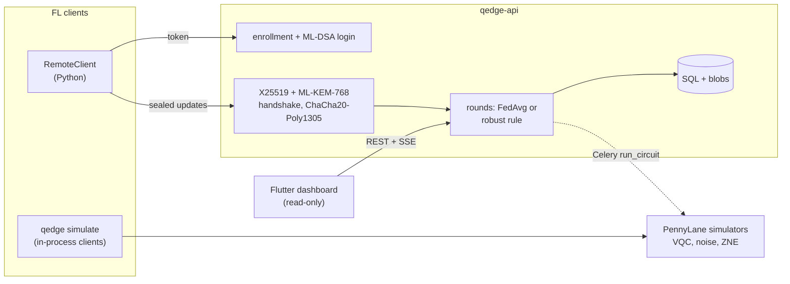

# Q-Edge

[](https://github.com/rasidi3112/Q-Edge/actions/workflows/ci.yml)
[](LICENSE)
[](pyproject.toml)

[English](README.md) | [العربية](README_ar.md) | [Deutsch](README_de.md) | [Español](README_es.md) | [Français](README_fr.md) | [हिन्दी](README_hi.md) | **Bahasa Indonesia** | [Italiano](README_it.md) | [日本語](README_ja.md) | [한국어](README_ko.md) | [Bahasa Melayu](README_ms.md) | [Português](README_pt.md) | [Русский](README_ru.md) | [Türkçe](README_tr.md) | [Tiếng Việt](README_vi.md) | [中文](README_zh.md)

> Ini terjemahan dari [README.md](README.md). Jika ada perbedaan, versi bahasa Inggris yang berlaku.

Q-Edge adalah testbed riset untuk federated learning dengan model hybrid
kuantum-klasik dan proteksi post-quantum untuk update dari client. Proyek ini
menjawab tiga pertanyaan dengan angka yang bisa direproduksi:

1. Pada data non-IID, apakah head variational quantum circuit (VQC) kecil
   sebaik head klasik dengan jumlah parameter yang sama, dengan dan tanpa
   noise serta zero-noise extrapolation?
2. Berapa biaya proteksi post-quantum (ML-KEM-768, ML-DSA-65, hybrid
   X25519 + ML-KEM-768 dan secure aggregation) per ronde?
3. Seberapa besar kerusakan yang bisa dibuat client jahat, seberapa jauh
   aturan robust aggregation membantu, dan bagaimana aturan itu berkonflik
   dengan secure aggregation?

Jawaban negatif juga dihitung sebagai hasil. Setiap angka di bawah berasal dari
`results/summary/*.json`, yang dibuat ulang oleh `make reproduce`;
[`docs/results.md`](docs/results.md) berisi tabel dan gambar lengkap.

## Apa proyek ini dan apa yang bukan

Proyek ini adalah:

- Simulator federated (`qedge simulate`) pada dataset breast_cancer dan
  digits dari scikit-learn dengan label skew Dirichlet. Strategi: FedAvg,
  FedProx, FedAdam dan FedYogi. Juga kompresi top-k, serangan, aturan robust
  dan secure aggregation. Kode client dan server yang sama juga berjalan
  sebagai aplikasi Flower 1.40 (`flwr run experiments/flower`).
- Model hybrid PyTorch dengan head VQC PennyLane, simulasi noise gate dan
  readout, ZNE dengan global folding, serta diagnostik (variansi gradien,
  konsentrasi kernel, expressibility).
- Server FastAPI dengan enrollment oleh admin, login challenge-response
  ML-DSA, transport X25519 + ML-KEM-768 yang ditandatangani, ronde yang
  divalidasi, server-sent events dan metrik Prometheus. Dashboard Flutter
  read-only menampilkan statusnya.

Proyek ini bukan:

- Hardware kuantum. Semua sirkuit berjalan di simulator (`default.qubit`,
  `default.mixed`).
- Deployment nyata. Client disimulasikan dalam satu proses atau berupa
  skrip Python; tidak ada training di perangkat mobile.
- Kriptografi yang sudah diaudit. Penggabung KEM hybrid, transport dan
  protokol secure aggregation adalah konstruksi proyek ini sendiri. Backend
  pure-Python tidak constant-time.
- Bukti keunggulan kuantum. Dalam eksperimen ini head VQC tidak pernah
  jelas lebih baik dari head klasik.

## Arsitektur



Detail: [`docs/architecture.md`](docs/architecture.md); keputusan desain:
[`docs/decisions/`](docs/decisions/); ancaman:
[`docs/threat-model.md`](docs/threat-model.md).

## Mulai cepat

```bash
git clone https://github.com/rasidi3112/Q-Edge.git && cd Q-Edge
python -m venv .venv && source .venv/bin/activate
pip install torch --index-url https://download.pytorch.org/whl/cpu   # optional: CPU-only torch
pip install -e ".[fl,pqc-pure]"

qedge demo                       # one run of each component, about 5 s
qedge simulate --dataset breast_cancer --clients 10 --rounds 30 --alpha 0.5 --strategy fedavg
qedge simulate --model hybrid-vqc --qubits 4 --layers 2 --noise 0.01 --zne richardson
qedge simulate --dataset digits --model mlp --attack scaling --attack-fraction 0.3 --defense multi_krum
qedge simulate --secure-aggregation
```

Setiap run `simulate` menulis `results/runs/<run_id>/config.yaml` (konfigurasi,
partisi client, jumlah parameter, versi paket, mesin) dan `metrics.jsonl`
(satu baris per ronde). `pqc-pure` adalah ML-KEM dan ML-DSA pure-Python untuk
mencoba-coba; untuk keperluan lain, build liboqs 0.16 dan pasang
`q-edge[pqc]`.

| Extra | Menambahkan |
|---|---|
| `fl` | PyTorch, Flower, scikit-learn, PyYAML: simulator, model hybrid |
| `server` | Server FastAPI, worker Celery, `qedge clients` |
| `pqc` | liboqs-python (butuh library C liboqs) |
| `pqc-pure` | kyber-py dan dilithium-py: tidak constant-time, hanya untuk test |
| `report` | matplotlib untuk `python -m experiments.report` |
| `flower-sim` | Ray, untuk `flwr run` |
| `postgres` | psycopg, untuk stack compose |
| `dev` | pytest, hypothesis, ruff, mypy, pre-commit |

### Server

```bash
pip install -e ".[server,pqc-pure]"
qedge keys init --dir ./keys --backend pure        # server KEM and ML-DSA keys
qedge clients keygen --out ./admin --backend pure  # admin key pair, stays local
qedge clients add --id admin --scope admin --public-key ./admin/client.pub --backend pure
JWT_SECRET_KEY=$(python -c "import secrets; print(secrets.token_urlsafe(48))") \
  QEDGE_CRYPTO_BACKEND=pure QEDGE_KEY_DIR=./keys qedge-api
```

Admin mendaftarkan client dan membuka ronde (`POST /admin/rounds`). Client
(`qedge.fl.remote.RemoteClient`) login dengan menandatangani nonce, membuka
sesi terenkripsi dan mengirim satu update tersegel per ronde. Server
melakukan agregasi saat `min_clients` update sudah masuk atau deadline lewat,
memakai `QEDGE_AGGREGATION` (`fedavg`, `median`, `trimmed_mean`, `krum`,
`multi_krum` atau `bounded`). Tanpa kunci atau backend kripto, server menolak
untuk berjalan. Dengan Docker:

```bash
cp .env.example .env   # set JWT_SECRET_KEY, REDIS_PASSWORD, POSTGRES_PASSWORD
qedge clients keygen --out ./admin
docker compose run --rm api qedge keys init --dir /keys
docker compose run --rm -v "$PWD/admin:/admin:ro" api \
  qedge clients add --id admin --scope admin --public-key /admin/client.pub
docker compose up --build
```

Dashboard: `cd mobile_app && flutter run -d chrome --web-port 3000
--dart-define=QEDGE_API_URL=http://localhost:8000`
([`mobile_app/README.md`](mobile_app/README.md)).

## Hasil

Client disimulasikan di CPU laptop; rata-rata ± std dari seed 0-2. Tabel
lengkap, gambar dan konfigurasi: [`docs/results.md`](docs/results.md),
`experiments/configs/`.

**RQ1: head VQC vs head klasik.** 5 client, 15 ronde, 4 qubit, 2 layer
strongly entangling (24 parameter) melawan head tanh dengan 20 parameter.
Encoder dan readout identik.

| Dataset, α | Head klasik | VQC | VQC, p = 0.01 | VQC, p = 0.01, ZNE |
|---|---|---|---|---|
| breast_cancer, 0.1 | 0.968 ± 0.018 | 0.965 ± 0.032 | 0.930 ± 0.092 | 0.965 ± 0.032 |
| breast_cancer, 1.0 | 0.974 ± 0.018 | 0.977 ± 0.018 | 0.974 ± 0.018 | 0.977 ± 0.018 |
| digits, 0.1 | 0.643 ± 0.125 | 0.486 ± 0.093 | 0.496 ± 0.086 | 0.491 ± 0.084 |
| digits, 1.0 | 0.685 ± 0.143 | 0.514 ± 0.061 | 0.485 ± 0.100 | 0.512 ± 0.058 |

Head VQC setara dengan head klasik pada breast_cancer dan sekitar 0.16 lebih
buruk pada digits. Noise depolarizing p = 0.01 dan ZNE mengubah akurasi akhir
kurang dari sebaran antar-seed; efek terbesar ada pada breast_cancer dengan
α = 0.1 (0.965 tanpa noise, 0.930 dengan noise, 0.965 dengan ZNE). ZNE membuat
training sekitar 8x lebih lambat. Pada sirkuit 4 qubit acak, ZNE menurunkan
galat nilai ekspektasi pada p = 0.01 dari 0.055 menjadi 0.005 (Richardson)
atau 0.003 (eksponensial).

**RQ2: biaya proteksi post-quantum** (liboqs 0.16):

- Handshake transport butuh 0.57 ms dan 7 840 byte sekali per sesi, ditambah
  52 byte per frame update.
- Secure aggregation per ronde, per client, dibandingkan upload float32 biasa:
  - 10 client, 1 210 parameter: 36.6 KiB naik, bukan 4.7 KiB, 2.6 ms;
    server 3.8 ms.
  - 50 client, 100 000 parameter: 895 KiB, bukan 391 KiB, 33 ms; server 95 ms.
- Upload menjadi dua kali lipat karena nilai yang di-mask butuh 8 byte, dan
  pertukaran kunci tumbuh linear dengan jumlah client.

**RQ3: client jahat** (digits, MLP, 10 client, 30 ronde, 3 dari 10 menyerang):

| Serangan | FedAvg | Median | Multi-Krum |
|---|---|---|---|
| tidak ada | 0.952 ± 0.003 | 0.931 ± 0.006 | 0.922 ± 0.003 |
| label flip | 0.700 ± 0.314 | 0.883 ± 0.032 | 0.938 ± 0.013 |
| scaling (model replacement) | 0.177 ± 0.094 | 0.908 ± 0.015 | 0.936 ± 0.022 |
| random noise | 0.578 ± 0.065 | 0.933 ± 0.014 | 0.936 ± 0.022 |
| jumlah sampel palsu | 0.030 ± 0.018 | 0.883 ± 0.032 | 0.938 ± 0.013 |

FedAvg gagal melawan setiap serangan. Multi-Krum bertahan dalam 0.02 dari
akurasi bersihnya sendiri tetapi kehilangan 0.03 tanpa penyerang; Krum saja
kehilangan 0.28 pada data non-IID. Tidak satu pun aturan ini bisa berjalan di
bawah secure aggregation, karena secure aggregation menyembunyikan update
individual yang mereka periksa (ADR 0010). Trimmed mean, norm clipping dan
batas sampel ada di `docs/results.md`.

## Model keamanan

Dilindungi: membaca atau memalsukan update di jaringan, sekarang atau setelah
X25519 dipecahkan komputer kuantum (KEM hybrid, handshake bertanda tangan,
frame AEAD, counter replay); menyamar sebagai server atau client terdaftar;
update yang rusak atau duplikat; client yang memicu agregasi. Dilindungi
sebagian: client jahat yang mengikuti protokol, lewat aturan robust. Tidak
dilindungi: server yang penasaran di luar simulator (secure aggregation tidak
tersedia lewat HTTP), inferensi dari model global (tidak ada privacy
accountant), denial of service, side channel pada backend pure, dan token
curian sebelum kedaluwarsa. Lihat [`docs/threat-model.md`](docs/threat-model.md).

## Keterbatasan

- Dua dataset kecil dan mudah. Selisih di bawah kira-kira satu standar deviasi
  (hingga 0.14 pada digits di RQ1) tidak bisa disimpulkan dengan 3 seed.
- RQ1 memakai 5 client dan 15 ronde agar run ZNE tetap terjangkau, sehingga
  akurasi digits (0.5-0.7) jauh di bawah MLP 30 ronde (0.95).
- Noise simulasi adalah satu channel per gate dan wire: tanpa crosstalk, idle
  noise atau error koheren. Backpropagation lewat `default.mixed` memberi
  gradien yang tidak bisa diperoleh hardware (ADR 0009).
- Secure aggregation tidak punya pemulihan dropout dan hanya berjalan
  in-process. Biaya yang diukur tidak termasuk latensi jaringan.
- Clipping dan noise Gaussian ada, tetapi tidak ada ε yang dilaporkan karena
  belum ada privacy accountant.
- Aturan robust mengasumsikan paling banyak 30% penyerang dan belum diuji
  terhadap backdoor tertarget atau penyerang adaptif.
- Aplikasi Flutter bersifat read-only dan tidak melakukan kriptografi; build
  Android dan iOS belum diuji.

## Pengembangan

```bash
pip install torch --index-url https://download.pytorch.org/whl/cpu
pip install -e ".[dev,server,pqc-pure,fl,report]"
pre-commit install
make lint             # ruff check, ruff format --check, mypy --strict on src/qedge
make test             # pytest -m "not slow"
pytest -m slow        # Flower end-to-end and a noisy ZNE run (needs flower-sim)
make reproduce        # every experiment and docs/results.md, about 62 minutes
```

`python -m experiments.run_all --skip quantum_head` menjalankan ulang semuanya
kecuali grid ZNE dalam sekitar 7 menit. CI menjalankan lint dan test di
Python 3.11-3.13, job liboqs, test Flutter dan build Docker.

## Struktur

```
src/qedge/
  crypto/     ML-KEM, ML-DSA, hybrid KEM, transport, key files, backends
  fl/         datasets, models, training, strategies, robust rules, attacks,
              compression, privacy, secure aggregation, simulator, Flower apps
  quantum/    circuits, noise, ZNE and readout mitigation, kernels, models,
              diagnostics
  server/     FastAPI app, auth, rounds, storage, metrics, Celery worker
  cli.py      qedge keys | clients | simulate | demo
  demo.py
experiments/  configs/*.yaml, one script per experiment, run_all.py, report.py
bench/        crypto.py, secagg.py
results/      summary/*.json (committed), runs/ (ignored)
docs/         architecture.md, threat-model.md, results.md, figures/, decisions/
mobile_app/   Flutter dashboard
```

## Referensi

- McMahan et al., "Communication-Efficient Learning of Deep Networks from
  Decentralized Data", 2017, arXiv:1602.05629 (FedAvg).
- Li et al., "Federated Optimization in Heterogeneous Networks", 2018,
  arXiv:1812.06127 (FedProx).
- Reddi et al., "Adaptive Federated Optimization", 2020, arXiv:2003.00295
  (FedAdam, FedYogi).
- Karimireddy et al., "Error Feedback Fixes SignSGD and other Gradient
  Compression Schemes", 2019, arXiv:1901.09847.
- Yin et al., "Byzantine-Robust Distributed Learning: Towards Optimal
  Statistical Rates", 2018, arXiv:1803.01498 (median, trimmed mean).
- Blanchard et al., "Machine Learning with Adversaries: Byzantine Tolerant
  Gradient Descent", NeurIPS 2017 (Krum).
- Sun et al., "Can You Really Backdoor Federated Learning?", 2019,
  arXiv:1911.07963 (norm clipping).
- Bagdasaryan et al., "How To Backdoor Federated Learning", 2018,
  arXiv:1807.00459 (model replacement).
- Bonawitz et al., "Practical Secure Aggregation for Privacy-Preserving
  Machine Learning", CCS 2017.
- Schuld et al., "Circuit-centric quantum classifiers", 2018,
  arXiv:1804.00633.
- Pérez-Salinas et al., "Data re-uploading for a universal quantum
  classifier", 2020, arXiv:1907.02085.
- Havlíček et al., "Supervised learning with quantum-enhanced feature
  spaces", Nature 2019.
- Temme et al., "Error mitigation for short-depth quantum circuits", 2017,
  arXiv:1612.02058.
- Giurgica-Tiron et al., "Digital zero noise extrapolation for quantum
  error mitigation", 2020, arXiv:2005.10921.
- McClean et al., "Barren plateaus in quantum neural network training
  landscapes", 2018, arXiv:1803.11173.
- Thanasilp et al., "Exponential concentration in quantum kernel methods",
  2022, arXiv:2208.11060.
- Sim et al., "Expressibility and entangling capability of parameterized
  quantum circuits", 2019, arXiv:1905.10876.
- NIST FIPS 203 (ML-KEM) and FIPS 204 (ML-DSA), 2024.

## Lisensi

Apache 2.0, lihat [LICENSE](LICENSE). Perubahan dicatat di
[CHANGELOG.md](CHANGELOG.md).
