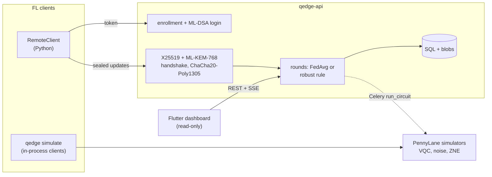

# Q-Edge

[](https://github.com/rasidi3112/Q-Edge/actions/workflows/ci.yml)
[](LICENSE)
[](pyproject.toml)

[English](README.md) | [العربية](README_ar.md) | [Deutsch](README_de.md) | [Español](README_es.md) | [Français](README_fr.md) | [हिन्दी](README_hi.md) | [Bahasa Indonesia](README_id.md) | **Italiano** | [日本語](README_ja.md) | [한국어](README_ko.md) | [Bahasa Melayu](README_ms.md) | [Português](README_pt.md) | [Русский](README_ru.md) | [Türkçe](README_tr.md) | [Tiếng Việt](README_vi.md) | [中文](README_zh.md)

> Questa è una traduzione di [README.md](README.md). In caso di differenze, fa fede la versione inglese.

Q-Edge è un banco di prova di ricerca per il federated learning con modelli
ibridi quantistico-classici e protezione post-quantistica degli aggiornamenti
dei client. Risponde a tre domande con numeri riproducibili:

1. Su dati non IID, una piccola testa a circuito quantistico variazionale
   (VQC) funziona come una testa classica con lo stesso numero di parametri,
   con e senza rumore ed estrapolazione a rumore zero?
2. Quanto costa per round la protezione post-quantistica (ML-KEM-768,
   ML-DSA-65, ibrido X25519 + ML-KEM-768 e aggregazione sicura)?
3. Quanti danni possono fare i client malevoli, quanto aiutano le regole di
   aggregazione robusta e in che modo queste regole entrano in conflitto con
   l'aggregazione sicura?

Anche le risposte negative contano come risultati. Ogni numero qui sotto
proviene da `results/summary/*.json`, che `make reproduce` rigenera;
[`docs/results.md`](docs/results.md) contiene tutte le tabelle e le figure.

## Che cos'è e che cosa non è

È:

- Un simulatore federato (`qedge simulate`) sui dataset breast_cancer e digits
  di scikit-learn con sbilanciamento delle etichette di Dirichlet. Strategie:
  FedAvg, FedProx, FedAdam e FedYogi. Inoltre compressione top-k, attacchi,
  regole robuste e aggregazione sicura. Lo stesso codice client e server gira
  anche come app Flower 1.40 (`flwr run experiments/flower`).
- Modelli ibridi PyTorch con una testa VQC PennyLane, rumore simulato su porte
  e lettura, ZNE tramite folding globale e diagnostica (varianza del
  gradiente, concentrazione del kernel, espressività).
- Un server FastAPI con registrazione dei client da parte di un
  amministratore, login challenge-response ML-DSA, trasporto firmato
  X25519 + ML-KEM-768, round validati, server-sent events e metriche
  Prometheus. Una dashboard Flutter in sola lettura ne mostra lo stato.

Non è:

- Hardware quantistico. Tutti i circuiti girano su simulatori
  (`default.qubit`, `default.mixed`).
- Un'installazione reale. I client sono simulati in un unico processo o sono
  script Python; non c'è addestramento su dispositivi mobili.
- Crittografia verificata da terzi. Il combinatore KEM ibrido, il trasporto e
  il protocollo di aggregazione sicura sono costruzioni proprie di questo
  progetto. Il backend in Python puro non è a tempo costante.
- Una prova di vantaggio quantistico. In questi esperimenti la testa VQC non è
  mai chiaramente migliore della testa classica.

## Architettura



Dettagli: [`docs/architecture.md`](docs/architecture.md); decisioni:
[`docs/decisions/`](docs/decisions/); minacce:
[`docs/threat-model.md`](docs/threat-model.md).

## Avvio rapido

```bash
git clone https://github.com/rasidi3112/Q-Edge.git && cd Q-Edge
python -m venv .venv && source .venv/bin/activate
pip install torch --index-url https://download.pytorch.org/whl/cpu   # optional: CPU-only torch
pip install -e ".[fl,pqc-pure]"

qedge demo                       # one run of each component, about 5 s
qedge simulate --dataset breast_cancer --clients 10 --rounds 30 --alpha 0.5 --strategy fedavg
qedge simulate --model hybrid-vqc --qubits 4 --layers 2 --noise 0.01 --zne richardson
qedge simulate --dataset digits --model mlp --attack scaling --attack-fraction 0.3 --defense multi_krum
qedge simulate --secure-aggregation
```

Ogni esecuzione di `simulate` scrive `results/runs/<run_id>/config.yaml`
(configurazione, partizione dei client, numero di parametri, versioni dei
pacchetti, macchina) e `metrics.jsonl` (una riga per round). `pqc-pure` è un
ML-KEM e ML-DSA in Python puro per fare prove; per tutto il resto compila
liboqs 0.16 e installa `q-edge[pqc]`.

| Extra | Aggiunge |
|---|---|
| `fl` | PyTorch, Flower, scikit-learn, PyYAML: simulatore, modelli ibridi |
| `server` | Server FastAPI, worker Celery, `qedge clients` |
| `pqc` | liboqs-python (richiede la libreria C liboqs) |
| `pqc-pure` | kyber-py e dilithium-py: non a tempo costante, solo per test |
| `report` | matplotlib per `python -m experiments.report` |
| `flower-sim` | Ray, per `flwr run` |
| `postgres` | psycopg, per lo stack compose |
| `dev` | pytest, hypothesis, ruff, mypy, pre-commit |

### Server

```bash
pip install -e ".[server,pqc-pure]"
qedge keys init --dir ./keys --backend pure        # server KEM and ML-DSA keys
qedge clients keygen --out ./admin --backend pure  # admin key pair, stays local
qedge clients add --id admin --scope admin --public-key ./admin/client.pub --backend pure
JWT_SECRET_KEY=$(python -c "import secrets; print(secrets.token_urlsafe(48))") \
  QEDGE_CRYPTO_BACKEND=pure QEDGE_KEY_DIR=./keys qedge-api
```

L'amministratore registra i client e apre i round (`POST /admin/rounds`). Un
client (`qedge.fl.remote.RemoteClient`) accede firmando un nonce, apre una
sessione cifrata e invia un aggiornamento sigillato per round. Il server
aggrega quando sono arrivati `min_clients` aggiornamenti o è scaduto il
termine, usando `QEDGE_AGGREGATION` (`fedavg`, `median`, `trimmed_mean`,
`krum`, `multi_krum` o `bounded`). Senza chiavi o backend crittografico si
rifiuta di avviarsi. Con Docker:

```bash
cp .env.example .env   # set JWT_SECRET_KEY, REDIS_PASSWORD, POSTGRES_PASSWORD
qedge clients keygen --out ./admin
docker compose run --rm api qedge keys init --dir /keys
docker compose run --rm -v "$PWD/admin:/admin:ro" api \
  qedge clients add --id admin --scope admin --public-key /admin/client.pub
docker compose up --build
```

La dashboard: `cd mobile_app && flutter run -d chrome --web-port 3000
--dart-define=QEDGE_API_URL=http://localhost:8000`
([`mobile_app/README.md`](mobile_app/README.md)).

## Risultati

Client simulati sulla CPU di un portatile; media ± deviazione standard sui
seed 0-2. Tabelle complete, figure e configurazioni:
[`docs/results.md`](docs/results.md), `experiments/configs/`.

**RQ1: testa VQC contro testa classica.** 5 client, 15 round, 4 qubit,
2 strati strongly entangling (24 parametri) contro una testa tanh con 20.
Encoder e strato di uscita sono identici.

| Dataset, α | Testa classica | VQC | VQC, p = 0.01 | VQC, p = 0.01, ZNE |
|---|---|---|---|---|
| breast_cancer, 0.1 | 0.968 ± 0.018 | 0.965 ± 0.032 | 0.930 ± 0.092 | 0.965 ± 0.032 |
| breast_cancer, 1.0 | 0.974 ± 0.018 | 0.977 ± 0.018 | 0.974 ± 0.018 | 0.977 ± 0.018 |
| digits, 0.1 | 0.643 ± 0.125 | 0.486 ± 0.093 | 0.496 ± 0.086 | 0.491 ± 0.084 |
| digits, 1.0 | 0.685 ± 0.143 | 0.514 ± 0.061 | 0.485 ± 0.100 | 0.512 ± 0.058 |

La testa VQC eguaglia quella classica su breast_cancer ed è circa 0.16
peggiore su digits. Il rumore depolarizzante con p = 0.01 e la ZNE cambiano
l'accuratezza finale meno della variabilità tra seed; l'effetto maggiore è su
breast_cancer con α = 0.1 (0.965 senza rumore, 0.930 con rumore, 0.965 con
ZNE). La ZNE rende l'addestramento circa 8x più lento. Su circuiti casuali a
4 qubit la ZNE riduce l'errore del valore atteso con p = 0.01 da 0.055 a 0.005
(Richardson) o 0.003 (esponenziale).

**RQ2: costo della protezione post-quantistica** (liboqs 0.16):

- L'handshake del trasporto richiede 0.57 ms e 7 840 byte una volta per
  sessione, più 52 byte per frame di aggiornamento.
- Aggregazione sicura per round e per client, rispetto a un semplice invio
  float32:
  - 10 client, 1 210 parametri: 36.6 KiB inviati invece di 4.7 KiB, 2.6 ms;
    server 3.8 ms.
  - 50 client, 100 000 parametri: 895 KiB invece di 391 KiB, 33 ms;
    server 95 ms.
- L'invio raddoppia perché i valori mascherati occupano 8 byte, e lo scambio
  di chiavi cresce linearmente con il numero di client.

**RQ3: client malevoli** (digits, MLP, 10 client, 30 round, 3 su 10
attaccano):

| Attacco | FedAvg | Mediana | Multi-Krum |
|---|---|---|---|
| nessuno | 0.952 ± 0.003 | 0.931 ± 0.006 | 0.922 ± 0.003 |
| inversione delle etichette | 0.700 ± 0.314 | 0.883 ± 0.032 | 0.938 ± 0.013 |
| scaling (sostituzione del modello) | 0.177 ± 0.094 | 0.908 ± 0.015 | 0.936 ± 0.022 |
| rumore casuale | 0.578 ± 0.065 | 0.933 ± 0.014 | 0.936 ± 0.022 |
| numero di campioni falso | 0.030 ± 0.018 | 0.883 ± 0.032 | 0.938 ± 0.013 |

FedAvg fallisce contro ogni attacco. Multi-Krum resta entro 0.02 dalla propria
accuratezza senza attacchi, ma costa 0.03 in assenza di attaccanti; Krum da
solo costa 0.28 su dati non IID. Nessuna di queste regole può funzionare con
l'aggregazione sicura, che nasconde proprio gli aggiornamenti individuali che
esaminano (ADR 0010). Media troncata, clipping della norma e limiti sui
campioni sono in `docs/results.md`.

## Modello di sicurezza

Protetto: leggere o falsificare gli aggiornamenti in rete, ora o dopo che un
computer quantistico abbia violato X25519 (KEM ibrido, handshake firmato,
frame AEAD, contatori anti-replay); impersonare il server o un client
registrato; aggiornamenti malformati o duplicati; client che avviano
l'aggregazione. Protetto in parte: client malevoli che rispettano il
protocollo, tramite regole robuste. Non protetto: un server curioso fuori dal
simulatore (l'aggregazione sicura non è esposta via HTTP), l'inferenza dal
modello globale (nessun contabile della privacy), il denial of service, i
canali laterali del backend puro e i token rubati prima della scadenza.
Vedi [`docs/threat-model.md`](docs/threat-model.md).

## Limiti

- Due dataset piccoli e facili. Differenze inferiori a circa una deviazione
  standard (fino a 0.14 su digits in RQ1) non si risolvono con 3 seed.
- RQ1 usa 5 client e 15 round per mantenere sostenibili le esecuzioni con
  ZNE, quindi le accuratezze su digits (0.5-0.7) sono molto al di sotto di un
  MLP a 30 round (0.95).
- Il rumore simulato è un canale per porta e per filo: niente crosstalk,
  rumore a riposo o errori coerenti. La backpropagation attraverso
  `default.mixed` fornisce gradienti che l'hardware non può fornire
  (ADR 0009).
- L'aggregazione sicura non gestisce gli abbandoni e gira solo nel processo.
  I costi misurati escludono la latenza di rete.
- Clipping e rumore gaussiano esistono, ma non viene riportato alcun ε perché
  manca un contabile della privacy.
- Le regole robuste presuppongono al massimo il 30 % di attaccanti e non sono
  state provate contro backdoor mirate o attaccanti adattivi.
- L'app Flutter è in sola lettura e non fa crittografia; le build Android e
  iOS non sono state provate.

## Sviluppo

```bash
pip install torch --index-url https://download.pytorch.org/whl/cpu
pip install -e ".[dev,server,pqc-pure,fl,report]"
pre-commit install
make lint             # ruff check, ruff format --check, mypy --strict on src/qedge
make test             # pytest -m "not slow"
pytest -m slow        # Flower end-to-end and a noisy ZNE run (needs flower-sim)
make reproduce        # every experiment and docs/results.md, about 62 minutes
```

`python -m experiments.run_all --skip quantum_head` riesegue tutto tranne la
griglia ZNE in circa 7 minuti. La CI esegue lint e test su Python 3.11-3.13,
un job con liboqs, i test Flutter e le build Docker.

## Struttura

```
src/qedge/
  crypto/     ML-KEM, ML-DSA, hybrid KEM, transport, key files, backends
  fl/         datasets, models, training, strategies, robust rules, attacks,
              compression, privacy, secure aggregation, simulator, Flower apps
  quantum/    circuits, noise, ZNE and readout mitigation, kernels, models,
              diagnostics
  server/     FastAPI app, auth, rounds, storage, metrics, Celery worker
  cli.py      qedge keys | clients | simulate | demo
  demo.py
experiments/  configs/*.yaml, one script per experiment, run_all.py, report.py
bench/        crypto.py, secagg.py
results/      summary/*.json (committed), runs/ (ignored)
docs/         architecture.md, threat-model.md, results.md, figures/, decisions/
mobile_app/   Flutter dashboard
```

## Riferimenti

- McMahan et al., "Communication-Efficient Learning of Deep Networks from
  Decentralized Data", 2017, arXiv:1602.05629 (FedAvg).
- Li et al., "Federated Optimization in Heterogeneous Networks", 2018,
  arXiv:1812.06127 (FedProx).
- Reddi et al., "Adaptive Federated Optimization", 2020, arXiv:2003.00295
  (FedAdam, FedYogi).
- Karimireddy et al., "Error Feedback Fixes SignSGD and other Gradient
  Compression Schemes", 2019, arXiv:1901.09847.
- Yin et al., "Byzantine-Robust Distributed Learning: Towards Optimal
  Statistical Rates", 2018, arXiv:1803.01498 (median, trimmed mean).
- Blanchard et al., "Machine Learning with Adversaries: Byzantine Tolerant
  Gradient Descent", NeurIPS 2017 (Krum).
- Sun et al., "Can You Really Backdoor Federated Learning?", 2019,
  arXiv:1911.07963 (norm clipping).
- Bagdasaryan et al., "How To Backdoor Federated Learning", 2018,
  arXiv:1807.00459 (model replacement).
- Bonawitz et al., "Practical Secure Aggregation for Privacy-Preserving
  Machine Learning", CCS 2017.
- Schuld et al., "Circuit-centric quantum classifiers", 2018,
  arXiv:1804.00633.
- Pérez-Salinas et al., "Data re-uploading for a universal quantum
  classifier", 2020, arXiv:1907.02085.
- Havlíček et al., "Supervised learning with quantum-enhanced feature
  spaces", Nature 2019.
- Temme et al., "Error mitigation for short-depth quantum circuits", 2017,
  arXiv:1612.02058.
- Giurgica-Tiron et al., "Digital zero noise extrapolation for quantum
  error mitigation", 2020, arXiv:2005.10921.
- McClean et al., "Barren plateaus in quantum neural network training
  landscapes", 2018, arXiv:1803.11173.
- Thanasilp et al., "Exponential concentration in quantum kernel methods",
  2022, arXiv:2208.11060.
- Sim et al., "Expressibility and entangling capability of parameterized
  quantum circuits", 2019, arXiv:1905.10876.
- NIST FIPS 203 (ML-KEM) and FIPS 204 (ML-DSA), 2024.

## Licenza

Apache 2.0, vedi [LICENSE](LICENSE). Le modifiche sono elencate in
[CHANGELOG.md](CHANGELOG.md).
