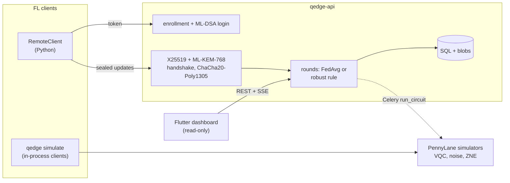

# Q-Edge

[](https://github.com/rasidi3112/Q-Edge/actions/workflows/ci.yml)
[](LICENSE)
[](pyproject.toml)

[English](README.md) | [العربية](README_ar.md) | [Deutsch](README_de.md) | [Español](README_es.md) | [Français](README_fr.md) | [हिन्दी](README_hi.md) | [Bahasa Indonesia](README_id.md) | [Italiano](README_it.md) | **日本語** | [한국어](README_ko.md) | [Bahasa Melayu](README_ms.md) | [Português](README_pt.md) | [Русский](README_ru.md) | [Türkçe](README_tr.md) | [Tiếng Việt](README_vi.md) | [中文](README_zh.md)

> これは [README.md](README.md) の翻訳です。内容が異なる場合は英語版が優先されます。

Q-Edge は、量子・古典ハイブリッドモデルによる連合学習と、クライアント更新の
耐量子保護のための研究用テストベッドです。次の 3 つの問いに、再現可能な数値で
答えます。

1. 非 IID データにおいて、小さな変分量子回路 (VQC) ヘッドは、同じパラメータ数の
   古典ヘッドと同等の性能を出せるか。ノイズの有無、ゼロノイズ外挿の有無で
   比較する。
2. 耐量子保護 (ML-KEM-768、ML-DSA-65、ハイブリッド X25519 + ML-KEM-768、
   セキュアアグリゲーション) のコストはラウンドあたりどれくらいか。
3. 悪意あるクライアントはどれだけ損害を与えられるか、ロバスト集約ルールは
   どれだけ役立つか、そしてそれらのルールはセキュアアグリゲーションとどう
   衝突するか。

否定的な答えも結果として扱います。以下の数値はすべて
`results/summary/*.json` から取っており、`make reproduce` で再生成されます。
表と図の全体は [`docs/results.md`](docs/results.md) にあります。

## これは何か、何ではないか

これは:

- scikit-learn の breast_cancer と digits に Dirichlet ラベル偏りを与えた
  連合学習シミュレータ (`qedge simulate`)。戦略は FedAvg、FedProx、FedAdam、
  FedYogi。さらに top-k 圧縮、攻撃、ロバストルール、セキュアアグリゲーション。
  同じクライアント・サーバのコードは Flower 1.40 アプリとしても動作します
  (`flwr run experiments/flower`)。
- PennyLane の VQC ヘッドを持つ PyTorch ハイブリッドモデル。ゲートと読み出しの
  ノイズのシミュレーション、グローバルフォールディングによる ZNE、診断
  (勾配分散、カーネル集中、表現力) を備えます。
- 管理者によるクライアント登録、ML-DSA のチャレンジ・レスポンス認証、署名付き
  X25519 + ML-KEM-768 トランスポート、検証済みラウンド、server-sent events、
  Prometheus メトリクスを備えた FastAPI サーバ。読み取り専用の Flutter
  ダッシュボードがその状態を表示します。

これは次のものではありません:

- 量子ハードウェア。すべての回路はシミュレータ (`default.qubit`、
  `default.mixed`) 上で動きます。
- 実運用環境。クライアントは 1 プロセス内でシミュレートされるか Python
  スクリプトであり、モバイル端末上での学習はありません。
- 監査済みの暗号。ハイブリッド KEM の結合、トランスポート、セキュア
  アグリゲーションのプロトコルは本プロジェクト独自の構成です。純 Python の
  バックエンドは定数時間ではありません。
- 量子優位性の証拠。これらの実験で VQC ヘッドが古典ヘッドより明確に優れた
  ことは一度もありません。

## アーキテクチャ



詳細: [`docs/architecture.md`](docs/architecture.md)、設計判断:
[`docs/decisions/`](docs/decisions/)、脅威:
[`docs/threat-model.md`](docs/threat-model.md)。

## クイックスタート

```bash
git clone https://github.com/rasidi3112/Q-Edge.git && cd Q-Edge
python -m venv .venv && source .venv/bin/activate
pip install torch --index-url https://download.pytorch.org/whl/cpu   # optional: CPU-only torch
pip install -e ".[fl,pqc-pure]"

qedge demo                       # one run of each component, about 5 s
qedge simulate --dataset breast_cancer --clients 10 --rounds 30 --alpha 0.5 --strategy fedavg
qedge simulate --model hybrid-vqc --qubits 4 --layers 2 --noise 0.01 --zne richardson
qedge simulate --dataset digits --model mlp --attack scaling --attack-fraction 0.3 --defense multi_krum
qedge simulate --secure-aggregation
```

`simulate` を実行するたびに `results/runs/<run_id>/config.yaml` (設定、
クライアント分割、パラメータ数、パッケージのバージョン、マシン) と
`metrics.jsonl` (ラウンドごとに 1 行) が書き出されます。`pqc-pure` は試用向けの
純 Python 版 ML-KEM と ML-DSA です。それ以外の用途では liboqs 0.16 をビルドし、
`q-edge[pqc]` をインストールしてください。

| Extra | 追加されるもの |
|---|---|
| `fl` | PyTorch、Flower、scikit-learn、PyYAML: シミュレータ、ハイブリッドモデル |
| `server` | FastAPI サーバ、Celery ワーカー、`qedge clients` |
| `pqc` | liboqs-python (liboqs の C ライブラリが必要) |
| `pqc-pure` | kyber-py と dilithium-py: 定数時間ではない、テスト専用 |
| `report` | `python -m experiments.report` 用の matplotlib |
| `flower-sim` | `flwr run` 用の Ray |
| `postgres` | compose スタック用の psycopg |
| `dev` | pytest、hypothesis、ruff、mypy、pre-commit |

### サーバ

```bash
pip install -e ".[server,pqc-pure]"
qedge keys init --dir ./keys --backend pure        # server KEM and ML-DSA keys
qedge clients keygen --out ./admin --backend pure  # admin key pair, stays local
qedge clients add --id admin --scope admin --public-key ./admin/client.pub --backend pure
JWT_SECRET_KEY=$(python -c "import secrets; print(secrets.token_urlsafe(48))") \
  QEDGE_CRYPTO_BACKEND=pure QEDGE_KEY_DIR=./keys qedge-api
```

管理者がクライアントを登録し、ラウンドを開きます (`POST /admin/rounds`)。
クライアント (`qedge.fl.remote.RemoteClient`) は nonce に署名してログインし、
暗号化セッションを開いて、ラウンドごとに封印された更新を 1 つ送ります。
サーバは `min_clients` 件の更新が届くか期限が過ぎた時点で、
`QEDGE_AGGREGATION` (`fedavg`、`median`、`trimmed_mean`、`krum`、
`multi_krum`、`bounded`) を使って集約します。鍵や暗号バックエンドがない場合は
起動を拒否します。Docker の場合:

```bash
cp .env.example .env   # set JWT_SECRET_KEY, REDIS_PASSWORD, POSTGRES_PASSWORD
qedge clients keygen --out ./admin
docker compose run --rm api qedge keys init --dir /keys
docker compose run --rm -v "$PWD/admin:/admin:ro" api \
  qedge clients add --id admin --scope admin --public-key /admin/client.pub
docker compose up --build
```

ダッシュボード: `cd mobile_app && flutter run -d chrome --web-port 3000
--dart-define=QEDGE_API_URL=http://localhost:8000`
([`mobile_app/README.md`](mobile_app/README.md))。

## 結果

クライアントはノート PC の CPU 上でシミュレート。seed 0-2 の平均 ± 標準偏差。
表・図・設定の全体: [`docs/results.md`](docs/results.md)、
`experiments/configs/`。

**RQ1: VQC ヘッド対古典ヘッド。** クライアント 5、ラウンド 15、4 量子ビット、
strongly entangling 層 2 つ (パラメータ 24) と、パラメータ 20 の tanh ヘッドを
比較。エンコーダと出力層は同一です。

| データセット, α | 古典ヘッド | VQC | VQC, p = 0.01 | VQC, p = 0.01, ZNE |
|---|---|---|---|---|
| breast_cancer, 0.1 | 0.968 ± 0.018 | 0.965 ± 0.032 | 0.930 ± 0.092 | 0.965 ± 0.032 |
| breast_cancer, 1.0 | 0.974 ± 0.018 | 0.977 ± 0.018 | 0.974 ± 0.018 | 0.977 ± 0.018 |
| digits, 0.1 | 0.643 ± 0.125 | 0.486 ± 0.093 | 0.496 ± 0.086 | 0.491 ± 0.084 |
| digits, 1.0 | 0.685 ± 0.143 | 0.514 ± 0.061 | 0.485 ± 0.100 | 0.512 ± 0.058 |

VQC ヘッドは breast_cancer では古典ヘッドと同等で、digits では約 0.16 劣り
ます。p = 0.01 の脱分極ノイズと ZNE が最終精度に与える変化は seed 間のばらつき
より小さく、最も大きな効果は α = 0.1 の breast_cancer (ノイズなし 0.965、
ノイズあり 0.930、ZNE あり 0.965) です。ZNE により学習は約 8 倍遅くなります。
ランダムな 4 量子ビット回路では、ZNE は p = 0.01 での期待値の誤差を 0.055 から
0.005 (Richardson) または 0.003 (指数) に下げます。

**RQ2: 耐量子保護のコスト** (liboqs 0.16):

- トランスポートのハンドシェイクはセッションごとに 1 回、0.57 ms と
  7 840 バイト。加えて更新フレームごとに 52 バイト。
- ラウンド・クライアントあたりのセキュアアグリゲーション (通常の float32
  アップロードとの比較):
  - クライアント 10、パラメータ 1 210: 4.7 KiB ではなく 36.6 KiB の
    アップロード、2.6 ms。サーバ 3.8 ms。
  - クライアント 50、パラメータ 100 000: 391 KiB ではなく 895 KiB、33 ms。
    サーバ 95 ms。
- マスクされた値が 8 バイトを占めるためアップロードは 2 倍になり、鍵交換は
  クライアント数に比例して増えます。

**RQ3: 悪意あるクライアント** (digits、MLP、クライアント 10、ラウンド 30、
10 中 3 が攻撃):

| 攻撃 | FedAvg | 中央値 | Multi-Krum |
|---|---|---|---|
| なし | 0.952 ± 0.003 | 0.931 ± 0.006 | 0.922 ± 0.003 |
| ラベル反転 | 0.700 ± 0.314 | 0.883 ± 0.032 | 0.938 ± 0.013 |
| スケーリング (モデル置換) | 0.177 ± 0.094 | 0.908 ± 0.015 | 0.936 ± 0.022 |
| ランダムノイズ | 0.578 ± 0.065 | 0.933 ± 0.014 | 0.936 ± 0.022 |
| サンプル数の偽装 | 0.030 ± 0.018 | 0.883 ± 0.032 | 0.938 ± 0.013 |

FedAvg はすべての攻撃に失敗します。Multi-Krum は攻撃なしの自身の精度から
0.02 以内に収まりますが、攻撃者がいないときは 0.03 低下します。Krum 単体は
非 IID データで 0.28 低下します。これらのルールはいずれも、検査対象の個々の
更新を隠すセキュアアグリゲーションの下では動作できません (ADR 0010)。
トリム平均、ノルムクリッピング、サンプル数の上限は `docs/results.md` に
あります。

## セキュリティモデル

保護されるもの: 通信路上での更新の盗聴や偽造 (現在も、量子計算機が X25519 を
破った後も。ハイブリッド KEM、署名付きハンドシェイク、AEAD フレーム、
リプレイカウンタ)、サーバや登録済みクライアントへのなりすまし、不正な形式や
重複した更新、クライアントによる集約のトリガー。一部保護されるもの:
プロトコルに従う悪意あるクライアント (ロバストルールによる)。保護されない
もの: シミュレータ外の好奇心のあるサーバ (セキュアアグリゲーションは HTTP 経由
では提供されない)、グローバルモデルからの推論 (プライバシー会計なし)、
サービス妨害、純 Python バックエンドのサイドチャネル、有効期限前に盗まれた
トークン。[`docs/threat-model.md`](docs/threat-model.md) を参照してください。

## 制限事項

- 小さく簡単なデータセットが 2 つだけ。標準偏差 1 つ程度 (RQ1 の digits で
  最大 0.14) より小さい差は、seed 3 つでは判別できません。
- RQ1 は ZNE の実行を現実的な時間に収めるためにクライアント 5、ラウンド 15
  を使っており、digits の精度 (0.5-0.7) は 30 ラウンドの MLP (0.95) を大きく
  下回ります。
- シミュレートされたノイズはゲートとワイヤごとに 1 チャネルで、クロストーク、
  アイドルノイズ、コヒーレント誤差はありません。`default.mixed` を通した
  誤差逆伝播はハードウェアでは得られない勾配を与えます (ADR 0009)。
- セキュアアグリゲーションには脱落時の回復がなく、プロセス内でのみ動作
  します。測定コストにはネットワーク遅延が含まれません。
- クリッピングとガウスノイズはありますが、プライバシー会計がないため ε は
  報告しません。
- ロバストルールは攻撃者が最大 30 % であることを前提とし、標的型バックドアや
  適応的な攻撃者に対してはテストしていません。
- Flutter アプリは読み取り専用で暗号処理を行いません。Android と iOS の
  ビルドは未テストです。

## 開発

```bash
pip install torch --index-url https://download.pytorch.org/whl/cpu
pip install -e ".[dev,server,pqc-pure,fl,report]"
pre-commit install
make lint             # ruff check, ruff format --check, mypy --strict on src/qedge
make test             # pytest -m "not slow"
pytest -m slow        # Flower end-to-end and a noisy ZNE run (needs flower-sim)
make reproduce        # every experiment and docs/results.md, about 62 minutes
```

`python -m experiments.run_all --skip quantum_head` は ZNE のグリッド以外を
約 7 分で再実行します。CI は Python 3.11-3.13 での lint とテスト、liboqs の
ジョブ、Flutter のテスト、Docker のビルドを実行します。

## 構成

```
src/qedge/
  crypto/     ML-KEM, ML-DSA, hybrid KEM, transport, key files, backends
  fl/         datasets, models, training, strategies, robust rules, attacks,
              compression, privacy, secure aggregation, simulator, Flower apps
  quantum/    circuits, noise, ZNE and readout mitigation, kernels, models,
              diagnostics
  server/     FastAPI app, auth, rounds, storage, metrics, Celery worker
  cli.py      qedge keys | clients | simulate | demo
  demo.py
experiments/  configs/*.yaml, one script per experiment, run_all.py, report.py
bench/        crypto.py, secagg.py
results/      summary/*.json (committed), runs/ (ignored)
docs/         architecture.md, threat-model.md, results.md, figures/, decisions/
mobile_app/   Flutter dashboard
```

## 参考文献

- McMahan et al., "Communication-Efficient Learning of Deep Networks from
  Decentralized Data", 2017, arXiv:1602.05629 (FedAvg).
- Li et al., "Federated Optimization in Heterogeneous Networks", 2018,
  arXiv:1812.06127 (FedProx).
- Reddi et al., "Adaptive Federated Optimization", 2020, arXiv:2003.00295
  (FedAdam, FedYogi).
- Karimireddy et al., "Error Feedback Fixes SignSGD and other Gradient
  Compression Schemes", 2019, arXiv:1901.09847.
- Yin et al., "Byzantine-Robust Distributed Learning: Towards Optimal
  Statistical Rates", 2018, arXiv:1803.01498 (median, trimmed mean).
- Blanchard et al., "Machine Learning with Adversaries: Byzantine Tolerant
  Gradient Descent", NeurIPS 2017 (Krum).
- Sun et al., "Can You Really Backdoor Federated Learning?", 2019,
  arXiv:1911.07963 (norm clipping).
- Bagdasaryan et al., "How To Backdoor Federated Learning", 2018,
  arXiv:1807.00459 (model replacement).
- Bonawitz et al., "Practical Secure Aggregation for Privacy-Preserving
  Machine Learning", CCS 2017.
- Schuld et al., "Circuit-centric quantum classifiers", 2018,
  arXiv:1804.00633.
- Pérez-Salinas et al., "Data re-uploading for a universal quantum
  classifier", 2020, arXiv:1907.02085.
- Havlíček et al., "Supervised learning with quantum-enhanced feature
  spaces", Nature 2019.
- Temme et al., "Error mitigation for short-depth quantum circuits", 2017,
  arXiv:1612.02058.
- Giurgica-Tiron et al., "Digital zero noise extrapolation for quantum
  error mitigation", 2020, arXiv:2005.10921.
- McClean et al., "Barren plateaus in quantum neural network training
  landscapes", 2018, arXiv:1803.11173.
- Thanasilp et al., "Exponential concentration in quantum kernel methods",
  2022, arXiv:2208.11060.
- Sim et al., "Expressibility and entangling capability of parameterized
  quantum circuits", 2019, arXiv:1905.10876.
- NIST FIPS 203 (ML-KEM) and FIPS 204 (ML-DSA), 2024.

## ライセンス

Apache 2.0。[LICENSE](LICENSE) を参照してください。変更履歴は
[CHANGELOG.md](CHANGELOG.md) にあります。
