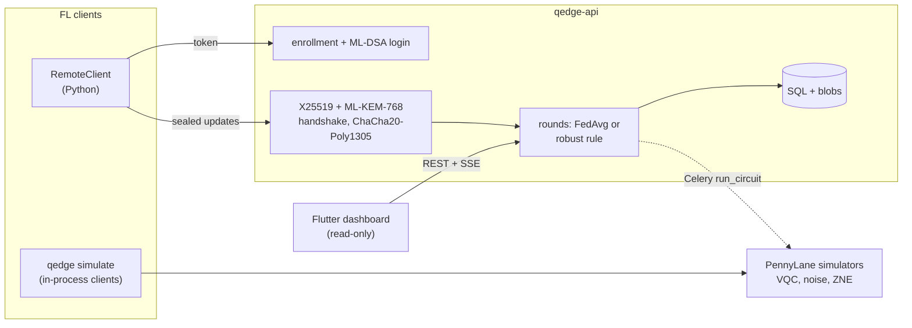

# Q-Edge

[](https://github.com/rasidi3112/Q-Edge/actions/workflows/ci.yml)
[](LICENSE)
[](pyproject.toml)

[English](README.md) | [العربية](README_ar.md) | [Deutsch](README_de.md) | [Español](README_es.md) | [Français](README_fr.md) | [हिन्दी](README_hi.md) | [Bahasa Indonesia](README_id.md) | [Italiano](README_it.md) | [日本語](README_ja.md) | **한국어** | [Bahasa Melayu](README_ms.md) | [Português](README_pt.md) | [Русский](README_ru.md) | [Türkçe](README_tr.md) | [Tiếng Việt](README_vi.md) | [中文](README_zh.md)

> 이 문서는 [README.md](README.md)의 번역본입니다. 내용이 다를 경우 영어판이 우선합니다.

Q-Edge는 양자-고전 하이브리드 모델을 사용하는 연합 학습과 클라이언트 업데이트의
양자내성 보호를 위한 연구용 테스트베드입니다. 세 가지 질문에 재현 가능한
수치로 답합니다.

1. 비 IID 데이터에서 작은 변분 양자 회로(VQC) 헤드는 파라미터 수가 같은 고전
   헤드만큼 성능을 낼까? 노이즈가 있을 때와 없을 때, 제로 노이즈 외삽을
   적용했을 때와 하지 않았을 때를 비교합니다.
2. 양자내성 보호(ML-KEM-768, ML-DSA-65, 하이브리드 X25519 + ML-KEM-768,
   보안 집계)는 라운드당 얼마의 비용이 드는가?
3. 악의적인 클라이언트는 얼마나 큰 피해를 줄 수 있고, 강건 집계 규칙은 얼마나
   도움이 되며, 이 규칙들은 보안 집계와 어떻게 충돌하는가?

부정적인 답도 결과로 인정합니다. 아래의 모든 수치는 `make reproduce`가 다시
만드는 `results/summary/*.json`에서 가져왔으며, 전체 표와 그림은
[`docs/results.md`](docs/results.md)에 있습니다.

## 무엇이고 무엇이 아닌가

이 프로젝트는:

- scikit-learn의 breast_cancer와 digits에 Dirichlet 레이블 편향을 적용한 연합
  학습 시뮬레이터(`qedge simulate`)입니다. 전략: FedAvg, FedProx, FedAdam,
  FedYogi. 그 밖에 top-k 압축, 공격, 강건 규칙, 보안 집계를 제공합니다. 같은
  클라이언트·서버 코드가 Flower 1.40 앱으로도 실행됩니다
  (`flwr run experiments/flower`).
- PennyLane VQC 헤드를 가진 PyTorch 하이브리드 모델입니다. 게이트 및 판독
  노이즈 시뮬레이션, 전역 폴딩을 이용한 ZNE, 진단(기울기 분산, 커널 집중,
  표현력)을 갖추고 있습니다.
- 관리자에 의한 클라이언트 등록, ML-DSA 챌린지-응답 로그인, 서명된
  X25519 + ML-KEM-768 전송, 검증된 라운드, server-sent events, Prometheus
  지표를 갖춘 FastAPI 서버입니다. 읽기 전용 Flutter 대시보드가 상태를
  보여 줍니다.

이 프로젝트는 다음이 아닙니다:

- 양자 하드웨어. 모든 회로는 시뮬레이터(`default.qubit`, `default.mixed`)에서
  실행됩니다.
- 실제 배포. 클라이언트는 하나의 프로세스 안에서 시뮬레이션되거나 Python
  스크립트이며, 모바일 기기에서의 학습은 없습니다.
- 감사를 거친 암호. 하이브리드 KEM 결합 방식, 전송 계층, 보안 집계 프로토콜은
  이 프로젝트 자체의 설계입니다. 순수 Python 백엔드는 상수 시간이 아닙니다.
- 양자 우위의 증거. 이번 실험에서 VQC 헤드가 고전 헤드보다 확실히 나은 경우는
  한 번도 없었습니다.

## 아키텍처



자세한 내용: [`docs/architecture.md`](docs/architecture.md), 설계 결정:
[`docs/decisions/`](docs/decisions/), 위협:
[`docs/threat-model.md`](docs/threat-model.md).

## 빠른 시작

```bash
git clone https://github.com/rasidi3112/Q-Edge.git && cd Q-Edge
python -m venv .venv && source .venv/bin/activate
pip install torch --index-url https://download.pytorch.org/whl/cpu   # optional: CPU-only torch
pip install -e ".[fl,pqc-pure]"

qedge demo                       # one run of each component, about 5 s
qedge simulate --dataset breast_cancer --clients 10 --rounds 30 --alpha 0.5 --strategy fedavg
qedge simulate --model hybrid-vqc --qubits 4 --layers 2 --noise 0.01 --zne richardson
qedge simulate --dataset digits --model mlp --attack scaling --attack-fraction 0.3 --defense multi_krum
qedge simulate --secure-aggregation
```

`simulate`를 실행할 때마다 `results/runs/<run_id>/config.yaml`(설정,
클라이언트 분할, 파라미터 수, 패키지 버전, 머신)과 `metrics.jsonl`(라운드마다
한 줄)이 기록됩니다. `pqc-pure`는 시험용 순수 Python ML-KEM 및 ML-DSA입니다.
그 밖의 용도에는 liboqs 0.16을 빌드하고 `q-edge[pqc]`를 설치하세요.

| Extra | 추가되는 것 |
|---|---|
| `fl` | PyTorch, Flower, scikit-learn, PyYAML: 시뮬레이터, 하이브리드 모델 |
| `server` | FastAPI 서버, Celery 워커, `qedge clients` |
| `pqc` | liboqs-python (liboqs C 라이브러리 필요) |
| `pqc-pure` | kyber-py와 dilithium-py: 상수 시간 아님, 테스트 전용 |
| `report` | `python -m experiments.report`용 matplotlib |
| `flower-sim` | `flwr run`용 Ray |
| `postgres` | compose 스택용 psycopg |
| `dev` | pytest, hypothesis, ruff, mypy, pre-commit |

### 서버

```bash
pip install -e ".[server,pqc-pure]"
qedge keys init --dir ./keys --backend pure        # server KEM and ML-DSA keys
qedge clients keygen --out ./admin --backend pure  # admin key pair, stays local
qedge clients add --id admin --scope admin --public-key ./admin/client.pub --backend pure
JWT_SECRET_KEY=$(python -c "import secrets; print(secrets.token_urlsafe(48))") \
  QEDGE_CRYPTO_BACKEND=pure QEDGE_KEY_DIR=./keys qedge-api
```

관리자가 클라이언트를 등록하고 라운드를 엽니다(`POST /admin/rounds`).
클라이언트(`qedge.fl.remote.RemoteClient`)는 nonce에 서명해 로그인하고,
암호화된 세션을 연 뒤 라운드마다 봉인된 업데이트 하나를 보냅니다. 서버는
`min_clients`개의 업데이트가 도착하거나 마감 시간이 지나면
`QEDGE_AGGREGATION`(`fedavg`, `median`, `trimmed_mean`, `krum`,
`multi_krum`, `bounded`)으로 집계합니다. 키나 암호 백엔드가 없으면 시작을
거부합니다. Docker 사용 시:

```bash
cp .env.example .env   # set JWT_SECRET_KEY, REDIS_PASSWORD, POSTGRES_PASSWORD
qedge clients keygen --out ./admin
docker compose run --rm api qedge keys init --dir /keys
docker compose run --rm -v "$PWD/admin:/admin:ro" api \
  qedge clients add --id admin --scope admin --public-key /admin/client.pub
docker compose up --build
```

대시보드: `cd mobile_app && flutter run -d chrome --web-port 3000
--dart-define=QEDGE_API_URL=http://localhost:8000`
([`mobile_app/README.md`](mobile_app/README.md)).

## 결과

노트북 CPU에서 시뮬레이션한 클라이언트, seed 0-2에 대한 평균 ± 표준편차.
전체 표, 그림, 설정: [`docs/results.md`](docs/results.md),
`experiments/configs/`.

**RQ1: VQC 헤드 대 고전 헤드.** 클라이언트 5, 라운드 15, 큐비트 4,
strongly entangling 층 2개(파라미터 24)를 파라미터 20의 tanh 헤드와
비교합니다. 인코더와 출력층은 동일합니다.

| 데이터셋, α | 고전 헤드 | VQC | VQC, p = 0.01 | VQC, p = 0.01, ZNE |
|---|---|---|---|---|
| breast_cancer, 0.1 | 0.968 ± 0.018 | 0.965 ± 0.032 | 0.930 ± 0.092 | 0.965 ± 0.032 |
| breast_cancer, 1.0 | 0.974 ± 0.018 | 0.977 ± 0.018 | 0.974 ± 0.018 | 0.977 ± 0.018 |
| digits, 0.1 | 0.643 ± 0.125 | 0.486 ± 0.093 | 0.496 ± 0.086 | 0.491 ± 0.084 |
| digits, 1.0 | 0.685 ± 0.143 | 0.514 ± 0.061 | 0.485 ± 0.100 | 0.512 ± 0.058 |

VQC 헤드는 breast_cancer에서 고전 헤드와 비슷하고 digits에서는 약 0.16
낮습니다. p = 0.01 탈분극 노이즈와 ZNE가 최종 정확도를 바꾸는 폭은 seed 간
편차보다 작으며, 가장 큰 효과는 α = 0.1의 breast_cancer(노이즈 없음 0.965,
노이즈 있음 0.930, ZNE 적용 0.965)에서 나타납니다. ZNE는 학습을 약 8배
느리게 만듭니다. 무작위 4큐비트 회로에서 ZNE는 p = 0.01의 기댓값 오차를
0.055에서 0.005(Richardson) 또는 0.003(지수)으로 줄입니다.

**RQ2: 양자내성 보호의 비용** (liboqs 0.16):

- 전송 핸드셰이크는 세션당 한 번, 0.57 ms와 7 840 바이트가 들며 업데이트
  프레임마다 52 바이트가 추가됩니다.
- 라운드·클라이언트당 보안 집계 비용(일반 float32 업로드와 비교):
  - 클라이언트 10, 파라미터 1 210: 4.7 KiB 대신 36.6 KiB 업로드, 2.6 ms;
    서버 3.8 ms.
  - 클라이언트 50, 파라미터 100 000: 391 KiB 대신 895 KiB, 33 ms;
    서버 95 ms.
- 마스킹된 값이 8 바이트를 차지하므로 업로드가 두 배가 되며, 키 교환은
  클라이언트 수에 비례해 늘어납니다.

**RQ3: 악의적인 클라이언트** (digits, MLP, 클라이언트 10, 라운드 30, 10명 중
3명이 공격):

| 공격 | FedAvg | 중앙값 | Multi-Krum |
|---|---|---|---|
| 없음 | 0.952 ± 0.003 | 0.931 ± 0.006 | 0.922 ± 0.003 |
| 레이블 뒤집기 | 0.700 ± 0.314 | 0.883 ± 0.032 | 0.938 ± 0.013 |
| 스케일링(모델 교체) | 0.177 ± 0.094 | 0.908 ± 0.015 | 0.936 ± 0.022 |
| 무작위 노이즈 | 0.578 ± 0.065 | 0.933 ± 0.014 | 0.936 ± 0.022 |
| 샘플 수 위조 | 0.030 ± 0.018 | 0.883 ± 0.032 | 0.938 ± 0.013 |

FedAvg는 모든 공격에 실패합니다. Multi-Krum은 공격이 없을 때 자신의 정확도에서
0.02 이내를 유지하지만, 공격자가 없을 때 0.03의 손실이 있습니다. Krum만
쓰면 비 IID 데이터에서 0.28 손실이 납니다. 이 규칙들은 모두 검사 대상인 개별
업데이트를 숨기는 보안 집계 아래에서는 동작할 수 없습니다(ADR 0010). 절사
평균, 노름 클리핑, 샘플 수 상한은 `docs/results.md`에 있습니다.

## 보안 모델

보호되는 것: 현재 또는 양자 컴퓨터가 X25519를 깬 이후의 통신 중 업데이트
도청·위조(하이브리드 KEM, 서명된 핸드셰이크, AEAD 프레임, 재전송 카운터),
서버나 등록된 클라이언트로의 위장, 잘못된 형식이거나 중복된 업데이트,
클라이언트에 의한 집계 개시. 부분적으로 보호되는 것: 프로토콜을 따르는
악의적 클라이언트(강건 규칙을 통해). 보호되지 않는 것: 시뮬레이터 밖의
호기심 많은 서버(보안 집계는 HTTP로 제공되지 않음), 전역 모델로부터의
추론(프라이버시 회계 없음), 서비스 거부, 순수 백엔드의 부채널, 만료 전에
탈취된 토큰. [`docs/threat-model.md`](docs/threat-model.md)를 참고하세요.

## 한계

- 작고 쉬운 데이터셋 두 개뿐입니다. 표준편차 하나 정도(RQ1 digits에서 최대
  0.14)보다 작은 차이는 seed 3개로는 판별할 수 없습니다.
- RQ1은 ZNE 실행 시간을 감당할 수 있도록 클라이언트 5, 라운드 15를 쓰므로
  digits 정확도(0.5-0.7)는 30라운드 MLP(0.95)보다 훨씬 낮습니다.
- 시뮬레이션 노이즈는 게이트와 와이어마다 채널 하나이며, 크로스토크, 유휴
  노이즈, 코히어런트 오류가 없습니다. `default.mixed`를 통한 역전파는
  하드웨어로는 얻을 수 없는 기울기를 줍니다(ADR 0009).
- 보안 집계에는 이탈 복구가 없고 프로세스 내부에서만 실행됩니다. 측정된
  비용에는 네트워크 지연이 포함되지 않습니다.
- 클리핑과 가우시안 노이즈는 있지만 프라이버시 회계가 없어 ε는 보고하지
  않습니다.
- 강건 규칙은 공격자가 최대 30 %라고 가정하며, 표적형 백도어나 적응형
  공격자에 대해서는 테스트하지 않았습니다.
- Flutter 앱은 읽기 전용이며 암호 처리를 하지 않습니다. Android와 iOS
  빌드는 테스트하지 않았습니다.

## 개발

```bash
pip install torch --index-url https://download.pytorch.org/whl/cpu
pip install -e ".[dev,server,pqc-pure,fl,report]"
pre-commit install
make lint             # ruff check, ruff format --check, mypy --strict on src/qedge
make test             # pytest -m "not slow"
pytest -m slow        # Flower end-to-end and a noisy ZNE run (needs flower-sim)
make reproduce        # every experiment and docs/results.md, about 62 minutes
```

`python -m experiments.run_all --skip quantum_head`는 ZNE 그리드를 제외한
모든 것을 약 7분 만에 다시 실행합니다. CI는 Python 3.11-3.13에서 lint와
테스트, liboqs 작업, Flutter 테스트, Docker 빌드를 실행합니다.

## 구조

```
src/qedge/
  crypto/     ML-KEM, ML-DSA, hybrid KEM, transport, key files, backends
  fl/         datasets, models, training, strategies, robust rules, attacks,
              compression, privacy, secure aggregation, simulator, Flower apps
  quantum/    circuits, noise, ZNE and readout mitigation, kernels, models,
              diagnostics
  server/     FastAPI app, auth, rounds, storage, metrics, Celery worker
  cli.py      qedge keys | clients | simulate | demo
  demo.py
experiments/  configs/*.yaml, one script per experiment, run_all.py, report.py
bench/        crypto.py, secagg.py
results/      summary/*.json (committed), runs/ (ignored)
docs/         architecture.md, threat-model.md, results.md, figures/, decisions/
mobile_app/   Flutter dashboard
```

## 참고 문헌

- McMahan et al., "Communication-Efficient Learning of Deep Networks from
  Decentralized Data", 2017, arXiv:1602.05629 (FedAvg).
- Li et al., "Federated Optimization in Heterogeneous Networks", 2018,
  arXiv:1812.06127 (FedProx).
- Reddi et al., "Adaptive Federated Optimization", 2020, arXiv:2003.00295
  (FedAdam, FedYogi).
- Karimireddy et al., "Error Feedback Fixes SignSGD and other Gradient
  Compression Schemes", 2019, arXiv:1901.09847.
- Yin et al., "Byzantine-Robust Distributed Learning: Towards Optimal
  Statistical Rates", 2018, arXiv:1803.01498 (median, trimmed mean).
- Blanchard et al., "Machine Learning with Adversaries: Byzantine Tolerant
  Gradient Descent", NeurIPS 2017 (Krum).
- Sun et al., "Can You Really Backdoor Federated Learning?", 2019,
  arXiv:1911.07963 (norm clipping).
- Bagdasaryan et al., "How To Backdoor Federated Learning", 2018,
  arXiv:1807.00459 (model replacement).
- Bonawitz et al., "Practical Secure Aggregation for Privacy-Preserving
  Machine Learning", CCS 2017.
- Schuld et al., "Circuit-centric quantum classifiers", 2018,
  arXiv:1804.00633.
- Pérez-Salinas et al., "Data re-uploading for a universal quantum
  classifier", 2020, arXiv:1907.02085.
- Havlíček et al., "Supervised learning with quantum-enhanced feature
  spaces", Nature 2019.
- Temme et al., "Error mitigation for short-depth quantum circuits", 2017,
  arXiv:1612.02058.
- Giurgica-Tiron et al., "Digital zero noise extrapolation for quantum
  error mitigation", 2020, arXiv:2005.10921.
- McClean et al., "Barren plateaus in quantum neural network training
  landscapes", 2018, arXiv:1803.11173.
- Thanasilp et al., "Exponential concentration in quantum kernel methods",
  2022, arXiv:2208.11060.
- Sim et al., "Expressibility and entangling capability of parameterized
  quantum circuits", 2019, arXiv:1905.10876.
- NIST FIPS 203 (ML-KEM) and FIPS 204 (ML-DSA), 2024.

## 라이선스

Apache 2.0, [LICENSE](LICENSE)를 참고하세요. 변경 사항은
[CHANGELOG.md](CHANGELOG.md)에 있습니다.
