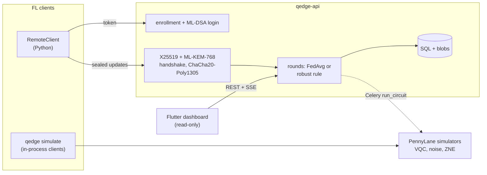

# Q-Edge

[](https://github.com/rasidi3112/Q-Edge/actions/workflows/ci.yml)
[](LICENSE)
[](pyproject.toml)

[English](README.md) | [العربية](README_ar.md) | [Deutsch](README_de.md) | [Español](README_es.md) | [Français](README_fr.md) | [हिन्दी](README_hi.md) | [Bahasa Indonesia](README_id.md) | [Italiano](README_it.md) | [日本語](README_ja.md) | [한국어](README_ko.md) | **Bahasa Melayu** | [Português](README_pt.md) | [Русский](README_ru.md) | [Türkçe](README_tr.md) | [Tiếng Việt](README_vi.md) | [中文](README_zh.md)

> Ini ialah terjemahan [README.md](README.md). Jika terdapat percanggahan, versi bahasa Inggeris yang terpakai.

Q-Edge ialah testbed penyelidikan untuk federated learning dengan model hibrid
kuantum-klasik dan perlindungan pasca-kuantum bagi kemas kini daripada klien.
Projek ini menjawab tiga soalan dengan angka yang boleh dihasilkan semula:

1. Pada data bukan-IID, adakah head variational quantum circuit (VQC) yang
   kecil setanding dengan head klasik yang mempunyai bilangan parameter yang
   sama, dengan dan tanpa hingar serta zero-noise extrapolation?
2. Berapakah kos perlindungan pasca-kuantum (ML-KEM-768, ML-DSA-65, hibrid
   X25519 + ML-KEM-768 dan secure aggregation) bagi setiap pusingan?
3. Sejauh mana kerosakan yang boleh dilakukan oleh klien berniat jahat,
   sejauh mana peraturan robust aggregation membantu, dan bagaimana
   peraturan itu bercanggah dengan secure aggregation?

Jawapan negatif juga dikira sebagai keputusan. Setiap angka di bawah datang
daripada `results/summary/*.json`, yang dijana semula oleh `make reproduce`;
[`docs/results.md`](docs/results.md) mengandungi jadual dan rajah penuh.

## Apa projek ini dan apa yang bukan

Projek ini ialah:

- Simulator federated (`qedge simulate`) pada set data breast_cancer dan
  digits daripada scikit-learn dengan label skew Dirichlet. Strategi:
  FedAvg, FedProx, FedAdam dan FedYogi. Juga pemampatan top-k, serangan,
  peraturan robust dan secure aggregation. Kod klien dan pelayan yang sama
  turut berjalan sebagai aplikasi Flower 1.40 (`flwr run experiments/flower`).
- Model hibrid PyTorch dengan head VQC PennyLane, hingar gate dan readout
  yang disimulasikan, ZNE melalui global folding, serta diagnostik (varians
  kecerunan, penumpuan kernel, expressibility).
- Pelayan FastAPI dengan pendaftaran oleh pentadbir, log masuk
  challenge-response ML-DSA, transport X25519 + ML-KEM-768 yang
  ditandatangani, pusingan yang disahkan, server-sent events dan metrik
  Prometheus. Papan pemuka Flutter baca-sahaja memaparkan keadaannya.

Projek ini bukan:

- Perkakasan kuantum. Semua litar berjalan pada simulator (`default.qubit`,
  `default.mixed`).
- Pelaksanaan sebenar. Klien disimulasikan dalam satu proses atau berupa
  skrip Python; tiada latihan pada peranti mudah alih.
- Kriptografi yang telah diaudit. Penggabung KEM hibrid, transport dan
  protokol secure aggregation ialah binaan projek ini sendiri. Backend
  pure-Python tidak constant-time.
- Bukti kelebihan kuantum. Dalam eksperimen ini head VQC tidak pernah jelas
  lebih baik daripada head klasik.

## Seni bina



Butiran: [`docs/architecture.md`](docs/architecture.md); keputusan reka
bentuk: [`docs/decisions/`](docs/decisions/); ancaman:
[`docs/threat-model.md`](docs/threat-model.md).

## Mula pantas

```bash
git clone https://github.com/rasidi3112/Q-Edge.git && cd Q-Edge
python -m venv .venv && source .venv/bin/activate
pip install torch --index-url https://download.pytorch.org/whl/cpu   # optional: CPU-only torch
pip install -e ".[fl,pqc-pure]"

qedge demo                       # one run of each component, about 5 s
qedge simulate --dataset breast_cancer --clients 10 --rounds 30 --alpha 0.5 --strategy fedavg
qedge simulate --model hybrid-vqc --qubits 4 --layers 2 --noise 0.01 --zne richardson
qedge simulate --dataset digits --model mlp --attack scaling --attack-fraction 0.3 --defense multi_krum
qedge simulate --secure-aggregation
```

Setiap larian `simulate` menulis `results/runs/<run_id>/config.yaml`
(konfigurasi, pembahagian klien, bilangan parameter, versi pakej, mesin) dan
`metrics.jsonl` (satu baris bagi setiap pusingan). `pqc-pure` ialah ML-KEM dan
ML-DSA pure-Python untuk mencuba; untuk kegunaan lain, bina liboqs 0.16 dan
pasang `q-edge[pqc]`.

| Extra | Menambah |
|---|---|
| `fl` | PyTorch, Flower, scikit-learn, PyYAML: simulator, model hibrid |
| `server` | Pelayan FastAPI, worker Celery, `qedge clients` |
| `pqc` | liboqs-python (memerlukan pustaka C liboqs) |
| `pqc-pure` | kyber-py dan dilithium-py: tidak constant-time, untuk ujian sahaja |
| `report` | matplotlib untuk `python -m experiments.report` |
| `flower-sim` | Ray, untuk `flwr run` |
| `postgres` | psycopg, untuk stack compose |
| `dev` | pytest, hypothesis, ruff, mypy, pre-commit |

### Pelayan

```bash
pip install -e ".[server,pqc-pure]"
qedge keys init --dir ./keys --backend pure        # server KEM and ML-DSA keys
qedge clients keygen --out ./admin --backend pure  # admin key pair, stays local
qedge clients add --id admin --scope admin --public-key ./admin/client.pub --backend pure
JWT_SECRET_KEY=$(python -c "import secrets; print(secrets.token_urlsafe(48))") \
  QEDGE_CRYPTO_BACKEND=pure QEDGE_KEY_DIR=./keys qedge-api
```

Pentadbir mendaftarkan klien dan membuka pusingan (`POST /admin/rounds`).
Klien (`qedge.fl.remote.RemoteClient`) log masuk dengan menandatangani nonce,
membuka sesi yang disulitkan dan menghantar satu kemas kini termeterai bagi
setiap pusingan. Pelayan membuat agregasi apabila `min_clients` kemas kini
telah diterima atau tarikh akhir berlalu, menggunakan `QEDGE_AGGREGATION`
(`fedavg`, `median`, `trimmed_mean`, `krum`, `multi_krum` atau `bounded`).
Tanpa kunci atau backend kripto, pelayan enggan bermula. Dengan Docker:

```bash
cp .env.example .env   # set JWT_SECRET_KEY, REDIS_PASSWORD, POSTGRES_PASSWORD
qedge clients keygen --out ./admin
docker compose run --rm api qedge keys init --dir /keys
docker compose run --rm -v "$PWD/admin:/admin:ro" api \
  qedge clients add --id admin --scope admin --public-key /admin/client.pub
docker compose up --build
```

Papan pemuka: `cd mobile_app && flutter run -d chrome --web-port 3000
--dart-define=QEDGE_API_URL=http://localhost:8000`
([`mobile_app/README.md`](mobile_app/README.md)).

## Keputusan

Klien disimulasikan pada CPU komputer riba; purata ± sisihan piawai bagi seed
0-2. Jadual penuh, rajah dan konfigurasi: [`docs/results.md`](docs/results.md),
`experiments/configs/`.

**RQ1: head VQC lawan head klasik.** 5 klien, 15 pusingan, 4 qubit, 2 lapisan
strongly entangling (24 parameter) berbanding head tanh dengan 20 parameter.
Encoder dan readout adalah sama.

| Set data, α | Head klasik | VQC | VQC, p = 0.01 | VQC, p = 0.01, ZNE |
|---|---|---|---|---|
| breast_cancer, 0.1 | 0.968 ± 0.018 | 0.965 ± 0.032 | 0.930 ± 0.092 | 0.965 ± 0.032 |
| breast_cancer, 1.0 | 0.974 ± 0.018 | 0.977 ± 0.018 | 0.974 ± 0.018 | 0.977 ± 0.018 |
| digits, 0.1 | 0.643 ± 0.125 | 0.486 ± 0.093 | 0.496 ± 0.086 | 0.491 ± 0.084 |
| digits, 1.0 | 0.685 ± 0.143 | 0.514 ± 0.061 | 0.485 ± 0.100 | 0.512 ± 0.058 |

Head VQC setanding dengan head klasik pada breast_cancer dan kira-kira 0.16
lebih rendah pada digits. Hingar depolarizing p = 0.01 dan ZNE mengubah
ketepatan akhir kurang daripada serakan antara seed; kesan terbesar ialah pada
breast_cancer dengan α = 0.1 (0.965 tanpa hingar, 0.930 dengan hingar, 0.965
dengan ZNE). ZNE menjadikan latihan kira-kira 8x lebih perlahan. Pada litar
4 qubit rawak, ZNE mengurangkan ralat nilai jangkaan pada p = 0.01 daripada
0.055 kepada 0.005 (Richardson) atau 0.003 (eksponen).

**RQ2: kos perlindungan pasca-kuantum** (liboqs 0.16):

- Handshake transport mengambil 0.57 ms dan 7 840 bait sekali bagi setiap
  sesi, ditambah 52 bait bagi setiap bingkai kemas kini.
- Secure aggregation bagi setiap pusingan, bagi setiap klien, berbanding muat
  naik float32 biasa:
  - 10 klien, 1 210 parameter: 36.6 KiB naik dan bukannya 4.7 KiB, 2.6 ms;
    pelayan 3.8 ms.
  - 50 klien, 100 000 parameter: 895 KiB dan bukannya 391 KiB, 33 ms;
    pelayan 95 ms.
- Muat naik menjadi dua kali ganda kerana nilai yang ditopeng memerlukan 8
  bait, dan pertukaran kunci bertambah secara linear dengan bilangan klien.

**RQ3: klien berniat jahat** (digits, MLP, 10 klien, 30 pusingan, 3 daripada
10 menyerang):

| Serangan | FedAvg | Median | Multi-Krum |
|---|---|---|---|
| tiada | 0.952 ± 0.003 | 0.931 ± 0.006 | 0.922 ± 0.003 |
| label flip | 0.700 ± 0.314 | 0.883 ± 0.032 | 0.938 ± 0.013 |
| scaling (model replacement) | 0.177 ± 0.094 | 0.908 ± 0.015 | 0.936 ± 0.022 |
| hingar rawak | 0.578 ± 0.065 | 0.933 ± 0.014 | 0.936 ± 0.022 |
| bilangan sampel palsu | 0.030 ± 0.018 | 0.883 ± 0.032 | 0.938 ± 0.013 |

FedAvg gagal menghadapi setiap serangan. Multi-Krum kekal dalam lingkungan 0.02
daripada ketepatan bersihnya sendiri tetapi kehilangan 0.03 tanpa penyerang;
Krum sahaja kehilangan 0.28 pada data bukan-IID. Tiada satu pun peraturan ini
boleh berjalan di bawah secure aggregation, kerana secure aggregation
menyembunyikan kemas kini individu yang diperiksa oleh peraturan tersebut
(ADR 0010). Trimmed mean, norm clipping dan had sampel terdapat dalam
`docs/results.md`.

## Model keselamatan

Dilindungi: membaca atau memalsukan kemas kini dalam rangkaian, sekarang atau
selepas X25519 dipecahkan oleh komputer kuantum (KEM hibrid, handshake
bertandatangan, bingkai AEAD, pembilang replay); menyamar sebagai pelayan atau
klien berdaftar; kemas kini yang rosak atau berganda; klien yang mencetuskan
agregasi. Dilindungi separa: klien berniat jahat yang mematuhi protokol,
melalui peraturan robust. Tidak dilindungi: pelayan yang ingin tahu di luar
simulator (secure aggregation tidak tersedia melalui HTTP), inferens daripada
model global (tiada privacy accountant), denial of service, saluran sisi pada
backend pure, dan token yang dicuri sebelum tamat tempoh. Lihat
[`docs/threat-model.md`](docs/threat-model.md).

## Batasan

- Dua set data yang kecil dan mudah. Perbezaan di bawah kira-kira satu
  sisihan piawai (sehingga 0.14 pada digits dalam RQ1) tidak dapat
  disimpulkan dengan 3 seed.
- RQ1 menggunakan 5 klien dan 15 pusingan supaya larian ZNE kekal mampu
  dijalankan, jadi ketepatan digits (0.5-0.7) jauh di bawah MLP 30 pusingan
  (0.95).
- Hingar simulasi ialah satu saluran bagi setiap gate dan wire: tiada
  crosstalk, idle noise atau ralat koheren. Backpropagation melalui
  `default.mixed` memberikan kecerunan yang tidak boleh diperoleh oleh
  perkakasan (ADR 0009).
- Secure aggregation tiada pemulihan dropout dan hanya berjalan in-process.
  Kos yang diukur tidak termasuk kependaman rangkaian.
- Clipping dan hingar Gaussian wujud, tetapi tiada ε dilaporkan kerana belum
  ada privacy accountant.
- Peraturan robust menganggap paling banyak 30% penyerang dan belum diuji
  terhadap backdoor bersasar atau penyerang adaptif.
- Aplikasi Flutter adalah baca-sahaja dan tidak melakukan kriptografi; binaan
  Android dan iOS belum diuji.

## Pembangunan

```bash
pip install torch --index-url https://download.pytorch.org/whl/cpu
pip install -e ".[dev,server,pqc-pure,fl,report]"
pre-commit install
make lint             # ruff check, ruff format --check, mypy --strict on src/qedge
make test             # pytest -m "not slow"
pytest -m slow        # Flower end-to-end and a noisy ZNE run (needs flower-sim)
make reproduce        # every experiment and docs/results.md, about 62 minutes
```

`python -m experiments.run_all --skip quantum_head` menjalankan semula
semuanya kecuali grid ZNE dalam kira-kira 7 minit. CI menjalankan lint dan
ujian pada Python 3.11-3.13, kerja liboqs, ujian Flutter dan binaan Docker.

## Struktur

```
src/qedge/
  crypto/     ML-KEM, ML-DSA, hybrid KEM, transport, key files, backends
  fl/         datasets, models, training, strategies, robust rules, attacks,
              compression, privacy, secure aggregation, simulator, Flower apps
  quantum/    circuits, noise, ZNE and readout mitigation, kernels, models,
              diagnostics
  server/     FastAPI app, auth, rounds, storage, metrics, Celery worker
  cli.py      qedge keys | clients | simulate | demo
  demo.py
experiments/  configs/*.yaml, one script per experiment, run_all.py, report.py
bench/        crypto.py, secagg.py
results/      summary/*.json (committed), runs/ (ignored)
docs/         architecture.md, threat-model.md, results.md, figures/, decisions/
mobile_app/   Flutter dashboard
```

## Rujukan

- McMahan et al., "Communication-Efficient Learning of Deep Networks from
  Decentralized Data", 2017, arXiv:1602.05629 (FedAvg).
- Li et al., "Federated Optimization in Heterogeneous Networks", 2018,
  arXiv:1812.06127 (FedProx).
- Reddi et al., "Adaptive Federated Optimization", 2020, arXiv:2003.00295
  (FedAdam, FedYogi).
- Karimireddy et al., "Error Feedback Fixes SignSGD and other Gradient
  Compression Schemes", 2019, arXiv:1901.09847.
- Yin et al., "Byzantine-Robust Distributed Learning: Towards Optimal
  Statistical Rates", 2018, arXiv:1803.01498 (median, trimmed mean).
- Blanchard et al., "Machine Learning with Adversaries: Byzantine Tolerant
  Gradient Descent", NeurIPS 2017 (Krum).
- Sun et al., "Can You Really Backdoor Federated Learning?", 2019,
  arXiv:1911.07963 (norm clipping).
- Bagdasaryan et al., "How To Backdoor Federated Learning", 2018,
  arXiv:1807.00459 (model replacement).
- Bonawitz et al., "Practical Secure Aggregation for Privacy-Preserving
  Machine Learning", CCS 2017.
- Schuld et al., "Circuit-centric quantum classifiers", 2018,
  arXiv:1804.00633.
- Pérez-Salinas et al., "Data re-uploading for a universal quantum
  classifier", 2020, arXiv:1907.02085.
- Havlíček et al., "Supervised learning with quantum-enhanced feature
  spaces", Nature 2019.
- Temme et al., "Error mitigation for short-depth quantum circuits", 2017,
  arXiv:1612.02058.
- Giurgica-Tiron et al., "Digital zero noise extrapolation for quantum
  error mitigation", 2020, arXiv:2005.10921.
- McClean et al., "Barren plateaus in quantum neural network training
  landscapes", 2018, arXiv:1803.11173.
- Thanasilp et al., "Exponential concentration in quantum kernel methods",
  2022, arXiv:2208.11060.
- Sim et al., "Expressibility and entangling capability of parameterized
  quantum circuits", 2019, arXiv:1905.10876.
- NIST FIPS 203 (ML-KEM) and FIPS 204 (ML-DSA), 2024.

## Lesen

Apache 2.0, lihat [LICENSE](LICENSE). Perubahan disenaraikan dalam
[CHANGELOG.md](CHANGELOG.md).
