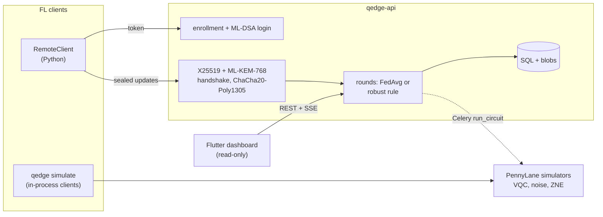

# Q-Edge

[](https://github.com/rasidi3112/Q-Edge/actions/workflows/ci.yml)
[](LICENSE)
[](pyproject.toml)

[English](README.md) | [العربية](README_ar.md) | [Deutsch](README_de.md) | [Español](README_es.md) | [Français](README_fr.md) | [हिन्दी](README_hi.md) | [Bahasa Indonesia](README_id.md) | [Italiano](README_it.md) | [日本語](README_ja.md) | [한국어](README_ko.md) | [Bahasa Melayu](README_ms.md) | **Português** | [Русский](README_ru.md) | [Türkçe](README_tr.md) | [Tiếng Việt](README_vi.md) | [中文](README_zh.md)

> Esta é uma tradução de [README.md](README.md). Em caso de divergência, vale a versão em inglês.

Q-Edge é um ambiente de testes de pesquisa para aprendizado federado com
modelos híbridos quântico-clássicos e proteção pós-quântica das atualizações
dos clientes. Ele responde a três perguntas com números reproduzíveis:

1. Em dados não IID, uma pequena cabeça de circuito quântico variacional (VQC)
   se sai tão bem quanto uma cabeça clássica com o mesmo número de parâmetros,
   com e sem ruído e extrapolação para ruído zero?
2. Quanto custa por rodada a proteção pós-quântica (ML-KEM-768, ML-DSA-65,
   híbrido X25519 + ML-KEM-768 e agregação segura)?
3. Quanto dano clientes maliciosos podem causar, quanto as regras de agregação
   robusta ajudam e como essas regras entram em conflito com a agregação
   segura?

Respostas negativas contam como resultados. Cada número abaixo vem de
`results/summary/*.json`, que `make reproduce` regenera;
[`docs/results.md`](docs/results.md) traz todas as tabelas e figuras.

## O que é e o que não é

É:

- Um simulador federado (`qedge simulate`) sobre os conjuntos breast_cancer e
  digits do scikit-learn com desequilíbrio de rótulos de Dirichlet.
  Estratégias: FedAvg, FedProx, FedAdam e FedYogi. Também compressão top-k,
  ataques, regras robustas e agregação segura. O mesmo código de cliente e
  servidor roda como apps do Flower 1.40 (`flwr run experiments/flower`).
- Modelos híbridos em PyTorch com uma cabeça VQC do PennyLane, ruído simulado
  de portas e de leitura, ZNE por dobramento global e diagnósticos (variância
  do gradiente, concentração do kernel, expressividade).
- Um servidor FastAPI com cadastro de clientes por um administrador, login
  desafio-resposta com ML-DSA, transporte assinado X25519 + ML-KEM-768,
  rodadas validadas, server-sent events e métricas do Prometheus. Um painel
  Flutter somente leitura mostra o seu estado.

Não é:

- Hardware quântico. Todos os circuitos rodam em simuladores
  (`default.qubit`, `default.mixed`).
- Uma implantação real. Os clientes são simulados em um processo ou são
  scripts Python; não há treinamento em dispositivos móveis.
- Criptografia auditada. O combinador KEM híbrido, o transporte e o protocolo
  de agregação segura são construções próprias deste projeto. O backend em
  Python puro não é de tempo constante.
- Evidência de vantagem quântica. Nestes experimentos a cabeça VQC nunca é
  claramente melhor que a cabeça clássica.

## Arquitetura



Detalhes: [`docs/architecture.md`](docs/architecture.md); decisões:
[`docs/decisions/`](docs/decisions/); ameaças:
[`docs/threat-model.md`](docs/threat-model.md).

## Início rápido

```bash
git clone https://github.com/rasidi3112/Q-Edge.git && cd Q-Edge
python -m venv .venv && source .venv/bin/activate
pip install torch --index-url https://download.pytorch.org/whl/cpu   # optional: CPU-only torch
pip install -e ".[fl,pqc-pure]"

qedge demo                       # one run of each component, about 5 s
qedge simulate --dataset breast_cancer --clients 10 --rounds 30 --alpha 0.5 --strategy fedavg
qedge simulate --model hybrid-vqc --qubits 4 --layers 2 --noise 0.01 --zne richardson
qedge simulate --dataset digits --model mlp --attack scaling --attack-fraction 0.3 --defense multi_krum
qedge simulate --secure-aggregation
```

Cada execução de `simulate` grava `results/runs/<run_id>/config.yaml`
(configuração, partição dos clientes, número de parâmetros, versões dos
pacotes, máquina) e `metrics.jsonl` (uma linha por rodada). `pqc-pure` é um
ML-KEM e ML-DSA em Python puro para experimentar; para todo o resto, compile a
liboqs 0.16 e instale `q-edge[pqc]`.

| Extra | Adiciona |
|---|---|
| `fl` | PyTorch, Flower, scikit-learn, PyYAML: simulador, modelos híbridos |
| `server` | Servidor FastAPI, worker do Celery, `qedge clients` |
| `pqc` | liboqs-python (requer a biblioteca C liboqs) |
| `pqc-pure` | kyber-py e dilithium-py: não são de tempo constante, só para testes |
| `report` | matplotlib para `python -m experiments.report` |
| `flower-sim` | Ray, para `flwr run` |
| `postgres` | psycopg, para a stack do compose |
| `dev` | pytest, hypothesis, ruff, mypy, pre-commit |

### Servidor

```bash
pip install -e ".[server,pqc-pure]"
qedge keys init --dir ./keys --backend pure        # server KEM and ML-DSA keys
qedge clients keygen --out ./admin --backend pure  # admin key pair, stays local
qedge clients add --id admin --scope admin --public-key ./admin/client.pub --backend pure
JWT_SECRET_KEY=$(python -c "import secrets; print(secrets.token_urlsafe(48))") \
  QEDGE_CRYPTO_BACKEND=pure QEDGE_KEY_DIR=./keys qedge-api
```

O administrador cadastra os clientes e abre rodadas (`POST /admin/rounds`). Um
cliente (`qedge.fl.remote.RemoteClient`) faz login assinando um nonce, abre
uma sessão cifrada e envia uma atualização selada por rodada. O servidor
agrega quando chegam `min_clients` atualizações ou quando o prazo vence,
usando `QEDGE_AGGREGATION` (`fedavg`, `median`, `trimmed_mean`, `krum`,
`multi_krum` ou `bounded`). Sem chaves ou backend criptográfico, ele se recusa
a iniciar. Com Docker:

```bash
cp .env.example .env   # set JWT_SECRET_KEY, REDIS_PASSWORD, POSTGRES_PASSWORD
qedge clients keygen --out ./admin
docker compose run --rm api qedge keys init --dir /keys
docker compose run --rm -v "$PWD/admin:/admin:ro" api \
  qedge clients add --id admin --scope admin --public-key /admin/client.pub
docker compose up --build
```

O painel: `cd mobile_app && flutter run -d chrome --web-port 3000
--dart-define=QEDGE_API_URL=http://localhost:8000`
([`mobile_app/README.md`](mobile_app/README.md)).

## Resultados

Clientes simulados na CPU de um notebook; média ± desvio padrão nas sementes
0-2. Tabelas completas, figuras e configurações:
[`docs/results.md`](docs/results.md), `experiments/configs/`.

**RQ1: cabeça VQC contra cabeça clássica.** 5 clientes, 15 rodadas, 4 qubits,
2 camadas strongly entangling (24 parâmetros) contra uma cabeça tanh com 20.
O codificador e a camada de saída são idênticos.

| Conjunto, α | Cabeça clássica | VQC | VQC, p = 0.01 | VQC, p = 0.01, ZNE |
|---|---|---|---|---|
| breast_cancer, 0.1 | 0.968 ± 0.018 | 0.965 ± 0.032 | 0.930 ± 0.092 | 0.965 ± 0.032 |
| breast_cancer, 1.0 | 0.974 ± 0.018 | 0.977 ± 0.018 | 0.974 ± 0.018 | 0.977 ± 0.018 |
| digits, 0.1 | 0.643 ± 0.125 | 0.486 ± 0.093 | 0.496 ± 0.086 | 0.491 ± 0.084 |
| digits, 1.0 | 0.685 ± 0.143 | 0.514 ± 0.061 | 0.485 ± 0.100 | 0.512 ± 0.058 |

A cabeça VQC empata com a clássica em breast_cancer e é cerca de 0.16 pior em
digits. Ruído despolarizante com p = 0.01 e ZNE mudam a acurácia final menos
do que a variação entre sementes; o maior efeito é em breast_cancer com
α = 0.1 (0.965 sem ruído, 0.930 com ruído, 0.965 com ZNE). A ZNE deixa o
treinamento cerca de 8x mais lento. Em circuitos aleatórios de 4 qubits, a ZNE
reduz o erro do valor esperado com p = 0.01 de 0.055 para 0.005 (Richardson)
ou 0.003 (exponencial).

**RQ2: custo da proteção pós-quântica** (liboqs 0.16):

- O handshake do transporte leva 0.57 ms e 7 840 bytes uma vez por sessão,
  mais 52 bytes por quadro de atualização.
- Agregação segura por rodada e por cliente, comparada a um envio float32
  simples:
  - 10 clientes, 1 210 parâmetros: 36.6 KiB enviados em vez de 4.7 KiB,
    2.6 ms; servidor 3.8 ms.
  - 50 clientes, 100 000 parâmetros: 895 KiB em vez de 391 KiB, 33 ms;
    servidor 95 ms.
- O envio dobra porque os valores mascarados ocupam 8 bytes, e a troca de
  chaves cresce linearmente com o número de clientes.

**RQ3: clientes maliciosos** (digits, MLP, 10 clientes, 30 rodadas, 3 de 10
atacam):

| Ataque | FedAvg | Mediana | Multi-Krum |
|---|---|---|---|
| nenhum | 0.952 ± 0.003 | 0.931 ± 0.006 | 0.922 ± 0.003 |
| troca de rótulos | 0.700 ± 0.314 | 0.883 ± 0.032 | 0.938 ± 0.013 |
| escalonamento (substituição de modelo) | 0.177 ± 0.094 | 0.908 ± 0.015 | 0.936 ± 0.022 |
| ruído aleatório | 0.578 ± 0.065 | 0.933 ± 0.014 | 0.936 ± 0.022 |
| número de amostras falso | 0.030 ± 0.018 | 0.883 ± 0.032 | 0.938 ± 0.013 |

O FedAvg falha contra todos os ataques. O Multi-Krum fica a menos de 0.02 da
sua própria acurácia sem ataque, mas custa 0.03 quando não há atacantes; o
Krum sozinho custa 0.28 em dados não IID. Nenhuma dessas regras funciona com
agregação segura, que esconde justamente as atualizações individuais que elas
inspecionam (ADR 0010). Média aparada, corte de norma e limites de amostras
estão em `docs/results.md`.

## Modelo de segurança

Protegido: ler ou forjar atualizações na rede, agora ou depois que um
computador quântico quebrar o X25519 (KEM híbrido, handshake assinado,
quadros AEAD, contadores contra repetição); fingir ser o servidor ou um
cliente cadastrado; atualizações malformadas ou duplicadas; clientes que
disparam a agregação. Protegido em parte: clientes maliciosos dentro do
protocolo, por meio de regras robustas. Não protegido: um servidor curioso
fora do simulador (a agregação segura não está exposta via HTTP), inferência a
partir do modelo global (não há contabilidade de privacidade), negação de
serviço, canais laterais do backend puro e tokens roubados antes de expirar.
Veja [`docs/threat-model.md`](docs/threat-model.md).

## Limitações

- Dois conjuntos de dados pequenos e fáceis. Diferenças menores que cerca de
  um desvio padrão (até 0.14 em digits na RQ1) não são resolvidas com
  3 sementes.
- A RQ1 usa 5 clientes e 15 rodadas para manter viáveis as execuções com ZNE,
  então as acurácias em digits (0.5-0.7) ficam bem abaixo de um MLP com
  30 rodadas (0.95).
- O ruído simulado é um canal por porta e por fio: sem crosstalk, ruído
  ocioso ou erros coerentes. A retropropagação através de `default.mixed`
  fornece gradientes que o hardware não consegue fornecer (ADR 0009).
- A agregação segura não tem recuperação de desistências e roda apenas dentro
  do processo. Os custos medidos não incluem a latência de rede.
- Corte e ruído gaussiano existem, mas nenhum ε é informado porque não há
  contabilidade de privacidade.
- As regras robustas assumem no máximo 30 % de atacantes e não foram testadas
  contra backdoors direcionados nem atacantes adaptativos.
- O app Flutter é somente leitura e não faz criptografia; as builds para
  Android e iOS não foram testadas.

## Desenvolvimento

```bash
pip install torch --index-url https://download.pytorch.org/whl/cpu
pip install -e ".[dev,server,pqc-pure,fl,report]"
pre-commit install
make lint             # ruff check, ruff format --check, mypy --strict on src/qedge
make test             # pytest -m "not slow"
pytest -m slow        # Flower end-to-end and a noisy ZNE run (needs flower-sim)
make reproduce        # every experiment and docs/results.md, about 62 minutes
```

`python -m experiments.run_all --skip quantum_head` executa tudo de novo,
exceto a grade de ZNE, em cerca de 7 minutos. A CI executa lint e testes no
Python 3.11-3.13, um job com liboqs, os testes do Flutter e as builds Docker.

## Estrutura

```
src/qedge/
  crypto/     ML-KEM, ML-DSA, hybrid KEM, transport, key files, backends
  fl/         datasets, models, training, strategies, robust rules, attacks,
              compression, privacy, secure aggregation, simulator, Flower apps
  quantum/    circuits, noise, ZNE and readout mitigation, kernels, models,
              diagnostics
  server/     FastAPI app, auth, rounds, storage, metrics, Celery worker
  cli.py      qedge keys | clients | simulate | demo
  demo.py
experiments/  configs/*.yaml, one script per experiment, run_all.py, report.py
bench/        crypto.py, secagg.py
results/      summary/*.json (committed), runs/ (ignored)
docs/         architecture.md, threat-model.md, results.md, figures/, decisions/
mobile_app/   Flutter dashboard
```

## Referências

- McMahan et al., "Communication-Efficient Learning of Deep Networks from
  Decentralized Data", 2017, arXiv:1602.05629 (FedAvg).
- Li et al., "Federated Optimization in Heterogeneous Networks", 2018,
  arXiv:1812.06127 (FedProx).
- Reddi et al., "Adaptive Federated Optimization", 2020, arXiv:2003.00295
  (FedAdam, FedYogi).
- Karimireddy et al., "Error Feedback Fixes SignSGD and other Gradient
  Compression Schemes", 2019, arXiv:1901.09847.
- Yin et al., "Byzantine-Robust Distributed Learning: Towards Optimal
  Statistical Rates", 2018, arXiv:1803.01498 (median, trimmed mean).
- Blanchard et al., "Machine Learning with Adversaries: Byzantine Tolerant
  Gradient Descent", NeurIPS 2017 (Krum).
- Sun et al., "Can You Really Backdoor Federated Learning?", 2019,
  arXiv:1911.07963 (norm clipping).
- Bagdasaryan et al., "How To Backdoor Federated Learning", 2018,
  arXiv:1807.00459 (model replacement).
- Bonawitz et al., "Practical Secure Aggregation for Privacy-Preserving
  Machine Learning", CCS 2017.
- Schuld et al., "Circuit-centric quantum classifiers", 2018,
  arXiv:1804.00633.
- Pérez-Salinas et al., "Data re-uploading for a universal quantum
  classifier", 2020, arXiv:1907.02085.
- Havlíček et al., "Supervised learning with quantum-enhanced feature
  spaces", Nature 2019.
- Temme et al., "Error mitigation for short-depth quantum circuits", 2017,
  arXiv:1612.02058.
- Giurgica-Tiron et al., "Digital zero noise extrapolation for quantum
  error mitigation", 2020, arXiv:2005.10921.
- McClean et al., "Barren plateaus in quantum neural network training
  landscapes", 2018, arXiv:1803.11173.
- Thanasilp et al., "Exponential concentration in quantum kernel methods",
  2022, arXiv:2208.11060.
- Sim et al., "Expressibility and entangling capability of parameterized
  quantum circuits", 2019, arXiv:1905.10876.
- NIST FIPS 203 (ML-KEM) and FIPS 204 (ML-DSA), 2024.

## Licença

Apache 2.0, veja [LICENSE](LICENSE). As mudanças estão em
[CHANGELOG.md](CHANGELOG.md).
