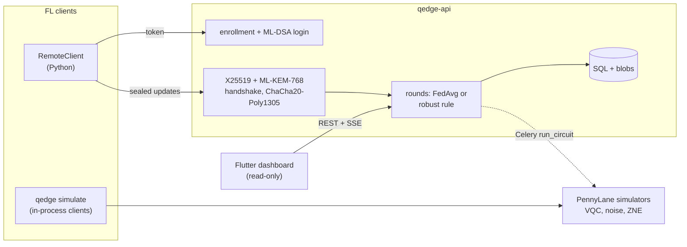

# Q-Edge

[](https://github.com/rasidi3112/Q-Edge/actions/workflows/ci.yml)
[](LICENSE)
[](pyproject.toml)

[English](README.md) | [العربية](README_ar.md) | [Deutsch](README_de.md) | [Español](README_es.md) | [Français](README_fr.md) | [हिन्दी](README_hi.md) | [Bahasa Indonesia](README_id.md) | [Italiano](README_it.md) | [日本語](README_ja.md) | [한국어](README_ko.md) | [Bahasa Melayu](README_ms.md) | [Português](README_pt.md) | **Русский** | [Türkçe](README_tr.md) | [Tiếng Việt](README_vi.md) | [中文](README_zh.md)

> Это перевод [README.md](README.md). При расхождениях действует английская версия.

Q-Edge — исследовательский стенд для федеративного обучения с гибридными
квантово-классическими моделями и постквантовой защитой обновлений клиентов.
Он отвечает на три вопроса воспроизводимыми числами:

1. Справляется ли на не-IID данных небольшая голова на вариационной квантовой
   схеме (VQC) так же, как классическая голова с тем же числом параметров, с
   шумом и без него, с экстраполяцией к нулевому шуму и без неё?
2. Сколько стоит за раунд постквантовая защита (ML-KEM-768, ML-DSA-65,
   гибрид X25519 + ML-KEM-768 и безопасная агрегация)?
3. Какой вред могут нанести злонамеренные клиенты, насколько помогают правила
   робастной агрегации и как эти правила конфликтуют с безопасной агрегацией?

Отрицательные ответы тоже считаются результатами. Каждое число ниже взято из
`results/summary/*.json`, которые заново создаёт `make reproduce`;
[`docs/results.md`](docs/results.md) содержит все таблицы и рисунки.

## Что это и чем это не является

Это:

- Федеративный симулятор (`qedge simulate`) на наборах breast_cancer и digits
  из scikit-learn с перекосом меток по Дирихле. Стратегии: FedAvg, FedProx,
  FedAdam и FedYogi. Также сжатие top-k, атаки, робастные правила и
  безопасная агрегация. Тот же код клиента и сервера работает как приложения
  Flower 1.40 (`flwr run experiments/flower`).
- Гибридные модели PyTorch с головой VQC на PennyLane, симулированным шумом
  вентилей и считывания, ZNE через глобальное свёртывание (folding) и
  диагностикой (дисперсия градиента, концентрация ядра, выразительность).
- Сервер на FastAPI с регистрацией клиентов администратором, входом по схеме
  «вызов-ответ» с ML-DSA, подписанным транспортом X25519 + ML-KEM-768,
  проверяемыми раундами, server-sent events и метриками Prometheus.
  Панель на Flutter только для чтения показывает его состояние.

Это не:

- Квантовое оборудование. Все схемы выполняются на симуляторах
  (`default.qubit`, `default.mixed`).
- Реальное развёртывание. Клиенты моделируются в одном процессе или являются
  скриптами Python; обучения на мобильных устройствах нет.
- Проверенная аудитом криптография. Гибридный комбинатор KEM, транспорт и
  протокол безопасной агрегации — собственные конструкции проекта. Бэкенд на
  чистом Python не работает за постоянное время.
- Доказательство квантового преимущества. В этих экспериментах голова VQC ни
  разу не оказалась явно лучше классической.

## Архитектура



Подробности: [`docs/architecture.md`](docs/architecture.md); решения:
[`docs/decisions/`](docs/decisions/); угрозы:
[`docs/threat-model.md`](docs/threat-model.md).

## Быстрый старт

```bash
git clone https://github.com/rasidi3112/Q-Edge.git && cd Q-Edge
python -m venv .venv && source .venv/bin/activate
pip install torch --index-url https://download.pytorch.org/whl/cpu   # optional: CPU-only torch
pip install -e ".[fl,pqc-pure]"

qedge demo                       # one run of each component, about 5 s
qedge simulate --dataset breast_cancer --clients 10 --rounds 30 --alpha 0.5 --strategy fedavg
qedge simulate --model hybrid-vqc --qubits 4 --layers 2 --noise 0.01 --zne richardson
qedge simulate --dataset digits --model mlp --attack scaling --attack-fraction 0.3 --defense multi_krum
qedge simulate --secure-aggregation
```

Каждый запуск `simulate` записывает `results/runs/<run_id>/config.yaml`
(конфигурация, разбиение по клиентам, число параметров, версии пакетов,
машина) и `metrics.jsonl` (одна строка на раунд). `pqc-pure` — это ML-KEM и
ML-DSA на чистом Python для опытов; для всего остального соберите liboqs 0.16
и установите `q-edge[pqc]`.

| Extra | Добавляет |
|---|---|
| `fl` | PyTorch, Flower, scikit-learn, PyYAML: симулятор, гибридные модели |
| `server` | Сервер FastAPI, воркер Celery, `qedge clients` |
| `pqc` | liboqs-python (нужна C-библиотека liboqs) |
| `pqc-pure` | kyber-py и dilithium-py: не постоянное время, только для тестов |
| `report` | matplotlib для `python -m experiments.report` |
| `flower-sim` | Ray, для `flwr run` |
| `postgres` | psycopg, для стека compose |
| `dev` | pytest, hypothesis, ruff, mypy, pre-commit |

### Сервер

```bash
pip install -e ".[server,pqc-pure]"
qedge keys init --dir ./keys --backend pure        # server KEM and ML-DSA keys
qedge clients keygen --out ./admin --backend pure  # admin key pair, stays local
qedge clients add --id admin --scope admin --public-key ./admin/client.pub --backend pure
JWT_SECRET_KEY=$(python -c "import secrets; print(secrets.token_urlsafe(48))") \
  QEDGE_CRYPTO_BACKEND=pure QEDGE_KEY_DIR=./keys qedge-api
```

Администратор регистрирует клиентов и открывает раунды
(`POST /admin/rounds`). Клиент (`qedge.fl.remote.RemoteClient`) входит,
подписывая nonce, открывает зашифрованную сессию и отправляет одно
запечатанное обновление за раунд. Сервер агрегирует, когда пришло
`min_clients` обновлений или истёк срок, используя `QEDGE_AGGREGATION`
(`fedavg`, `median`, `trimmed_mean`, `krum`, `multi_krum` или `bounded`). Без
ключей или криптографического бэкенда он отказывается запускаться. С Docker:

```bash
cp .env.example .env   # set JWT_SECRET_KEY, REDIS_PASSWORD, POSTGRES_PASSWORD
qedge clients keygen --out ./admin
docker compose run --rm api qedge keys init --dir /keys
docker compose run --rm -v "$PWD/admin:/admin:ro" api \
  qedge clients add --id admin --scope admin --public-key /admin/client.pub
docker compose up --build
```

Панель: `cd mobile_app && flutter run -d chrome --web-port 3000
--dart-define=QEDGE_API_URL=http://localhost:8000`
([`mobile_app/README.md`](mobile_app/README.md)).

## Результаты

Клиенты моделируются на CPU ноутбука; среднее ± стандартное отклонение по
seed 0-2. Полные таблицы, рисунки и конфигурации:
[`docs/results.md`](docs/results.md), `experiments/configs/`.

**RQ1: голова VQC против классической головы.** 5 клиентов, 15 раундов,
4 кубита, 2 слоя strongly entangling (24 параметра) против головы tanh с 20.
Кодировщик и выходной слой одинаковы.

| Набор, α | Классическая голова | VQC | VQC, p = 0.01 | VQC, p = 0.01, ZNE |
|---|---|---|---|---|
| breast_cancer, 0.1 | 0.968 ± 0.018 | 0.965 ± 0.032 | 0.930 ± 0.092 | 0.965 ± 0.032 |
| breast_cancer, 1.0 | 0.974 ± 0.018 | 0.977 ± 0.018 | 0.974 ± 0.018 | 0.977 ± 0.018 |
| digits, 0.1 | 0.643 ± 0.125 | 0.486 ± 0.093 | 0.496 ± 0.086 | 0.491 ± 0.084 |
| digits, 1.0 | 0.685 ± 0.143 | 0.514 ± 0.061 | 0.485 ± 0.100 | 0.512 ± 0.058 |

Голова VQC не уступает классической на breast_cancer и примерно на 0.16 хуже
на digits. Деполяризующий шум с p = 0.01 и ZNE меняют итоговую точность меньше,
чем разброс между seed; сильнее всего эффект на breast_cancer при α = 0.1
(0.965 без шума, 0.930 с шумом, 0.965 с ZNE). ZNE замедляет обучение примерно
в 8 раз. На случайных 4-кубитных схемах ZNE снижает ошибку математического
ожидания при p = 0.01 с 0.055 до 0.005 (Ричардсон) или 0.003
(экспоненциальная).

**RQ2: стоимость постквантовой защиты** (liboqs 0.16):

- Рукопожатие транспорта занимает 0.57 мс и 7 840 байт один раз за сессию,
  плюс 52 байта на кадр обновления.
- Безопасная агрегация за раунд на клиента по сравнению с обычной отправкой
  float32:
  - 10 клиентов, 1 210 параметров: 36.6 КиБ отправки вместо 4.7 КиБ, 2.6 мс;
    сервер 3.8 мс.
  - 50 клиентов, 100 000 параметров: 895 КиБ вместо 391 КиБ, 33 мс;
    сервер 95 мс.
- Объём отправки удваивается, потому что замаскированные значения занимают
  8 байт, а обмен ключами растёт линейно с числом клиентов.

**RQ3: злонамеренные клиенты** (digits, MLP, 10 клиентов, 30 раундов, 3 из 10
атакуют):

| Атака | FedAvg | Медиана | Multi-Krum |
|---|---|---|---|
| нет | 0.952 ± 0.003 | 0.931 ± 0.006 | 0.922 ± 0.003 |
| подмена меток | 0.700 ± 0.314 | 0.883 ± 0.032 | 0.938 ± 0.013 |
| масштабирование (замена модели) | 0.177 ± 0.094 | 0.908 ± 0.015 | 0.936 ± 0.022 |
| случайный шум | 0.578 ± 0.065 | 0.933 ± 0.014 | 0.936 ± 0.022 |
| ложное число примеров | 0.030 ± 0.018 | 0.883 ± 0.032 | 0.938 ± 0.013 |

FedAvg проваливается при любой атаке. Multi-Krum держится в пределах 0.02 от
собственной точности без атак, но без атакующих стоит 0.03; один Krum на
не-IID данных стоит 0.28. Ни одно из этих правил не работает при безопасной
агрегации, которая скрывает именно те отдельные обновления, которые они
проверяют (ADR 0010). Усечённое среднее, ограничение нормы и лимиты числа
примеров — в `docs/results.md`.

## Модель безопасности

Защищено: чтение или подделка обновлений в сети сейчас или после того, как
квантовый компьютер взломает X25519 (гибридный KEM, подписанное рукопожатие,
кадры AEAD, счётчики против повтора); выдача себя за сервер или
зарегистрированного клиента; повреждённые или повторные обновления; клиенты,
запускающие агрегацию. Частично защищено: злонамеренные клиенты в рамках
протокола — с помощью робастных правил. Не защищено: любопытный сервер вне
симулятора (безопасная агрегация недоступна по HTTP), выводы из глобальной
модели (нет учёта приватности), отказ в обслуживании, побочные каналы
чистого бэкенда и украденные токены до истечения срока. См.
[`docs/threat-model.md`](docs/threat-model.md).

## Ограничения

- Два небольших простых набора данных. Различия меньше примерно одного
  стандартного отклонения (до 0.14 на digits в RQ1) нельзя разрешить при
  3 seed.
- RQ1 использует 5 клиентов и 15 раундов, чтобы запуски с ZNE оставались
  посильными, поэтому точность на digits (0.5-0.7) намного ниже, чем у MLP за
  30 раундов (0.95).
- Симулированный шум — один канал на вентиль и провод: без перекрёстных
  помех, шума простоя и когерентных ошибок. Обратное распространение через
  `default.mixed` даёт градиенты, недоступные на реальном оборудовании
  (ADR 0009).
- Безопасная агрегация не восстанавливается после выбывания клиентов и
  работает только внутри процесса. Измеренные затраты не включают сетевую
  задержку.
- Ограничение и гауссов шум есть, но ε не приводится, потому что нет учёта
  приватности.
- Робастные правила предполагают не более 30 % атакующих и не проверялись
  против целевых бэкдоров и адаптивных атакующих.
- Приложение Flutter только для чтения и не выполняет криптографию; сборки
  для Android и iOS не проверялись.

## Разработка

```bash
pip install torch --index-url https://download.pytorch.org/whl/cpu
pip install -e ".[dev,server,pqc-pure,fl,report]"
pre-commit install
make lint             # ruff check, ruff format --check, mypy --strict on src/qedge
make test             # pytest -m "not slow"
pytest -m slow        # Flower end-to-end and a noisy ZNE run (needs flower-sim)
make reproduce        # every experiment and docs/results.md, about 62 minutes
```

`python -m experiments.run_all --skip quantum_head` перезапускает всё, кроме
сетки ZNE, примерно за 7 минут. CI запускает lint и тесты на Python
3.11-3.13, задание с liboqs, тесты Flutter и сборки Docker.

## Структура

```
src/qedge/
  crypto/     ML-KEM, ML-DSA, hybrid KEM, transport, key files, backends
  fl/         datasets, models, training, strategies, robust rules, attacks,
              compression, privacy, secure aggregation, simulator, Flower apps
  quantum/    circuits, noise, ZNE and readout mitigation, kernels, models,
              diagnostics
  server/     FastAPI app, auth, rounds, storage, metrics, Celery worker
  cli.py      qedge keys | clients | simulate | demo
  demo.py
experiments/  configs/*.yaml, one script per experiment, run_all.py, report.py
bench/        crypto.py, secagg.py
results/      summary/*.json (committed), runs/ (ignored)
docs/         architecture.md, threat-model.md, results.md, figures/, decisions/
mobile_app/   Flutter dashboard
```

## Литература

- McMahan et al., "Communication-Efficient Learning of Deep Networks from
  Decentralized Data", 2017, arXiv:1602.05629 (FedAvg).
- Li et al., "Federated Optimization in Heterogeneous Networks", 2018,
  arXiv:1812.06127 (FedProx).
- Reddi et al., "Adaptive Federated Optimization", 2020, arXiv:2003.00295
  (FedAdam, FedYogi).
- Karimireddy et al., "Error Feedback Fixes SignSGD and other Gradient
  Compression Schemes", 2019, arXiv:1901.09847.
- Yin et al., "Byzantine-Robust Distributed Learning: Towards Optimal
  Statistical Rates", 2018, arXiv:1803.01498 (median, trimmed mean).
- Blanchard et al., "Machine Learning with Adversaries: Byzantine Tolerant
  Gradient Descent", NeurIPS 2017 (Krum).
- Sun et al., "Can You Really Backdoor Federated Learning?", 2019,
  arXiv:1911.07963 (norm clipping).
- Bagdasaryan et al., "How To Backdoor Federated Learning", 2018,
  arXiv:1807.00459 (model replacement).
- Bonawitz et al., "Practical Secure Aggregation for Privacy-Preserving
  Machine Learning", CCS 2017.
- Schuld et al., "Circuit-centric quantum classifiers", 2018,
  arXiv:1804.00633.
- Pérez-Salinas et al., "Data re-uploading for a universal quantum
  classifier", 2020, arXiv:1907.02085.
- Havlíček et al., "Supervised learning with quantum-enhanced feature
  spaces", Nature 2019.
- Temme et al., "Error mitigation for short-depth quantum circuits", 2017,
  arXiv:1612.02058.
- Giurgica-Tiron et al., "Digital zero noise extrapolation for quantum
  error mitigation", 2020, arXiv:2005.10921.
- McClean et al., "Barren plateaus in quantum neural network training
  landscapes", 2018, arXiv:1803.11173.
- Thanasilp et al., "Exponential concentration in quantum kernel methods",
  2022, arXiv:2208.11060.
- Sim et al., "Expressibility and entangling capability of parameterized
  quantum circuits", 2019, arXiv:1905.10876.
- NIST FIPS 203 (ML-KEM) and FIPS 204 (ML-DSA), 2024.

## Лицензия

Apache 2.0, см. [LICENSE](LICENSE). Изменения перечислены в
[CHANGELOG.md](CHANGELOG.md).
