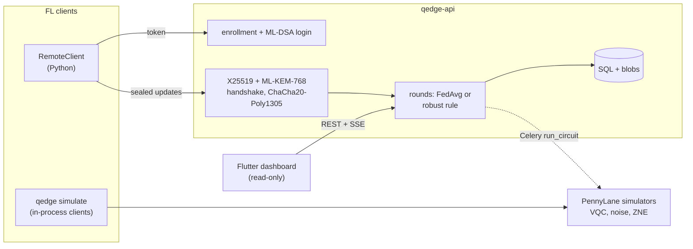

# Q-Edge

[](https://github.com/rasidi3112/Q-Edge/actions/workflows/ci.yml)
[](LICENSE)
[](pyproject.toml)

[English](README.md) | [العربية](README_ar.md) | [Deutsch](README_de.md) | [Español](README_es.md) | [Français](README_fr.md) | [हिन्दी](README_hi.md) | [Bahasa Indonesia](README_id.md) | [Italiano](README_it.md) | [日本語](README_ja.md) | [한국어](README_ko.md) | [Bahasa Melayu](README_ms.md) | [Português](README_pt.md) | [Русский](README_ru.md) | **Türkçe** | [Tiếng Việt](README_vi.md) | [中文](README_zh.md)

> Bu, [README.md](README.md) dosyasının çevirisidir. Farklılık olursa İngilizce sürüm geçerlidir.

Q-Edge, hibrit kuantum-klasik modellerle federe öğrenme ve istemci
güncellemelerinin kuantum sonrası korunması için bir araştırma test ortamıdır.
Üç soruyu yeniden üretilebilir sayılarla yanıtlar:

1. IID olmayan verilerde küçük bir varyasyonel kuantum devresi (VQC) başlığı,
   aynı sayıda parametreye sahip klasik bir başlık kadar iyi mi; gürültülü ve
   gürültüsüz, sıfır gürültü ekstrapolasyonlu ve ekstrapolasyonsuz?
2. Kuantum sonrası koruma (ML-KEM-768, ML-DSA-65, hibrit
   X25519 + ML-KEM-768 ve güvenli toplama) tur başına ne kadara mal olur?
3. Kötü niyetli istemciler ne kadar zarar verebilir, dayanıklı toplama
   kuralları ne kadar yardımcı olur ve bu kurallar güvenli toplamayla nasıl
   çatışır?

Olumsuz yanıtlar da sonuç sayılır. Aşağıdaki her sayı, `make reproduce`
komutunun yeniden ürettiği `results/summary/*.json` dosyalarından gelir;
[`docs/results.md`](docs/results.md) tüm tabloları ve şekilleri içerir.

## Ne olduğu ve ne olmadığı

Şunlardır:

- scikit-learn'ün breast_cancer ve digits veri kümelerinde Dirichlet etiket
  çarpıklığıyla çalışan bir federe simülatör (`qedge simulate`). Stratejiler:
  FedAvg, FedProx, FedAdam ve FedYogi. Ayrıca top-k sıkıştırma, saldırılar,
  dayanıklı kurallar ve güvenli toplama. Aynı istemci ve sunucu kodu Flower
  1.40 uygulamaları olarak da çalışır (`flwr run experiments/flower`).
- PennyLane VQC başlıklı hibrit PyTorch modelleri, simüle edilmiş kapı ve
  okuma gürültüsü, küresel katlama ile ZNE ve tanılar (gradyan varyansı,
  çekirdek yoğunlaşması, ifade gücü).
- Yönetici tarafından istemci kaydı, ML-DSA meydan okuma-yanıt girişi,
  imzalı X25519 + ML-KEM-768 taşıma katmanı, doğrulanan turlar, server-sent
  events ve Prometheus metrikleri içeren bir FastAPI sunucusu. Salt okunur
  bir Flutter paneli durumunu gösterir.

Şunlar değildir:

- Kuantum donanımı. Tüm devreler simülatörlerde çalışır (`default.qubit`,
  `default.mixed`).
- Gerçek bir kurulum. İstemciler tek bir süreçte simüle edilir ya da Python
  betikleridir; mobil cihazda eğitim yoktur.
- Denetlenmiş kriptografi. Hibrit KEM birleştiricisi, taşıma katmanı ve
  güvenli toplama protokolü bu projenin kendi yapılarıdır. Saf Python arka
  ucu sabit zamanlı değildir.
- Kuantum üstünlüğünün kanıtı. Bu deneylerde VQC başlığı klasik başlıktan
  hiçbir zaman açıkça daha iyi değildir.

## Mimari



Ayrıntılar: [`docs/architecture.md`](docs/architecture.md); kararlar:
[`docs/decisions/`](docs/decisions/); tehditler:
[`docs/threat-model.md`](docs/threat-model.md).

## Hızlı başlangıç

```bash
git clone https://github.com/rasidi3112/Q-Edge.git && cd Q-Edge
python -m venv .venv && source .venv/bin/activate
pip install torch --index-url https://download.pytorch.org/whl/cpu   # optional: CPU-only torch
pip install -e ".[fl,pqc-pure]"

qedge demo                       # one run of each component, about 5 s
qedge simulate --dataset breast_cancer --clients 10 --rounds 30 --alpha 0.5 --strategy fedavg
qedge simulate --model hybrid-vqc --qubits 4 --layers 2 --noise 0.01 --zne richardson
qedge simulate --dataset digits --model mlp --attack scaling --attack-fraction 0.3 --defense multi_krum
qedge simulate --secure-aggregation
```

Her `simulate` çalıştırması `results/runs/<run_id>/config.yaml` (yapılandırma,
istemci bölümlemesi, parametre sayıları, paket sürümleri, makine) ve
`metrics.jsonl` (tur başına bir satır) yazar. `pqc-pure`, denemek için saf
Python ML-KEM ve ML-DSA'dır; geri kalan her şey için liboqs 0.16'yı derleyip
`q-edge[pqc]` kurun.

| Extra | Ekledikleri |
|---|---|
| `fl` | PyTorch, Flower, scikit-learn, PyYAML: simülatör, hibrit modeller |
| `server` | FastAPI sunucusu, Celery worker, `qedge clients` |
| `pqc` | liboqs-python (liboqs C kütüphanesi gerekir) |
| `pqc-pure` | kyber-py ve dilithium-py: sabit zamanlı değil, yalnızca testler için |
| `report` | `python -m experiments.report` için matplotlib |
| `flower-sim` | `flwr run` için Ray |
| `postgres` | compose yığını için psycopg |
| `dev` | pytest, hypothesis, ruff, mypy, pre-commit |

### Sunucu

```bash
pip install -e ".[server,pqc-pure]"
qedge keys init --dir ./keys --backend pure        # server KEM and ML-DSA keys
qedge clients keygen --out ./admin --backend pure  # admin key pair, stays local
qedge clients add --id admin --scope admin --public-key ./admin/client.pub --backend pure
JWT_SECRET_KEY=$(python -c "import secrets; print(secrets.token_urlsafe(48))") \
  QEDGE_CRYPTO_BACKEND=pure QEDGE_KEY_DIR=./keys qedge-api
```

Yönetici istemcileri kaydeder ve turlar açar (`POST /admin/rounds`). Bir
istemci (`qedge.fl.remote.RemoteClient`) bir nonce imzalayarak giriş yapar,
şifreli bir oturum açar ve tur başına bir mühürlü güncelleme gönderir. Sunucu,
`min_clients` güncelleme geldiğinde veya süre dolduğunda
`QEDGE_AGGREGATION` (`fedavg`, `median`, `trimmed_mean`, `krum`,
`multi_krum` veya `bounded`) ile toplar. Anahtarlar veya kripto arka ucu
olmadan başlamayı reddeder. Docker ile:

```bash
cp .env.example .env   # set JWT_SECRET_KEY, REDIS_PASSWORD, POSTGRES_PASSWORD
qedge clients keygen --out ./admin
docker compose run --rm api qedge keys init --dir /keys
docker compose run --rm -v "$PWD/admin:/admin:ro" api \
  qedge clients add --id admin --scope admin --public-key /admin/client.pub
docker compose up --build
```

Panel: `cd mobile_app && flutter run -d chrome --web-port 3000
--dart-define=QEDGE_API_URL=http://localhost:8000`
([`mobile_app/README.md`](mobile_app/README.md)).

## Sonuçlar

İstemciler bir dizüstü bilgisayar CPU'sunda simüle edilir; 0-2 seed'leri
üzerinden ortalama ± standart sapma. Tam tablolar, şekiller ve yapılandırmalar:
[`docs/results.md`](docs/results.md), `experiments/configs/`.

**RQ1: VQC başlığı ile klasik başlık.** 5 istemci, 15 tur, 4 kübit,
2 strongly entangling katman (24 parametre), 20 parametreli bir tanh başlığa
karşı. Kodlayıcı ve çıkış katmanı aynıdır.

| Veri kümesi, α | Klasik başlık | VQC | VQC, p = 0.01 | VQC, p = 0.01, ZNE |
|---|---|---|---|---|
| breast_cancer, 0.1 | 0.968 ± 0.018 | 0.965 ± 0.032 | 0.930 ± 0.092 | 0.965 ± 0.032 |
| breast_cancer, 1.0 | 0.974 ± 0.018 | 0.977 ± 0.018 | 0.974 ± 0.018 | 0.977 ± 0.018 |
| digits, 0.1 | 0.643 ± 0.125 | 0.486 ± 0.093 | 0.496 ± 0.086 | 0.491 ± 0.084 |
| digits, 1.0 | 0.685 ± 0.143 | 0.514 ± 0.061 | 0.485 ± 0.100 | 0.512 ± 0.058 |

VQC başlığı breast_cancer'da klasik başlıkla eşit, digits'te ise yaklaşık
0.16 daha kötüdür. p = 0.01 depolarize edici gürültü ve ZNE, son doğruluğu
seed'ler arasındaki dağılımdan daha az değiştirir; en büyük etki
breast_cancer'da α = 0.1 ile görülür (gürültüsüz 0.965, gürültülü 0.930,
ZNE ile 0.965). ZNE eğitimi yaklaşık 8 kat yavaşlatır. Rastgele 4 kübitlik
devrelerde ZNE, p = 0.01'deki beklenen değer hatasını 0.055'ten 0.005'e
(Richardson) veya 0.003'e (üstel) indirir.

**RQ2: kuantum sonrası korumanın maliyeti** (liboqs 0.16):

- Taşıma el sıkışması oturum başına bir kez 0.57 ms ve 7 840 bayt sürer,
  buna güncelleme çerçevesi başına 52 bayt eklenir.
- Tur ve istemci başına güvenli toplama, düz bir float32 yüklemesine göre:
  - 10 istemci, 1 210 parametre: 4.7 KiB yerine 36.6 KiB yükleme, 2.6 ms;
    sunucu 3.8 ms.
  - 50 istemci, 100 000 parametre: 391 KiB yerine 895 KiB, 33 ms;
    sunucu 95 ms.
- Maskelenmiş değerler 8 bayt tuttuğu için yükleme iki katına çıkar; anahtar
  değişimi istemci sayısıyla doğrusal olarak büyür.

**RQ3: kötü niyetli istemciler** (digits, MLP, 10 istemci, 30 tur, 10'dan
3'ü saldırır):

| Saldırı | FedAvg | Medyan | Multi-Krum |
|---|---|---|---|
| yok | 0.952 ± 0.003 | 0.931 ± 0.006 | 0.922 ± 0.003 |
| etiket çevirme | 0.700 ± 0.314 | 0.883 ± 0.032 | 0.938 ± 0.013 |
| ölçekleme (model değiştirme) | 0.177 ± 0.094 | 0.908 ± 0.015 | 0.936 ± 0.022 |
| rastgele gürültü | 0.578 ± 0.065 | 0.933 ± 0.014 | 0.936 ± 0.022 |
| sahte örnek sayıları | 0.030 ± 0.018 | 0.883 ± 0.032 | 0.938 ± 0.013 |

FedAvg her saldırıya karşı başarısız olur. Multi-Krum saldırısız kendi
doğruluğunun 0.02 yakınında kalır ama saldırgan yokken 0.03 kaybettirir; tek
başına Krum, IID olmayan verilerde 0.28 kaybettirir. Bu kuralların hiçbiri,
incelediği bireysel güncellemeleri gizleyen güvenli toplama altında
çalışamaz (ADR 0010). Kırpılmış ortalama, norm kırpma ve örnek sınırları
`docs/results.md` içindedir.

## Güvenlik modeli

Korunanlar: güncellemelerin ağda okunması veya taklit edilmesi, şimdi ya da
bir kuantum bilgisayarı X25519'u kırdıktan sonra (hibrit KEM, imzalı el
sıkışma, AEAD çerçeveleri, tekrar sayaçları); sunucu veya kayıtlı bir istemci
kılığına girme; bozuk veya yinelenen güncellemeler; toplamayı tetikleyen
istemciler. Kısmen korunanlar: protokol içindeki kötü niyetli istemciler,
dayanıklı kurallar aracılığıyla. Korunmayanlar: simülatör dışındaki meraklı
bir sunucu (güvenli toplama HTTP üzerinden sunulmaz), küresel modelden çıkarım
(gizlilik muhasebesi yok), hizmet reddi, saf arka ucun yan kanalları ve
süresi dolmadan çalınan tokenlar. Bkz.
[`docs/threat-model.md`](docs/threat-model.md).

## Sınırlamalar

- İki küçük ve kolay veri kümesi. Yaklaşık bir standart sapmanın altındaki
  farklar (RQ1'de digits için 0.14'e kadar) 3 seed ile ayırt edilemez.
- RQ1, ZNE çalıştırmalarını karşılanabilir tutmak için 5 istemci ve 15 tur
  kullanır; bu yüzden digits doğrulukları (0.5-0.7), 30 turluk bir MLP'nin
  (0.95) çok altındadır.
- Simüle edilen gürültü, kapı ve tel başına bir kanaldır: çapraz konuşma,
  boşta gürültü veya tutarlı hatalar yoktur. `default.mixed` üzerinden geri
  yayılım, donanımın veremeyeceği gradyanlar verir (ADR 0009).
- Güvenli toplamada ayrılan istemciler için kurtarma yoktur ve yalnızca süreç
  içinde çalışır. Ölçülen maliyetler ağ gecikmesini içermez.
- Kırpma ve Gauss gürültüsü vardır, ancak gizlilik muhasebesi olmadığı için
  ε bildirilmez.
- Dayanıklı kurallar en fazla %30 saldırgan varsayar ve hedefli arka
  kapılara veya uyarlanabilir saldırganlara karşı test edilmemiştir.
- Flutter uygulaması salt okunurdur ve kriptografi yapmaz; Android ve iOS
  derlemeleri test edilmemiştir.

## Geliştirme

```bash
pip install torch --index-url https://download.pytorch.org/whl/cpu
pip install -e ".[dev,server,pqc-pure,fl,report]"
pre-commit install
make lint             # ruff check, ruff format --check, mypy --strict on src/qedge
make test             # pytest -m "not slow"
pytest -m slow        # Flower end-to-end and a noisy ZNE run (needs flower-sim)
make reproduce        # every experiment and docs/results.md, about 62 minutes
```

`python -m experiments.run_all --skip quantum_head`, ZNE ızgarası dışındaki
her şeyi yaklaşık 7 dakikada yeniden çalıştırır. CI, Python 3.11-3.13 üzerinde
lint ve testleri, bir liboqs işini, Flutter testlerini ve Docker derlemelerini
çalıştırır.

## Yapı

```
src/qedge/
  crypto/     ML-KEM, ML-DSA, hybrid KEM, transport, key files, backends
  fl/         datasets, models, training, strategies, robust rules, attacks,
              compression, privacy, secure aggregation, simulator, Flower apps
  quantum/    circuits, noise, ZNE and readout mitigation, kernels, models,
              diagnostics
  server/     FastAPI app, auth, rounds, storage, metrics, Celery worker
  cli.py      qedge keys | clients | simulate | demo
  demo.py
experiments/  configs/*.yaml, one script per experiment, run_all.py, report.py
bench/        crypto.py, secagg.py
results/      summary/*.json (committed), runs/ (ignored)
docs/         architecture.md, threat-model.md, results.md, figures/, decisions/
mobile_app/   Flutter dashboard
```

## Kaynaklar

- McMahan et al., "Communication-Efficient Learning of Deep Networks from
  Decentralized Data", 2017, arXiv:1602.05629 (FedAvg).
- Li et al., "Federated Optimization in Heterogeneous Networks", 2018,
  arXiv:1812.06127 (FedProx).
- Reddi et al., "Adaptive Federated Optimization", 2020, arXiv:2003.00295
  (FedAdam, FedYogi).
- Karimireddy et al., "Error Feedback Fixes SignSGD and other Gradient
  Compression Schemes", 2019, arXiv:1901.09847.
- Yin et al., "Byzantine-Robust Distributed Learning: Towards Optimal
  Statistical Rates", 2018, arXiv:1803.01498 (median, trimmed mean).
- Blanchard et al., "Machine Learning with Adversaries: Byzantine Tolerant
  Gradient Descent", NeurIPS 2017 (Krum).
- Sun et al., "Can You Really Backdoor Federated Learning?", 2019,
  arXiv:1911.07963 (norm clipping).
- Bagdasaryan et al., "How To Backdoor Federated Learning", 2018,
  arXiv:1807.00459 (model replacement).
- Bonawitz et al., "Practical Secure Aggregation for Privacy-Preserving
  Machine Learning", CCS 2017.
- Schuld et al., "Circuit-centric quantum classifiers", 2018,
  arXiv:1804.00633.
- Pérez-Salinas et al., "Data re-uploading for a universal quantum
  classifier", 2020, arXiv:1907.02085.
- Havlíček et al., "Supervised learning with quantum-enhanced feature
  spaces", Nature 2019.
- Temme et al., "Error mitigation for short-depth quantum circuits", 2017,
  arXiv:1612.02058.
- Giurgica-Tiron et al., "Digital zero noise extrapolation for quantum
  error mitigation", 2020, arXiv:2005.10921.
- McClean et al., "Barren plateaus in quantum neural network training
  landscapes", 2018, arXiv:1803.11173.
- Thanasilp et al., "Exponential concentration in quantum kernel methods",
  2022, arXiv:2208.11060.
- Sim et al., "Expressibility and entangling capability of parameterized
  quantum circuits", 2019, arXiv:1905.10876.
- NIST FIPS 203 (ML-KEM) and FIPS 204 (ML-DSA), 2024.

## Lisans

Apache 2.0, bkz. [LICENSE](LICENSE). Değişiklikler
[CHANGELOG.md](CHANGELOG.md) dosyasında listelenir.
