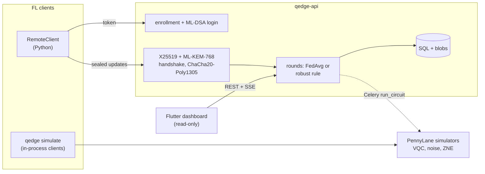

# Q-Edge

[](https://github.com/rasidi3112/Q-Edge/actions/workflows/ci.yml)
[](LICENSE)
[](pyproject.toml)

[English](README.md) | [العربية](README_ar.md) | [Deutsch](README_de.md) | [Español](README_es.md) | [Français](README_fr.md) | [हिन्दी](README_hi.md) | [Bahasa Indonesia](README_id.md) | [Italiano](README_it.md) | [日本語](README_ja.md) | [한국어](README_ko.md) | [Bahasa Melayu](README_ms.md) | [Português](README_pt.md) | [Русский](README_ru.md) | [Türkçe](README_tr.md) | **Tiếng Việt** | [中文](README_zh.md)

> Đây là bản dịch của [README.md](README.md). Nếu có khác biệt, bản tiếng Anh được ưu tiên.

Q-Edge là một nền tảng thử nghiệm nghiên cứu cho học liên kết (federated
learning) với mô hình lai lượng tử-cổ điển và bảo vệ hậu lượng tử cho các bản
cập nhật từ client. Dự án trả lời ba câu hỏi bằng các con số có thể tái tạo:

1. Trên dữ liệu không IID, một head mạch lượng tử biến phân (VQC) nhỏ có tốt
   bằng một head cổ điển có cùng số tham số hay không, khi có và không có
   nhiễu, có và không có ngoại suy về nhiễu bằng không?
2. Bảo vệ hậu lượng tử (ML-KEM-768, ML-DSA-65, lai X25519 + ML-KEM-768 và
   tổng hợp an toàn) tốn bao nhiêu cho mỗi vòng?
3. Client độc hại có thể gây hại đến mức nào, các quy tắc tổng hợp bền vững
   giúp được bao nhiêu, và các quy tắc đó xung đột với tổng hợp an toàn ra
   sao?

Câu trả lời phủ định cũng được tính là kết quả. Mọi con số bên dưới đều lấy từ
`results/summary/*.json`, được `make reproduce` tạo lại;
[`docs/results.md`](docs/results.md) chứa đầy đủ bảng và hình.

## Dự án là gì và không phải là gì

Dự án là:

- Một trình mô phỏng liên kết (`qedge simulate`) trên hai tập breast_cancer và
  digits của scikit-learn với độ lệch nhãn Dirichlet. Chiến lược: FedAvg,
  FedProx, FedAdam và FedYogi. Ngoài ra còn nén top-k, tấn công, quy tắc bền
  vững và tổng hợp an toàn. Cùng một mã client và server cũng chạy dưới dạng
  ứng dụng Flower 1.40 (`flwr run experiments/flower`).
- Các mô hình lai PyTorch với head VQC của PennyLane, nhiễu cổng và nhiễu đọc
  được mô phỏng, ZNE bằng gấp toàn cục (global folding) và các chẩn đoán
  (phương sai gradient, độ tập trung của kernel, khả năng biểu đạt).
- Một server FastAPI với việc đăng ký client do quản trị viên thực hiện, đăng
  nhập thử thách-phản hồi bằng ML-DSA, kênh truyền X25519 + ML-KEM-768 có ký,
  các vòng được kiểm tra, server-sent events và số liệu Prometheus. Một bảng
  điều khiển Flutter chỉ đọc hiển thị trạng thái của server.

Dự án không phải là:

- Phần cứng lượng tử. Mọi mạch đều chạy trên trình mô phỏng
  (`default.qubit`, `default.mixed`).
- Một triển khai thực tế. Client được mô phỏng trong một tiến trình hoặc là
  các script Python; không có huấn luyện trên thiết bị di động.
- Mật mã đã được kiểm toán. Bộ kết hợp KEM lai, kênh truyền và giao thức tổng
  hợp an toàn là thiết kế riêng của dự án này. Backend Python thuần không chạy
  theo thời gian hằng định.
- Bằng chứng về lợi thế lượng tử. Trong các thí nghiệm này, head VQC chưa bao
  giờ rõ ràng tốt hơn head cổ điển.

## Kiến trúc



Chi tiết: [`docs/architecture.md`](docs/architecture.md); các quyết định:
[`docs/decisions/`](docs/decisions/); mối đe dọa:
[`docs/threat-model.md`](docs/threat-model.md).

## Bắt đầu nhanh

```bash
git clone https://github.com/rasidi3112/Q-Edge.git && cd Q-Edge
python -m venv .venv && source .venv/bin/activate
pip install torch --index-url https://download.pytorch.org/whl/cpu   # optional: CPU-only torch
pip install -e ".[fl,pqc-pure]"

qedge demo                       # one run of each component, about 5 s
qedge simulate --dataset breast_cancer --clients 10 --rounds 30 --alpha 0.5 --strategy fedavg
qedge simulate --model hybrid-vqc --qubits 4 --layers 2 --noise 0.01 --zne richardson
qedge simulate --dataset digits --model mlp --attack scaling --attack-fraction 0.3 --defense multi_krum
qedge simulate --secure-aggregation
```

Mỗi lần chạy `simulate` ghi `results/runs/<run_id>/config.yaml` (cấu hình,
phân chia client, số tham số, phiên bản gói, máy) và `metrics.jsonl` (mỗi vòng
một dòng). `pqc-pure` là ML-KEM và ML-DSA viết bằng Python thuần để dùng thử;
với mọi mục đích khác, hãy build liboqs 0.16 và cài `q-edge[pqc]`.

| Extra | Bổ sung |
|---|---|
| `fl` | PyTorch, Flower, scikit-learn, PyYAML: trình mô phỏng, mô hình lai |
| `server` | Server FastAPI, worker Celery, `qedge clients` |
| `pqc` | liboqs-python (cần thư viện C liboqs) |
| `pqc-pure` | kyber-py và dilithium-py: không hằng định thời gian, chỉ để kiểm thử |
| `report` | matplotlib cho `python -m experiments.report` |
| `flower-sim` | Ray, cho `flwr run` |
| `postgres` | psycopg, cho stack compose |
| `dev` | pytest, hypothesis, ruff, mypy, pre-commit |

### Server

```bash
pip install -e ".[server,pqc-pure]"
qedge keys init --dir ./keys --backend pure        # server KEM and ML-DSA keys
qedge clients keygen --out ./admin --backend pure  # admin key pair, stays local
qedge clients add --id admin --scope admin --public-key ./admin/client.pub --backend pure
JWT_SECRET_KEY=$(python -c "import secrets; print(secrets.token_urlsafe(48))") \
  QEDGE_CRYPTO_BACKEND=pure QEDGE_KEY_DIR=./keys qedge-api
```

Quản trị viên đăng ký client và mở vòng (`POST /admin/rounds`). Một client
(`qedge.fl.remote.RemoteClient`) đăng nhập bằng cách ký một nonce, mở một
phiên mã hóa và gửi một bản cập nhật được niêm phong cho mỗi vòng. Server tổng
hợp khi đã nhận đủ `min_clients` bản cập nhật hoặc hết hạn, dùng
`QEDGE_AGGREGATION` (`fedavg`, `median`, `trimmed_mean`, `krum`, `multi_krum`
hoặc `bounded`). Nếu không có khóa hoặc backend mật mã, server từ chối khởi
động. Với Docker:

```bash
cp .env.example .env   # set JWT_SECRET_KEY, REDIS_PASSWORD, POSTGRES_PASSWORD
qedge clients keygen --out ./admin
docker compose run --rm api qedge keys init --dir /keys
docker compose run --rm -v "$PWD/admin:/admin:ro" api \
  qedge clients add --id admin --scope admin --public-key /admin/client.pub
docker compose up --build
```

Bảng điều khiển: `cd mobile_app && flutter run -d chrome --web-port 3000
--dart-define=QEDGE_API_URL=http://localhost:8000`
([`mobile_app/README.md`](mobile_app/README.md)).

## Kết quả

Client được mô phỏng trên CPU của laptop; trung bình ± độ lệch chuẩn trên các
seed 0-2. Bảng đầy đủ, hình và cấu hình: [`docs/results.md`](docs/results.md),
`experiments/configs/`.

**RQ1: head VQC so với head cổ điển.** 5 client, 15 vòng, 4 qubit, 2 lớp
strongly entangling (24 tham số) so với một head tanh có 20 tham số. Bộ mã hóa
và lớp đầu ra giống hệt nhau.

| Tập dữ liệu, α | Head cổ điển | VQC | VQC, p = 0.01 | VQC, p = 0.01, ZNE |
|---|---|---|---|---|
| breast_cancer, 0.1 | 0.968 ± 0.018 | 0.965 ± 0.032 | 0.930 ± 0.092 | 0.965 ± 0.032 |
| breast_cancer, 1.0 | 0.974 ± 0.018 | 0.977 ± 0.018 | 0.974 ± 0.018 | 0.977 ± 0.018 |
| digits, 0.1 | 0.643 ± 0.125 | 0.486 ± 0.093 | 0.496 ± 0.086 | 0.491 ± 0.084 |
| digits, 1.0 | 0.685 ± 0.143 | 0.514 ± 0.061 | 0.485 ± 0.100 | 0.512 ± 0.058 |

Head VQC ngang bằng head cổ điển trên breast_cancer và kém hơn khoảng 0.16
trên digits. Nhiễu khử phân cực với p = 0.01 và ZNE thay đổi độ chính xác cuối
cùng ít hơn mức dao động giữa các seed; ảnh hưởng lớn nhất là trên
breast_cancer với α = 0.1 (0.965 khi không nhiễu, 0.930 khi có nhiễu, 0.965
khi có ZNE). ZNE làm việc huấn luyện chậm hơn khoảng 8 lần. Trên các mạch
4 qubit ngẫu nhiên, ZNE giảm sai số giá trị kỳ vọng ở p = 0.01 từ 0.055 xuống
0.005 (Richardson) hoặc 0.003 (hàm mũ).

**RQ2: chi phí bảo vệ hậu lượng tử** (liboqs 0.16):

- Bắt tay của kênh truyền mất 0.57 ms và 7 840 byte một lần mỗi phiên, cộng
  52 byte cho mỗi khung cập nhật.
- Tổng hợp an toàn cho mỗi vòng, mỗi client, so với việc tải lên float32
  thông thường:
  - 10 client, 1 210 tham số: tải lên 36.6 KiB thay vì 4.7 KiB, 2.6 ms;
    server 3.8 ms.
  - 50 client, 100 000 tham số: 895 KiB thay vì 391 KiB, 33 ms; server 95 ms.
- Lượng tải lên tăng gấp đôi vì giá trị được che mặt nạ chiếm 8 byte, và việc
  trao đổi khóa tăng tuyến tính theo số client.

**RQ3: client độc hại** (digits, MLP, 10 client, 30 vòng, 3 trên 10 tấn
công):

| Tấn công | FedAvg | Trung vị | Multi-Krum |
|---|---|---|---|
| không có | 0.952 ± 0.003 | 0.931 ± 0.006 | 0.922 ± 0.003 |
| đảo nhãn | 0.700 ± 0.314 | 0.883 ± 0.032 | 0.938 ± 0.013 |
| phóng đại (thay thế mô hình) | 0.177 ± 0.094 | 0.908 ± 0.015 | 0.936 ± 0.022 |
| nhiễu ngẫu nhiên | 0.578 ± 0.065 | 0.933 ± 0.014 | 0.936 ± 0.022 |
| khai man số mẫu | 0.030 ± 0.018 | 0.883 ± 0.032 | 0.938 ± 0.013 |

FedAvg thất bại trước mọi kiểu tấn công. Multi-Krum giữ trong phạm vi 0.02 so
với độ chính xác khi không bị tấn công của chính nó, nhưng mất 0.03 khi không
có kẻ tấn công; riêng Krum mất 0.28 trên dữ liệu không IID. Không quy tắc nào
trong số này chạy được dưới tổng hợp an toàn, vì tổng hợp an toàn che giấu
chính các bản cập nhật riêng lẻ mà chúng cần kiểm tra (ADR 0010). Trung bình
cắt tỉa, cắt chuẩn và giới hạn số mẫu có trong `docs/results.md`.

## Mô hình bảo mật

Được bảo vệ: việc đọc hoặc giả mạo bản cập nhật trên đường truyền, hiện tại
hoặc sau khi máy tính lượng tử phá được X25519 (KEM lai, bắt tay có ký, khung
AEAD, bộ đếm chống phát lại); việc mạo danh server hoặc một client đã đăng ký;
bản cập nhật sai định dạng hoặc trùng lặp; client tự kích hoạt tổng hợp. Được
bảo vệ một phần: client độc hại tuân thủ giao thức, thông qua quy tắc bền
vững. Không được bảo vệ: server tò mò bên ngoài trình mô phỏng (tổng hợp an
toàn chưa có qua HTTP), suy luận từ mô hình toàn cục (không có cơ chế đo
quyền riêng tư), tấn công từ chối dịch vụ, kênh kề của backend thuần và token
bị đánh cắp trước khi hết hạn. Xem [`docs/threat-model.md`](docs/threat-model.md).

## Hạn chế

- Hai tập dữ liệu nhỏ và dễ. Những khác biệt dưới khoảng một độ lệch chuẩn
  (tới 0.14 trên digits trong RQ1) không thể kết luận được với 3 seed.
- RQ1 dùng 5 client và 15 vòng để các lần chạy ZNE còn chi trả được, nên độ
  chính xác trên digits (0.5-0.7) thấp hơn nhiều so với MLP 30 vòng (0.95).
- Nhiễu mô phỏng là một kênh cho mỗi cổng và mỗi dây: không có nhiễu xuyên
  âm, nhiễu khi rảnh hay lỗi kết hợp. Lan truyền ngược qua `default.mixed`
  cho ra gradient mà phần cứng không thể cho (ADR 0009).
- Tổng hợp an toàn chưa có cơ chế khôi phục khi client rời đi và chỉ chạy
  trong tiến trình. Chi phí đo được chưa tính độ trễ mạng.
- Có cắt ngưỡng và nhiễu Gauss, nhưng không báo cáo ε vì chưa có cơ chế đo
  quyền riêng tư.
- Các quy tắc bền vững giả định tối đa 30 % kẻ tấn công và chưa được thử với
  cửa hậu có chủ đích hay kẻ tấn công thích nghi.
- Ứng dụng Flutter chỉ đọc và không thực hiện mật mã; bản build Android và
  iOS chưa được kiểm thử.

## Phát triển

```bash
pip install torch --index-url https://download.pytorch.org/whl/cpu
pip install -e ".[dev,server,pqc-pure,fl,report]"
pre-commit install
make lint             # ruff check, ruff format --check, mypy --strict on src/qedge
make test             # pytest -m "not slow"
pytest -m slow        # Flower end-to-end and a noisy ZNE run (needs flower-sim)
make reproduce        # every experiment and docs/results.md, about 62 minutes
```

`python -m experiments.run_all --skip quantum_head` chạy lại mọi thứ trừ lưới
ZNE trong khoảng 7 phút. CI chạy lint và kiểm thử trên Python 3.11-3.13, một
job với liboqs, các bài kiểm thử Flutter và các bản build Docker.

## Cấu trúc

```
src/qedge/
  crypto/     ML-KEM, ML-DSA, hybrid KEM, transport, key files, backends
  fl/         datasets, models, training, strategies, robust rules, attacks,
              compression, privacy, secure aggregation, simulator, Flower apps
  quantum/    circuits, noise, ZNE and readout mitigation, kernels, models,
              diagnostics
  server/     FastAPI app, auth, rounds, storage, metrics, Celery worker
  cli.py      qedge keys | clients | simulate | demo
  demo.py
experiments/  configs/*.yaml, one script per experiment, run_all.py, report.py
bench/        crypto.py, secagg.py
results/      summary/*.json (committed), runs/ (ignored)
docs/         architecture.md, threat-model.md, results.md, figures/, decisions/
mobile_app/   Flutter dashboard
```

## Tài liệu tham khảo

- McMahan et al., "Communication-Efficient Learning of Deep Networks from
  Decentralized Data", 2017, arXiv:1602.05629 (FedAvg).
- Li et al., "Federated Optimization in Heterogeneous Networks", 2018,
  arXiv:1812.06127 (FedProx).
- Reddi et al., "Adaptive Federated Optimization", 2020, arXiv:2003.00295
  (FedAdam, FedYogi).
- Karimireddy et al., "Error Feedback Fixes SignSGD and other Gradient
  Compression Schemes", 2019, arXiv:1901.09847.
- Yin et al., "Byzantine-Robust Distributed Learning: Towards Optimal
  Statistical Rates", 2018, arXiv:1803.01498 (median, trimmed mean).
- Blanchard et al., "Machine Learning with Adversaries: Byzantine Tolerant
  Gradient Descent", NeurIPS 2017 (Krum).
- Sun et al., "Can You Really Backdoor Federated Learning?", 2019,
  arXiv:1911.07963 (norm clipping).
- Bagdasaryan et al., "How To Backdoor Federated Learning", 2018,
  arXiv:1807.00459 (model replacement).
- Bonawitz et al., "Practical Secure Aggregation for Privacy-Preserving
  Machine Learning", CCS 2017.
- Schuld et al., "Circuit-centric quantum classifiers", 2018,
  arXiv:1804.00633.
- Pérez-Salinas et al., "Data re-uploading for a universal quantum
  classifier", 2020, arXiv:1907.02085.
- Havlíček et al., "Supervised learning with quantum-enhanced feature
  spaces", Nature 2019.
- Temme et al., "Error mitigation for short-depth quantum circuits", 2017,
  arXiv:1612.02058.
- Giurgica-Tiron et al., "Digital zero noise extrapolation for quantum
  error mitigation", 2020, arXiv:2005.10921.
- McClean et al., "Barren plateaus in quantum neural network training
  landscapes", 2018, arXiv:1803.11173.
- Thanasilp et al., "Exponential concentration in quantum kernel methods",
  2022, arXiv:2208.11060.
- Sim et al., "Expressibility and entangling capability of parameterized
  quantum circuits", 2019, arXiv:1905.10876.
- NIST FIPS 203 (ML-KEM) and FIPS 204 (ML-DSA), 2024.

## Giấy phép

Apache 2.0, xem [LICENSE](LICENSE). Các thay đổi được liệt kê trong
[CHANGELOG.md](CHANGELOG.md).
