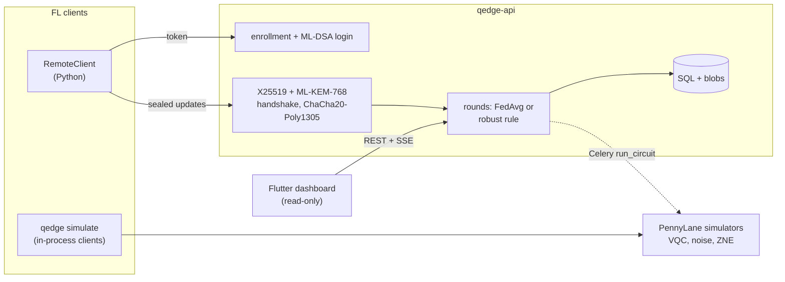

# Q-Edge

[](https://github.com/rasidi3112/Q-Edge/actions/workflows/ci.yml)
[](LICENSE)
[](pyproject.toml)

[English](README.md) | [العربية](README_ar.md) | [Deutsch](README_de.md) | [Español](README_es.md) | [Français](README_fr.md) | [हिन्दी](README_hi.md) | [Bahasa Indonesia](README_id.md) | [Italiano](README_it.md) | [日本語](README_ja.md) | [한국어](README_ko.md) | [Bahasa Melayu](README_ms.md) | [Português](README_pt.md) | [Русский](README_ru.md) | [Türkçe](README_tr.md) | [Tiếng Việt](README_vi.md) | **中文**

> 本文是 [README.md](README.md) 的翻译。如有出入，以英文版为准。

Q-Edge 是一个研究用测试平台，用于结合量子-经典混合模型的联邦学习，以及对客户端
更新的后量子保护。它用可复现的数字回答三个问题：

1. 在非 IID 数据上，一个小型变分量子电路（VQC）头能否与参数数量相同的经典头
   表现一样好？分别比较有无噪声、有无零噪声外推的情况。
2. 后量子保护（ML-KEM-768、ML-DSA-65、混合 X25519 + ML-KEM-768 以及安全聚合）
   每轮的开销是多少？
3. 恶意客户端能造成多大破坏，鲁棒聚合规则能帮上多少忙，这些规则又与安全聚合
   有何冲突？

否定的答案同样算作结果。下文的每个数字都来自 `results/summary/*.json`，可由
`make reproduce` 重新生成；完整的表格和图见 [`docs/results.md`](docs/results.md)。

## 它是什么，不是什么

它是：

- 一个联邦学习模拟器（`qedge simulate`），基于 scikit-learn 的 breast_cancer 和
  digits 数据集，并施加 Dirichlet 标签偏斜。策略：FedAvg、FedProx、FedAdam 和
  FedYogi。此外还有 top-k 压缩、攻击、鲁棒规则和安全聚合。同一套客户端与服务器
  代码也可以作为 Flower 1.40 应用运行（`flwr run experiments/flower`）。
- 带 PennyLane VQC 头的 PyTorch 混合模型，包括门噪声和读出噪声模拟、基于全局
  折叠的 ZNE，以及诊断工具（梯度方差、核集中度、表达能力）。
- 一个 FastAPI 服务器，支持管理员登记客户端、ML-DSA 挑战-应答登录、签名的
  X25519 + ML-KEM-768 传输、经过校验的轮次、server-sent events 和 Prometheus
  指标。一个只读的 Flutter 仪表盘显示其状态。

它不是：

- 量子硬件。所有电路都在模拟器上运行（`default.qubit`、`default.mixed`）。
- 真实部署。客户端在单个进程内模拟，或是 Python 脚本；没有在移动设备上训练。
- 经过审计的密码学。混合 KEM 组合方式、传输层和安全聚合协议都是本项目自行
  设计的。纯 Python 后端不是常数时间实现。
- 量子优势的证据。在这些实验中，VQC 头从未明显优于经典头。

## 架构



详情：[`docs/architecture.md`](docs/architecture.md)；设计决策：
[`docs/decisions/`](docs/decisions/)；威胁：
[`docs/threat-model.md`](docs/threat-model.md)。

## 快速开始

```bash
git clone https://github.com/rasidi3112/Q-Edge.git && cd Q-Edge
python -m venv .venv && source .venv/bin/activate
pip install torch --index-url https://download.pytorch.org/whl/cpu   # optional: CPU-only torch
pip install -e ".[fl,pqc-pure]"

qedge demo                       # one run of each component, about 5 s
qedge simulate --dataset breast_cancer --clients 10 --rounds 30 --alpha 0.5 --strategy fedavg
qedge simulate --model hybrid-vqc --qubits 4 --layers 2 --noise 0.01 --zne richardson
qedge simulate --dataset digits --model mlp --attack scaling --attack-fraction 0.3 --defense multi_krum
qedge simulate --secure-aggregation
```

每次运行 `simulate` 都会写出 `results/runs/<run_id>/config.yaml`（配置、客户端
划分、参数数量、软件包版本、机器信息）和 `metrics.jsonl`（每轮一行）。
`pqc-pure` 是用于试用的纯 Python ML-KEM 和 ML-DSA；其他用途请编译 liboqs 0.16
并安装 `q-edge[pqc]`。

| Extra | 新增内容 |
|---|---|
| `fl` | PyTorch、Flower、scikit-learn、PyYAML：模拟器、混合模型 |
| `server` | FastAPI 服务器、Celery worker、`qedge clients` |
| `pqc` | liboqs-python（需要 liboqs C 库） |
| `pqc-pure` | kyber-py 和 dilithium-py：非常数时间，仅用于测试 |
| `report` | 供 `python -m experiments.report` 使用的 matplotlib |
| `flower-sim` | 供 `flwr run` 使用的 Ray |
| `postgres` | 供 compose 栈使用的 psycopg |
| `dev` | pytest、hypothesis、ruff、mypy、pre-commit |

### 服务器

```bash
pip install -e ".[server,pqc-pure]"
qedge keys init --dir ./keys --backend pure        # server KEM and ML-DSA keys
qedge clients keygen --out ./admin --backend pure  # admin key pair, stays local
qedge clients add --id admin --scope admin --public-key ./admin/client.pub --backend pure
JWT_SECRET_KEY=$(python -c "import secrets; print(secrets.token_urlsafe(48))") \
  QEDGE_CRYPTO_BACKEND=pure QEDGE_KEY_DIR=./keys qedge-api
```

管理员登记客户端并开启轮次（`POST /admin/rounds`）。客户端
（`qedge.fl.remote.RemoteClient`）通过对 nonce 签名登录，建立加密会话，并在每轮
发送一个封装好的更新。当收到 `min_clients` 个更新或截止时间已过时，服务器使用
`QEDGE_AGGREGATION`（`fedavg`、`median`、`trimmed_mean`、`krum`、`multi_krum`
或 `bounded`）进行聚合。缺少密钥或密码学后端时，服务器拒绝启动。使用 Docker：

```bash
cp .env.example .env   # set JWT_SECRET_KEY, REDIS_PASSWORD, POSTGRES_PASSWORD
qedge clients keygen --out ./admin
docker compose run --rm api qedge keys init --dir /keys
docker compose run --rm -v "$PWD/admin:/admin:ro" api \
  qedge clients add --id admin --scope admin --public-key /admin/client.pub
docker compose up --build
```

仪表盘：`cd mobile_app && flutter run -d chrome --web-port 3000
--dart-define=QEDGE_API_URL=http://localhost:8000`
（[`mobile_app/README.md`](mobile_app/README.md)）。

## 结果

客户端在笔记本电脑 CPU 上模拟；结果为 seed 0-2 的均值 ± 标准差。完整表格、图和
配置：[`docs/results.md`](docs/results.md)、`experiments/configs/`。

**RQ1：VQC 头与经典头对比。** 5 个客户端、15 轮、4 个量子比特、2 个 strongly
entangling 层（24 个参数），对比一个有 20 个参数的 tanh 头。编码器和输出层完全
相同。

| 数据集, α | 经典头 | VQC | VQC, p = 0.01 | VQC, p = 0.01, ZNE |
|---|---|---|---|---|
| breast_cancer, 0.1 | 0.968 ± 0.018 | 0.965 ± 0.032 | 0.930 ± 0.092 | 0.965 ± 0.032 |
| breast_cancer, 1.0 | 0.974 ± 0.018 | 0.977 ± 0.018 | 0.974 ± 0.018 | 0.977 ± 0.018 |
| digits, 0.1 | 0.643 ± 0.125 | 0.486 ± 0.093 | 0.496 ± 0.086 | 0.491 ± 0.084 |
| digits, 1.0 | 0.685 ± 0.143 | 0.514 ± 0.061 | 0.485 ± 0.100 | 0.512 ± 0.058 |

VQC 头在 breast_cancer 上与经典头持平，在 digits 上约差 0.16。p = 0.01 的退极化
噪声和 ZNE 对最终准确率的影响小于不同 seed 之间的波动；影响最大的是 α = 0.1 的
breast_cancer（无噪声 0.965，有噪声 0.930，使用 ZNE 0.965）。ZNE 使训练慢约
8 倍。在随机 4 量子比特电路上，ZNE 将 p = 0.01 时期望值的误差从 0.055 降到
0.005（Richardson）或 0.003（指数）。

**RQ2：后量子保护的开销**（liboqs 0.16）：

- 传输握手每个会话一次，耗时 0.57 ms、占用 7 840 字节，另外每个更新帧增加
  52 字节。
- 每轮每个客户端的安全聚合开销（与普通 float32 上传相比）：
  - 10 个客户端、1 210 个参数：上传 36.6 KiB 而不是 4.7 KiB，2.6 ms；
    服务器 3.8 ms。
  - 50 个客户端、100 000 个参数：895 KiB 而不是 391 KiB，33 ms；服务器 95 ms。
- 上传量翻倍是因为掩码后的值占 8 字节，而密钥交换随客户端数量线性增长。

**RQ3：恶意客户端**（digits、MLP、10 个客户端、30 轮、10 个中有 3 个攻击）：

| 攻击 | FedAvg | 中位数 | Multi-Krum |
|---|---|---|---|
| 无 | 0.952 ± 0.003 | 0.931 ± 0.006 | 0.922 ± 0.003 |
| 标签翻转 | 0.700 ± 0.314 | 0.883 ± 0.032 | 0.938 ± 0.013 |
| 缩放（模型替换） | 0.177 ± 0.094 | 0.908 ± 0.015 | 0.936 ± 0.022 |
| 随机噪声 | 0.578 ± 0.065 | 0.933 ± 0.014 | 0.936 ± 0.022 |
| 伪造样本数 | 0.030 ± 0.018 | 0.883 ± 0.032 | 0.938 ± 0.013 |

FedAvg 在每种攻击下都会失败。Multi-Krum 能保持在其自身无攻击准确率的 0.02
以内，但在没有攻击者时会损失 0.03；单独使用 Krum 在非 IID 数据上损失 0.28。
这些规则都无法在安全聚合下运行，因为安全聚合恰好隐藏了它们需要检查的单个更新
（ADR 0010）。截尾均值、范数裁剪和样本数上限见 `docs/results.md`。

## 安全模型

受保护：在网络上读取或伪造更新，无论现在还是在量子计算机攻破 X25519 之后
（混合 KEM、签名握手、AEAD 帧、防重放计数器）；冒充服务器或已登记的客户端；
格式错误或重复的更新；由客户端触发聚合。部分受保护：遵守协议的恶意客户端，
通过鲁棒规则应对。不受保护：模拟器之外好奇的服务器（安全聚合未通过 HTTP
提供）、从全局模型进行推断（没有隐私核算）、拒绝服务、纯 Python 后端的侧信道，
以及过期前被盗的令牌。参见 [`docs/threat-model.md`](docs/threat-model.md)。

## 局限性

- 只有两个小而简单的数据集。小于约一个标准差的差异（RQ1 中 digits 最多
  0.14）无法用 3 个 seed 区分。
- RQ1 使用 5 个客户端和 15 轮以控制 ZNE 运行的耗时，因此 digits 的准确率
  （0.5-0.7）远低于 30 轮 MLP 的 0.95。
- 模拟噪声为每个门和每根线一个信道：没有串扰、空闲噪声或相干误差。通过
  `default.mixed` 的反向传播给出了硬件无法给出的梯度（ADR 0009）。
- 安全聚合没有客户端掉线恢复，且只在进程内运行。测得的开销不包括网络延迟。
- 已有裁剪和高斯噪声，但由于没有隐私核算，不报告 ε。
- 鲁棒规则假设攻击者最多占 30 %，且未针对定向后门或自适应攻击者进行测试。
- Flutter 应用为只读，不做任何密码学运算；Android 和 iOS 构建未经测试。

## 开发

```bash
pip install torch --index-url https://download.pytorch.org/whl/cpu
pip install -e ".[dev,server,pqc-pure,fl,report]"
pre-commit install
make lint             # ruff check, ruff format --check, mypy --strict on src/qedge
make test             # pytest -m "not slow"
pytest -m slow        # Flower end-to-end and a noisy ZNE run (needs flower-sim)
make reproduce        # every experiment and docs/results.md, about 62 minutes
```

`python -m experiments.run_all --skip quantum_head` 会在约 7 分钟内重新运行除
ZNE 网格之外的全部内容。CI 在 Python 3.11-3.13 上运行 lint 和测试、一个 liboqs
作业、Flutter 测试以及 Docker 构建。

## 目录结构

```
src/qedge/
  crypto/     ML-KEM, ML-DSA, hybrid KEM, transport, key files, backends
  fl/         datasets, models, training, strategies, robust rules, attacks,
              compression, privacy, secure aggregation, simulator, Flower apps
  quantum/    circuits, noise, ZNE and readout mitigation, kernels, models,
              diagnostics
  server/     FastAPI app, auth, rounds, storage, metrics, Celery worker
  cli.py      qedge keys | clients | simulate | demo
  demo.py
experiments/  configs/*.yaml, one script per experiment, run_all.py, report.py
bench/        crypto.py, secagg.py
results/      summary/*.json (committed), runs/ (ignored)
docs/         architecture.md, threat-model.md, results.md, figures/, decisions/
mobile_app/   Flutter dashboard
```

## 参考文献

- McMahan et al., "Communication-Efficient Learning of Deep Networks from
  Decentralized Data", 2017, arXiv:1602.05629 (FedAvg).
- Li et al., "Federated Optimization in Heterogeneous Networks", 2018,
  arXiv:1812.06127 (FedProx).
- Reddi et al., "Adaptive Federated Optimization", 2020, arXiv:2003.00295
  (FedAdam, FedYogi).
- Karimireddy et al., "Error Feedback Fixes SignSGD and other Gradient
  Compression Schemes", 2019, arXiv:1901.09847.
- Yin et al., "Byzantine-Robust Distributed Learning: Towards Optimal
  Statistical Rates", 2018, arXiv:1803.01498 (median, trimmed mean).
- Blanchard et al., "Machine Learning with Adversaries: Byzantine Tolerant
  Gradient Descent", NeurIPS 2017 (Krum).
- Sun et al., "Can You Really Backdoor Federated Learning?", 2019,
  arXiv:1911.07963 (norm clipping).
- Bagdasaryan et al., "How To Backdoor Federated Learning", 2018,
  arXiv:1807.00459 (model replacement).
- Bonawitz et al., "Practical Secure Aggregation for Privacy-Preserving
  Machine Learning", CCS 2017.
- Schuld et al., "Circuit-centric quantum classifiers", 2018,
  arXiv:1804.00633.
- Pérez-Salinas et al., "Data re-uploading for a universal quantum
  classifier", 2020, arXiv:1907.02085.
- Havlíček et al., "Supervised learning with quantum-enhanced feature
  spaces", Nature 2019.
- Temme et al., "Error mitigation for short-depth quantum circuits", 2017,
  arXiv:1612.02058.
- Giurgica-Tiron et al., "Digital zero noise extrapolation for quantum
  error mitigation", 2020, arXiv:2005.10921.
- McClean et al., "Barren plateaus in quantum neural network training
  landscapes", 2018, arXiv:1803.11173.
- Thanasilp et al., "Exponential concentration in quantum kernel methods",
  2022, arXiv:2208.11060.
- Sim et al., "Expressibility and entangling capability of parameterized
  quantum circuits", 2019, arXiv:1905.10876.
- NIST FIPS 203 (ML-KEM) and FIPS 204 (ML-DSA), 2024.

## 许可证

Apache 2.0，见 [LICENSE](LICENSE)。变更记录见 [CHANGELOG.md](CHANGELOG.md)。
