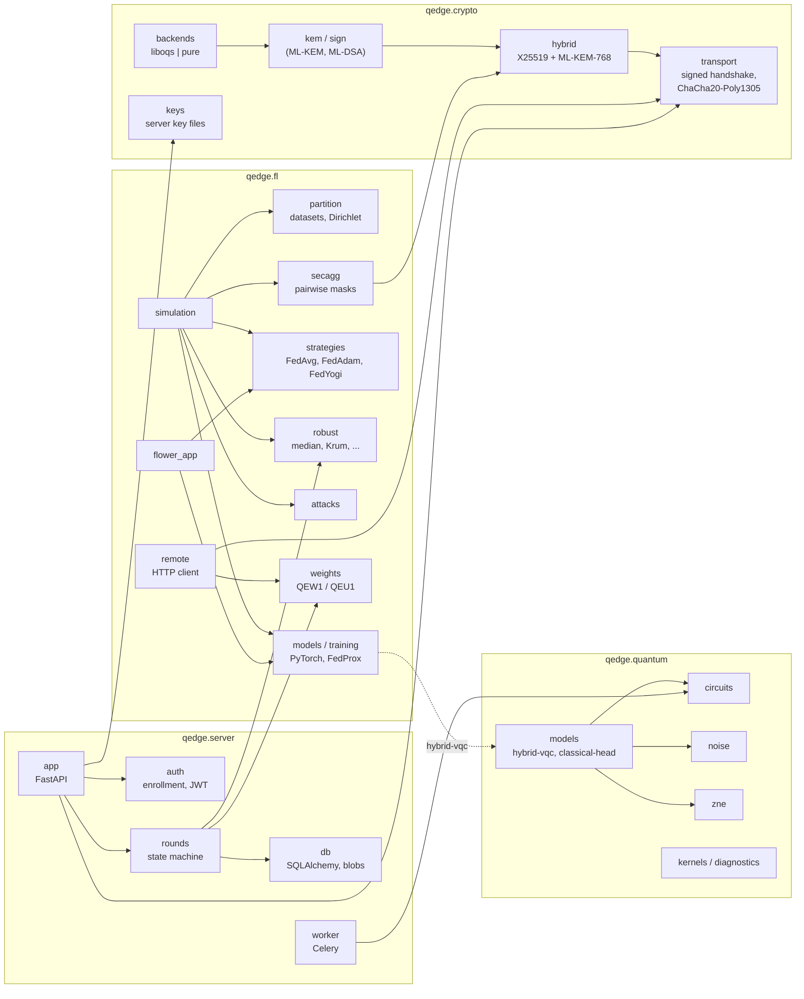
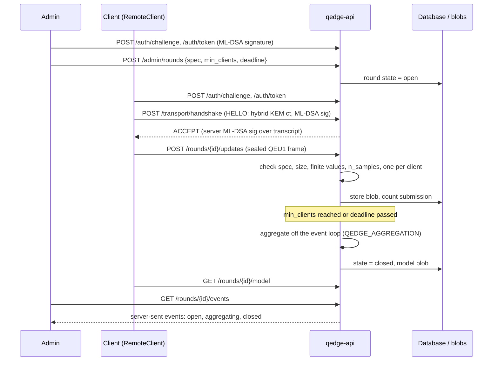

# Architecture

Q-Edge has two ways to run federated learning on the same code:

- **The simulator** (`qedge simulate`, `experiments/`): all clients in one
  process, used for every number in `docs/results.md`.
- **The server** (`qedge-api`): a FastAPI service that real clients reach
  over a post-quantum transport. It runs rounds with FedAvg or a robust
  rule. Secure aggregation runs in the simulator only (ADR 0010).

## Packages

Import rules that tests enforce:

- `qedge.fl.simulation` does not import PennyLane unless a quantum model
  is requested (`test_aggregation_does_not_evaluate_quantum_kernels`).
- Modules that need an extra raise `ImportError` with the extra's name
  when it is missing (`fl`, `server`).
- `qedge.fl.remote` does not import `qedge.server`.

## One server round

## Where state lives

| State | Where | Lifetime |
|---|---|---|
| Server KEM and ML-DSA keys | `QEDGE_KEY_DIR` files (`qedge keys init`) | until replaced |
| Enrolled clients, challenges, rounds, submissions | SQL database (SQLite or Postgres), Alembic migrations | persistent |
| Update and model weights | content-addressed blob store in `QEDGE_DATA_DIR` | persistent |
| Transport sessions | server memory (`SessionStore`) | `QEDGE_SESSION_TTL_SECONDS`, lost on restart |
| Bearer tokens | stateless JWT (HS256) | `JWT_TTL_SECONDS` |
| Simulation runs | `results/runs/<run_id>/` (ignored by git) | local |
| Experiment summaries | `results/summary/*.json` (committed) | regenerated by `make reproduce` |

## Extras

| Extra | Needed for |
|---|---|
| (none) | `qedge.crypto`, `qedge.quantum` circuits, kernels, noise, ZNE |
| `pqc` or `pqc-pure` | a crypto backend (liboqs, or pure Python for tests) |
| `server` | `qedge-api`, Celery worker, `qedge clients` |
| `fl` | simulator, `qedge simulate`, Flower apps, hybrid models |
| `flower-sim` | `flwr run` (Ray) |
| `report` | `python -m experiments.report` (matplotlib) |
| `postgres` | the compose stack |

## Decisions

See `docs/decisions/` (0001-0011) and `docs/threat-model.md`.
