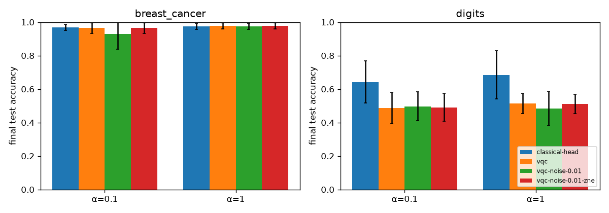
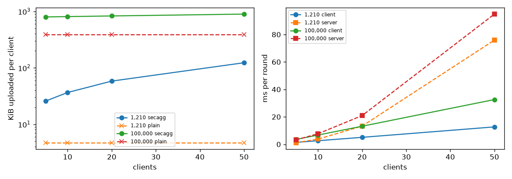
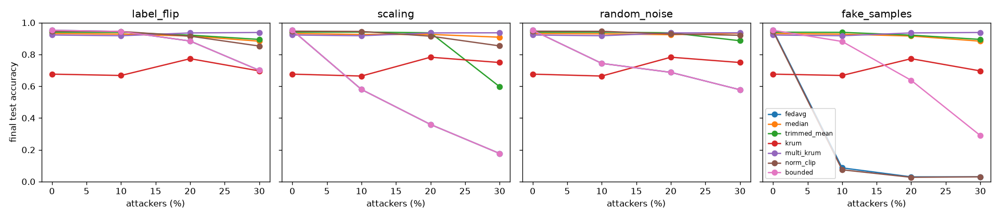

# Results

Generated by `python -m experiments.report` from `results/summary/*.json`;
do not edit by hand. Configurations are in `experiments/configs/`, and each
summary records its config, package versions and machine. All clients are
simulated in one process and all circuits run on PennyLane simulators.

## RQ1: VQC head vs classical head

- breast_cancer: the noiseless VQC head is +0.000 against the classical head (mean over α); noise changes the VQC by -0.019 and ZNE recovers +0.019. The largest std is 0.092, so smaller differences are not resolved.
- digits: the noiseless VQC head is -0.164 against the classical head (mean over α); noise changes the VQC by -0.009 and ZNE recovers +0.011. The largest std is 0.143, so smaller differences are not resolved.

5 clients, 15 rounds, 4 qubits, 2 layers, seeds [0, 1, 2]; final test accuracy, mean ± std.

| Dataset | α | classical-head | vqc | vqc-noise-0.01 | vqc-noise-0.01-zne |
|---|---|---|---|---|---|
| breast_cancer | 0.1 | 0.968 ± 0.018 | 0.965 ± 0.032 | 0.930 ± 0.092 | 0.965 ± 0.032 |
| breast_cancer | 1.0 | 0.974 ± 0.018 | 0.977 ± 0.018 | 0.974 ± 0.018 | 0.977 ± 0.018 |
| digits | 0.1 | 0.643 ± 0.125 | 0.486 ± 0.093 | 0.496 ± 0.086 | 0.491 ± 0.084 |
| digits | 1.0 | 0.685 ± 0.143 | 0.514 ± 0.061 | 0.485 ± 0.100 | 0.512 ± 0.058 |

|  | classical-head | vqc | vqc-noise-0.01 | vqc-noise-0.01-zne |
|---|---|---|---|---|
| Head parameters | 20 | 24 | 24 | 24 |
| Mean seconds per run | 0 | 5 | 28 | 241 |

## RQ2: cost of post-quantum protection

Transport (X25519 + ML-KEM-768 handshake signed with ML-DSA-65, then
ChaCha20-Poly1305 frames), from `results/summary/crypto.json`. The
handshake runs once per session; every update frame adds the frame
overhead. Encryption time per frame is not measured separately.

| Backend | Handshake ms (median) | Handshake bytes | Bytes per frame |
|---|---|---|---|
| liboqs | 0.57 | 7840 | 52 |
| pure | 129.28 | 7840 | 52 |

Secure aggregation per round (liboqs, median of 3, in-process, no network), from `results/summary/secagg.json`:

| Clients | Parameters | Plain up KiB | Secagg up KiB | Secagg down KiB | Client ms | Server ms |
|---|---|---|---|---|---|---|
| 5 | 1,210 | 4.7 | 25.8 | 26.3 | 1.4 | 1.2 |
| 5 | 100,000 | 390.6 | 797.6 | 26.3 | 3.5 | 3.2 |
| 10 | 1,210 | 4.7 | 36.6 | 59.2 | 2.6 | 3.8 |
| 10 | 100,000 | 390.6 | 808.4 | 59.2 | 6.7 | 7.7 |
| 20 | 1,210 | 4.7 | 58.2 | 125.0 | 5.1 | 13.2 |
| 20 | 100,000 | 390.6 | 830.0 | 125.0 | 13.2 | 20.9 |
| 50 | 1,210 | 4.7 | 123.1 | 322.5 | 12.7 | 75.9 |
| 50 | 100,000 | 390.6 | 894.9 | 322.5 | 32.6 | 94.9 |

## RQ3: malicious clients and robust aggregation

- label_flip at 30%: FedAvg 0.700, best rule multi_krum 0.938
- scaling at 30%: FedAvg 0.177, best rule multi_krum 0.936
- random_noise at 30%: FedAvg 0.578, best rule multi_krum 0.936
- fake_samples at 30%: FedAvg 0.030, best rule multi_krum 0.938
- without attackers, accuracy change against FedAvg: median -0.020, trimmed_mean -0.012, krum -0.276, multi_krum -0.030, norm_clip -0.006, bounded +0.000

digits, final test accuracy, mean ± std over seeds [0, 1, 2]. Secure aggregation cannot be combined with any of these rules (ADR 0010).

| Attack | fedavg | median | trimmed_mean | krum | multi_krum | norm_clip | bounded |
|---|---|---|---|---|---|---|---|
| none (0%) | 0.952 ± 0.003 | 0.931 ± 0.006 | 0.940 ± 0.011 | 0.676 ± 0.071 | 0.922 ± 0.003 | 0.946 ± 0.011 | 0.952 ± 0.003 |
| label_flip (30%) | 0.700 ± 0.314 | 0.883 ± 0.032 | 0.894 ± 0.031 | 0.696 ± 0.081 | 0.938 ± 0.013 | 0.853 ± 0.142 | 0.700 ± 0.314 |
| scaling (30%) | 0.177 ± 0.094 | 0.908 ± 0.015 | 0.597 ± 0.119 | 0.749 ± 0.112 | 0.936 ± 0.022 | 0.854 ± 0.143 | 0.177 ± 0.094 |
| random_noise (30%) | 0.578 ± 0.065 | 0.933 ± 0.014 | 0.886 ± 0.024 | 0.749 ± 0.112 | 0.936 ± 0.022 | 0.920 ± 0.032 | 0.578 ± 0.065 |
| fake_samples (30%) | 0.030 ± 0.018 | 0.883 ± 0.032 | 0.894 ± 0.031 | 0.696 ± 0.081 | 0.938 ± 0.013 | 0.030 ± 0.018 | 0.290 ± 0.163 |

## Supporting results

### FL strategies under label skew

| Dataset | Strategy | α | Accuracy |
|---|---|---|---|
| breast_cancer | fedavg | 0.1 | 0.971 ± 0.005 |
| breast_cancer | fedavg | 0.5 | 0.977 ± 0.010 |
| breast_cancer | fedavg | 100.0 | 0.974 ± 0.009 |
| breast_cancer | fedprox | 0.1 | 0.971 ± 0.005 |
| breast_cancer | fedprox | 0.5 | 0.977 ± 0.010 |
| breast_cancer | fedprox | 100.0 | 0.974 ± 0.009 |
| breast_cancer | fedadam | 0.1 | 0.980 ± 0.013 |
| breast_cancer | fedadam | 0.5 | 0.980 ± 0.005 |
| breast_cancer | fedadam | 100.0 | 0.977 ± 0.010 |
| breast_cancer | fedyogi | 0.1 | 0.980 ± 0.013 |
| breast_cancer | fedyogi | 0.5 | 0.980 ± 0.005 |
| breast_cancer | fedyogi | 100.0 | 0.977 ± 0.010 |
| digits | fedavg | 0.1 | 0.939 ± 0.010 |
| digits | fedavg | 0.5 | 0.952 ± 0.003 |
| digits | fedavg | 100.0 | 0.955 ± 0.004 |
| digits | fedprox | 0.1 | 0.940 ± 0.009 |
| digits | fedprox | 0.5 | 0.952 ± 0.003 |
| digits | fedprox | 100.0 | 0.955 ± 0.004 |
| digits | fedadam | 0.1 | 0.949 ± 0.013 |
| digits | fedadam | 0.5 | 0.955 ± 0.007 |
| digits | fedadam | 100.0 | 0.959 ± 0.009 |
| digits | fedyogi | 0.1 | 0.950 ± 0.013 |
| digits | fedyogi | 0.5 | 0.956 ± 0.010 |
| digits | fedyogi | 100.0 | 0.959 ± 0.009 |

### Top-k compression with error feedback

| Dataset | Keep ratio | Bytes up | Accuracy |
|---|---|---|---|
| breast_cancer | 1.0 | 74,400 | 0.977 ± 0.010 |
| breast_cancer | 0.5 | 74,400 | 0.977 ± 0.010 |
| breast_cancer | 0.2 | 31,200 | 0.974 ± 0.009 |
| breast_cancer | 0.1 | 16,800 | 0.977 ± 0.005 |
| breast_cancer | 0.05 | 9,600 | 0.974 ± 0.009 |
| breast_cancer | 0.01 | 4,800 | 0.968 ± 0.005 |
| digits | 1.0 | 1,452,000 | 0.952 ± 0.003 |
| digits | 0.5 | 1,452,000 | 0.952 ± 0.003 |
| digits | 0.2 | 580,800 | 0.954 ± 0.007 |
| digits | 0.1 | 290,400 | 0.956 ± 0.010 |
| digits | 0.05 | 146,400 | 0.950 ± 0.005 |
| digits | 0.01 | 33,600 | 0.917 ± 0.012 |

### Removed quantum weight mixing

| Rule | Accuracy |
|---|---|
| fedavg | 0.974 ± 0.000 |
| quantum_weight_mixing | 0.918 ± 0.013 |

### ZNE error on random circuits

| Channel | p | Unmitigated | richardson | poly2 | exponential |
|---|---|---|---|---|---|
| depolarizing | 0.001 | 0.0060 | 0.0002 | 0.0002 | 0.0002 |
| depolarizing | 0.01 | 0.0552 | 0.0051 | 0.0051 | 0.0026 |
| amplitude_damping | 0.001 | 0.0046 | 0.0004 | 0.0004 | 0.0015 |
| amplitude_damping | 0.01 | 0.0431 | 0.0050 | 0.0050 | 0.0056 |

### Circuit diagnostics

|  | 2 qubits | 4 qubits | 6 qubits | 8 qubits |
|---|---|---|---|---|
| global | 1.41e-01 | 3.63e-02 | 7.81e-03 | 2.21e-03 |
| local | 1.23e-01 | 3.33e-02 | 7.47e-03 | 1.89e-03 |
| kernel angle mean | 0.486 | 0.379 | 0.189 | 0.156 |
| kernel zz mean | 0.314 | 0.106 | 0.020 | 0.005 |
